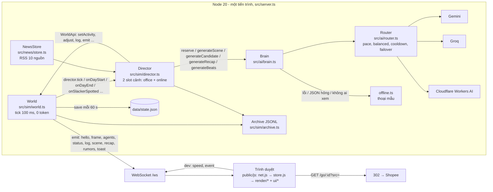

# Tổng quan dự án — Văn Phòng Ảo (Cty TNHH VibeCorp)

> Cập nhật lần cuối: 2026-11-03 · Phạm vi: toàn dự án (`src/`, `public/`, `scripts/`, `deploy/`, `data/`, `docs/`) · Đọc khi: lần đầu vào dự án; cần định vị một tính năng nằm ở file nào; cần hiểu "vì sao" trước khi sửa bất kỳ vùng nào.

Tài liệu này trả lời: sản phẩm là gì, người xem thấy gì, tiền đến từ đâu, chủ dự án đặt ra nguyên tắc nào và nguyên tắc đó nằm ở dòng code nào, hệ thống được ghép từ những mảnh gì và chúng nói chuyện với nhau ra sao, file nào làm việc gì, dự án đã đi qua những mốc nào, và một dev/agent mới nên đọc tiếp tài liệu nào theo vai trò của mình. Nó là **cửa vào** của bộ tài liệu trong `docs/` (mục lục có mô tả từng tài liệu, lộ trình đọc theo vai trò và bản đồ "sửa file nào → cập nhật tài liệu nào": [README.md](./README.md)); chi tiết từng vùng nằm ở các tài liệu `02`–`14` được trỏ tới ở mục 10. Hợp đồng kỹ thuật gốc vẫn là [`../SPEC.md`](../SPEC.md) (một phần đã lỗi thời, xem mục "Câu hỏi còn mở") và [`../src/types.ts`](../src/types.ts); hướng dẫn cho chủ dự án là [`../README.md`](../README.md). Tài liệu này không chép lại chúng mà chỉ dẫn tới.

Quy ước: tham chiếu code dạng `src/sim/world.ts:1118` là số dòng tại thời điểm viết (file có thể đã dịch dòng — tìm theo tên hàm nếu lệch). Tên file/hàm/biến giữ nguyên tiếng Anh. Không có API key, token hay mật khẩu nào trong tài liệu; chỉ nhắc **tên** biến môi trường.

---

## 1. Sản phẩm là gì

**Văn Phòng Ảo** là một trang web giải trí kiểu "sitcom văn phòng phát trực tiếp 24/7": một công ty công nghệ Việt Nam ảo — **Cty TNHH VibeCorp** (`COMPANY_NAME`, mặc định trong `src/config.ts:294`) — với **10 nhân viên AI** tự đi làm, gõ code, lướt TikTok, tám chuyện ở pantry, nói xấu sau lưng, bị sếp bắt quả tang, bị HR gọi lên phòng, bị cho nghỉ việc, được tuyển thay… Lời thoại do AI viết; người xem là **khán giả**: mọi trình duyệt nối WebSocket vào **một thế giới duy nhất** trên server (nguyên tắc "one shared world", `SPEC.md` §0.1) nên chi phí AI không tăng theo số người xem.

Site thật: **https://corp.vibe-coder.fun** (VPS dùng chung, chi tiết vận hành ở [10-van-hanh-deploy.md](./10-van-hanh-deploy.md)). Mô tả ngắn chính thức nằm trong `package.json` ("Văn phòng ảo: 10 nhân viên AI tự làm việc, tám chuyện, drama real-time") và `public/index.html:8` (meta description).

Ba lớp làm nên sản phẩm:

| Lớp | Là gì | Tốn token AI? | Code |
|---|---|---|---|
| **Body (thân xác)** | Mô phỏng: đồng hồ game, bản đồ lưới 60×34 ô, nhân viên đi lại/chọn việc theo trọng số, lịch ngày (đến – ăn trưa – về), KPI, sếp đi vắng/đi tuần, dự án/doanh thu/sự cố | **Không** (0 token) | `src/sim/world.ts`, `behavior.ts`, `map.ts`, `clock.ts` |
| **Director (đạo diễn)** | Quyết định *khi nào* có cảnh gì với ai ở đâu, xếp hàng đợi, giữ chỗ, gọi Brain, phát từng câu thoại, áp hiệu ứng; nhân sự (hàng rào), tin đồn, thời sự, AI biên kịch, bản tin cuối ngày | Không trực tiếp (chỉ hỏi Brain) | `src/sim/director.ts`, `scenes.ts`, `hr.ts`, `story.ts`, `rumors.ts` |
| **Brain (bộ não)** | Quyết định *có được gọi AI không* (`reserve`), gọi một trong nhiều nhà cung cấp miễn phí qua API OpenAI-compatible để viết **cả cảnh** (4–10 câu) trong **một** JSON, kiểm tra/làm sạch, luôn có đường lui offline | **Có**, nhưng chỉ ở "khoảnh khắc thú vị" | `src/ai/brain.ts`, `router.ts`, `llm.ts`, `prompts.ts`, `schemas.ts`, `sanitize.ts`, `offline.ts` |

Dàn nhân vật gốc (`src/content/roster.ts:70-212`, `INITIAL_ROSTER`; vai trò và chỉ tiêu KPI ở `ROLE_INFO` `:12-62`):

| id | Tên | Vai (`role` → `roleLabel`) | Bàn (`deskId`) | KPI gốc |
|---|---|---|---|---|
| `hung` | Hùng (Trần Quốc Hùng) | `boss` → Giám đốc | `d_boss` | 240 |
| `ngoc` | Ngọc (Lê Bảo Ngọc) | `hr` → Trưởng phòng Nhân sự | `d_hr` | 250 |
| `khoa` | Khoa (Phạm Đăng Khoa) | `techlead` → Tech Lead | `d_tl` | 290 |
| `tung` | Tùng (Nguyễn Thanh Tùng) | `senior` → Senior Developer | `d_senior` | 260 |
| `bao` | Bảo (Võ Gia Bảo) | `junior` → Fresher Developer | `d_junior` | 250 |
| `vy` | Vy (Đặng Thảo Vy) | `qa` → QA Tester | `d_qa` | 270 |
| `linh` | Linh (Hoàng Mỹ Linh) | `designer` → UI/UX Designer | `d_design` | 260 |
| `phat` | Phát (Huỳnh Tấn Phát) | `saleslead` → Trưởng nhóm Sales | `d_saleslead` | 290 |
| `tu` | Tú (Lý Minh Tú) | `salesnew` → Nhân viên Sales | `d_salesnew` | 300 |
| `tram` | Trâm (Ngô Bích Trâm) | `marketing` → Marketing Executive | `d_mkt` | 260 |

Sếp và HR **không bao giờ** bị cho nghỉ (`NEVER_FIRED`, `src/sim/hr.ts:36`; `World.removeAgent` cũng từ chối, `src/sim/world.ts:719`). Người mới do AI sinh ra (ứng viên) có id dạng `cand_<role>_<day>_<2–8 ký tự chữ/số>` — thường 4 ký tự base-36 (`candidateId`, `src/ai/sanitize.ts:744-748`; `src/ai/offline.ts:5195-5197`), hoặc 4 chữ số khi persona AI trả về không có id (`uniquePersona`, `src/sim/director.ts:1020-1023`); trùng id thì nối thêm `_<2 chữ số>`; regex nhận diện ở `sanitize.ts:272` là `cand_[a-z]+_\d+_[a-z0-9]{2,8}`.

---

## 2. Trải nghiệm người xem — từng khu vực màn hình

Khung DOM tĩnh duy nhất là `public/index.html` (143 dòng); mọi nội dung động do JS tạo bằng `textContent` (không `innerHTML`). Bố cục: `#app` → `main#main` (grid 2 cột) gồm `section.stage#stage` (trái) và `aside.sidebar#sidebar` (phải); ngoài `main` có `#drawer` (hồ sơ nhân viên). Dưới 900 px (mobile) canvas nằm trên, sidebar nằm dưới, drawer thành bottom-sheet.

| Khu vực | DOM | Người xem thấy gì | Module client | Dữ liệu từ server |
|---|---|---|---|---|
| **Bản đồ văn phòng** | `canvas#office` | 9 phòng (khu làm việc, phòng trưng bày, server, WC kín, phòng họp, phòng Giám đốc, sảnh, pantry, góc chill), 10 bàn, nhân vật chibi cao ≈ 1,95 ô (`render/character.js:1-2`, `U = 24`) đi lại, ngồi làm, màn hình máy tính đổi theo việc (code / TikTok / Shopee / game…), bong bóng thoại, 📱 khi nhắn nhóm chat, emote; đồng hồ treo tường theo giờ game, bảng trắng phòng họp ghi dự án, bảng KPI trên tường, biển **ĐI VẮNG** trên cửa phòng sếp, kệ phòng trưng bày có sản phẩm, cửa WC "Có người/Trống", tông màu sáng/tối theo giờ; cuộn/chụm để phóng to, kéo để di chuyển, bấm nhân vật mở hồ sơ | `public/js/render/*` (vào qua `createOffice`, `office.js`) | `hello.map` (= `MAP_DATA`, `src/sim/map.ts:203`), `frame` mỗi 200 ms, `agents`, `status`, `hello.products` |
| **HUD** (nổi trên canvas, mép trên) | `#hud` | Trái: huy hiệu **TRỰC TIẾP** + **chấm AI** (`#ai-dot`: xanh = AI đang viết thoại, xám = câu mẫu) + đồng hồ `HH:MM · Thứ · Ngày N` + thanh tiến độ ngày + `x5`/`🕒 giờ thật`. Phải: chip 🚀 dự án · 💰 doanh thu tháng · 👀 người xem · 🔥/📶 khi có sự cố · **🤖 AI chỉ admin** (`hud.js:183-190`) | `public/js/ui/hud.js` | `frame.clock`, `status` |
| **Popover** | `#popover` | Bấm/rê chip → chi tiết (dự án, doanh thu, người xem; admin: nguồn AI, lượt gọi, chi phí, lỗi) | `hud.js` | `status` |
| **Toast** | `#toasts` | Thông báo ngắn giữa mép trên canvas (tối đa 3) | `ui/toasts.js` | `ServerMsg` `toast` |
| **Nút thu phóng / gợi ý / tooltip** | `.zoom`, `#stage-hint`, `#hover-tip`, `#prod-tip` | ＋ － ⤢; "Bấm vào nhân viên để xem hồ sơ"; tooltip nhân vật / bảng KPI / bảng trắng / sản phẩm trên kệ | `main.js:141-224`, `ui/products.js` | — |
| **Bảng dev** | `#devbar` | Chỉ khi `hello.dev === true`: tốc độ x1/x2/x5/x10, 13 nút sự kiện (`DEV_EVENTS`, `labels.js:36-51`), nút 🚪 Thoát admin | `ui/devbar.js` | `hello.dev`, `status.speed` |
| **Ticker** | `#ticker` | Khi thu gọn sidebar: dải chạy 3 dòng thoại mới nhất (`TK_MAX 3`, đổi mỗi 4,5 s) + nút "Mở bảng tin" | `ui/sidebar.js` | `log` |
| **Màn chờ / mất kết nối** | `#loading`, `#conn-banner` | "Đang mở cửa văn phòng…"; "Mất kết nối, đang kết nối lại…" (canvas mờ) | `main.js:88-133` | `conn` (store) |
| **Sidebar — đầu** | `.sb-head`, `#sb-handle` | Tên công ty ngắn (`shortCompanyName`), tay kéo 260–520 px (mặc định 320, nhớ `localStorage`), nút thu gọn | `ui/sidebar.js` | `hello.companyName` |
| **Tab 💬 Trực tiếp** | `[data-panel=live]` | Thoại + sự kiện **gom theo thẻ cảnh** (icon, tiêu đề, 📍 nơi, người tham gia, đang diễn/đã xong + tóm tắt), lọc Tất cả / Văn phòng / Nhóm kín / Nhóm cty / Sự kiện; chip 🛒 sản phẩm dưới câu thoại; thẻ tin 🗞️ cho cảnh thời sự; tối đa 300 dòng (`feed.js:17`) | `ui/feed.js` | `hello.log` (≤ 200), `log`, `scene` |
| **Tab 👥 Nhân sự** | `#staff` | Thẻ từng người: đang làm gì, KPI hôm nay (tô màu theo tiến độ ngày), ⚡😊😰, cảnh cáo, "🔥 nguy cơ bị đuổi" | `ui/staff.js` | `agents` (mỗi 2 s) |
| **Tab 🛍️ Sản phẩm** | `#products` | 2 kệ Làm đẹp & thời trang / Công nghệ & nhà cửa, 1 câu giới thiệu (`note`) từng món, giá tham khảo, nút "Mua trên Shopee ↗" (`src=sidebar`) | `ui/products.js` | `hello.products` |
| **Tab 📰 Bản tin** | `#recaps` | Dải **🗞️ Tin đang bàn** (5 tin thật gần nhất), mục **🗂️ Lịch sử** (`GET /api/history`, mở ra mới tải; chỉ tái hiện dòng archive `log`/`hr`/`beat`/`news`/`kpi`/`resign`, **không** có tờ báo ngày cũ — xem 5.6), và các "tờ báo" cuối ngày (tít, nhân viên của ngày, drama, bảng KPI; client giữ ≤ 14 tờ, `store.js:398`) | `ui/news.js`, `ui/history.js`, `ui/recaps.js` | `hello.news`, `recap`, HTTP |
| **Tab 🗣️ Tin đồn** | `#rumors` | Chuỗi "tam sao thất bản": mỗi lần kể là một phiên bản, chữ mới được tô vàng | `ui/rumors.js` | `rumors` |
| **Hồ sơ nhân viên** | `#drawer` | Chân dung, tiểu sử, trạng thái, KPI 14 ngày (sparkline), 6 thanh tính cách (có chấm "gốc" `traitBase`), quan hệ, ký ức, món đồ trên bàn (link affiliate `src=desk`), nút 📍 xem trên bản đồ | `ui/profile.js` | `agents` |

Liên kết sâu: `#tab=live|staff|products|recap|rumors`, `#filter=<kênh>`, `#profile=<id>` do `applyHash()` xử lý (`main.js:116-125`); riêng lịch sử là `#tab=recap&history=YYYY-MM-DD` — tham số `history` do `ui/history.js:49-52` đọc lúc khởi tạo (không qua `applyHash`, phải đi kèm `tab=recap` để tab được mở). Admin mở trang **một lần** kèm `#dev=<DEV_TOKEN>`: `net.js` cất mã vào `localStorage['vpa.dev']`, gỡ khỏi URL, `POST /api/dev/login` để server đặt cookie HttpOnly `vpa_dev` (1 năm), rồi nối WS với `?dev=<token>` (`public/js/net.js:13-80`, `src/server.ts:68-121`). Nút 🚪 trong bảng dev gọi `forgetDevToken()` (xoá storage + `POST /api/dev/logout` + tải lại).

Ảnh tham chiếu giao diện: `docs/preview/` (18 PNG, 9,7 MB; bản v2 trong `docs/preview/v2/`). Chi tiết canvas ở [07-frontend-ve-canvas.md](./07-frontend-ve-canvas.md), DOM/CSS/sidebar ở [08-frontend-giao-dien.md](./08-frontend-giao-dien.md).

---

## 3. Mô hình kiếm tiền — link Shopee tiếp thị liên kết

Nguồn thu duy nhất hiện tại là **click vào link affiliate Shopee** của chủ dự án. Mọi món đồ nằm trong `data/products.json` (đọc đồng bộ **một lần** lúc khởi động bởi `src/content/products.ts:129-156`; sửa file xong phải khởi động lại server). Hiện có **26 món chính thức** (từ 2026-11-03, thay 18 món cũ gồm 16 món mẫu): 12 `lam-dep` (kệ `beauty` "Làm đẹp & thời trang", slot 0–11) và 14 `cong-nghe` (kệ `tech` "Công nghệ & nhà cửa", slot 0–13), mỗi kệ vẽ 2 tầng × 7 ô; link affiliate rút gọn `s.shopee.vn`; nguồn thông tin từng món [`danh-sach-26-san-pham.md`](danh-sach-26-san-pham.md). v4: món đồ chỉ được nhắc khi có **cớ** trong câu chuyện (vụ mua sắm do sếp / HR phát động, người đã mua kể lại, hàng về khui hộp, quà bí mật), AI không bao giờ nói con số giá — xem [04-dao-dien-cau-chuyen-nhan-su.md](04-dao-dien-cau-chuyen-nhan-su.md) §11.

Bốn điểm chạm, phân biệt bằng tham số `src` (`src/sim/world.ts:989`):

| `src` | Ở đâu trên màn hình | Code tạo link |
|---|---|---|
| `showroom` | Bấm vào thẻ sản phẩm trên **kệ phòng trưng bày** (canvas) hoặc bục giữa phòng | `hello.products[].url` do `getShowroomProducts()` / `buildShowroomProducts()` ép thành `/go/<id>?src=showroom` (`src/content/products.ts:225`, `src/sim/showroom.ts`) |
| `sidebar` | Nút "🛒 Mua trên Shopee ↗" trong **tab 🛍️** | client đổi `src` (`public/js/ui/products.js:20-26`) |
| `scene` | **Chip 🛒 dưới câu thoại** có nhắc món đồ (`LogEntry.product`) | Director gắn `toPublic(p, 'scene')` vào dòng `product: true` đầu tiên của cảnh (`director.ts`, `playLine`) |
| `desk` | **Món đồ trên bàn** trong hồ sơ nhân viên (`PublicAgent.deskItem`) | `World.deskItem()` → `toPublic(p, 'desk')` (`world.ts:2793-2806`) |

Client **không bao giờ thấy URL Shopee thật**: `toPublic()` chỉ gửi `url: /go/<id>?src=<src>` (`src/content/products.ts:211-219`). `GET /go/:id` (`src/server.ts:330-349`) kiểm tra id có trong danh mục, đếm click bằng `world.recordClick(id, src)` (chỉ với `GET`; `HEAD` của bot/trình duyệt đoán trước không tính), rồi `302` tới đúng `product.url` (không open redirect, `X-Robots-Tag: noindex, nofollow`). Số liệu click được giữ trong `data/state.json` (trần 500 sản phẩm × 16 nguồn, `world.ts:987-1003`) và chỉ lộ cho admin qua `GET /api/stats` (404 nếu không có mã dev) và `StatusInfo.clicks` trên socket dev.

Khi nào nhân viên nhắc sản phẩm (chi tiết ở [04-dao-dien-cau-chuyen-nhan-su.md](./04-dao-dien-cau-chuyen-nhan-su.md)): các loại cảnh có `product: true` trong `SCENE_DEFS` (`pantry_chat`, `group_chat`, `lunch`, `celebration`, `showroom_chat` — `src/sim/scenes.ts:88-211`), cách nhau tối thiểu `PRODUCT_MENTION_MIN_MINUTES` (mặc định 8 phút thật, `config.ts:288`); riêng `showroom_chat` ("Khoe đồ ở phòng trưng bày", **bắt buộc** có sản phẩm) cách nhau `SHOWROOM_SCENE_MIN_MINUTES` (mặc định 30 phút thật; `showroomMinMs()` `director.ts:65-69` đọc **thẳng** `process.env` vì `src/config.ts` **không có** khoá tương ứng — khác mọi biến v3 còn lại (`NEWS_*`, `SHOWRUNNER_*`, `STORY_TRAIT_DRIFT`, `HR_REVIEW_EVERY_DAYS`) đi qua `cfgNum()`/`cfgBool()` theo thứ tự `CONFIG` camelCase → `process.env` → mặc định, `director.ts:75-93, 420-427`). **Bẫy khi kiểm thử bằng mắt**: ngay sau khởi động/khôi phục, `PRODUCT_WARMUP_MS = 2 phút` thật (`director.ts:57`) đẩy lùi cả ba mốc `lastProductAt` / `lastShowroomAt` / `lastNewsAt` (`:417-418, :428`) — 2 phút đầu sau deploy không có cảnh nhắc sản phẩm, showroom hay thời sự dù đủ điều kiện khác. Prompt yêu cầu đúng **một** câu `product=true`, không nói giá, không nói link (`src/ai/prompts.ts`), sanitize bảo đảm điều đó. Mọi chip/nút đều kèm chú thích "Link tiếp thị liên kết" (`ui/feed.js`, `ui/products.js`).

---

## 4. Năm nguyên tắc của chủ dự án và nơi chúng sống trong code

| # | Nguyên tắc | Hiện thực ở đâu (kiểm chứng được) |
|---|---|---|
| 1 | **Tốn ít token nhất có thể, chỉ dùng AI miễn phí** (Gemini + Groq + Cloudflare Workers AI; không trả tiền) | `Brain.reserve()` quyết có gọi AI không (`src/ai/brain.ts:235-260`): không provider sẵn → nhịp offline `OFFLINE_MIN_SECONDS` (8 s); hết ngân sách ngày `DAILY_BUDGET_USD` hoặc **không ai xem** (`LLM_ONLY_WHEN_WATCHED=true`, `config.ts:276`) → cảnh thường bị bỏ (`skipped++`), cảnh `high` dùng offline; đầy `MAX_CONCURRENT_LLM` (2) → chỉ `high` xếp hàng; cảnh `low` cách nhau ≥ `MIN_SECONDS_BETWEEN_LLM` (20 s), `normal` một nửa. **Một lần gọi = cả cảnh** (`MAX_TOKENS.scene = 1300` trần token ra, `brain.ts:38`). System prompt **tĩnh** cho cả tiến trình để cache (`brain.ts:113-115`, `prompts.ts:81`); prompt động cắt theo **4 bậc** để vừa ngân sách `sceneUserTokenBudget` ≤ 2000 token @2,7 ký tự/token (`src/ai/prompt-budget.ts`). Router giữ nhịp quota ngày (`AI_<TÊN>_PACE`, `paceBlock`, `router.ts:437`), xen kẽ nguồn (`AI_ROUTING=balanced`, `order`, `router.ts:478`), tự áp `RPM/RPD/TPD`, nghỉ khi lỗi, biết Gemini reset 0h Pacific (`QUOTA_RESET_TZ`, `router.ts:57`), hạ trần token ra khi Groq báo "Request too large". Cầu dao sau 3 request thất bại liên tiếp (`BREAKER_AFTER`, `brain.ts:42-44`). Đường lui offline (`src/ai/offline.ts`, 5342 dòng mẫu thoại) không tốn gì. |
| 2 | **Câu chuyện tự phát triển ngẫu nhiên nhưng hợp lý do AI quyết; KHÔNG kịch bản cố định, không ai bị "đánh dấu" nạn nhân** | Lần khởi tạo đầu, trait công việc của mọi nhân viên (không sếp/HR) được **rút về một dải chung** `OPENING_DILIGENCE_BAND [0.45, 0.7]` / `OPENING_LAZINESS_BAND [0.35, 0.6]` rồi mới cộng nhiễu ±0,15 (`randomizeOpeningTraits`, `src/sim/world.ts:216-224`; chú thích `:76-81` giải thích vì sao: roster v1 làm Tú/Tùng/Trâm chiếm 94 % số lần bị đuổi). Hai công tắc `.env` của nguyên tắc này, mặc định đều bật: `STORY_RANDOMIZE_TRAITS` (`config.ts:314` → `world.ts:2981`; đặt `false` là **quay lại roster v1 có người bị "đánh dấu"**) và `STORY_TRAIT_DRIFT` (`config.ts:316` → `world.ts:751` `driftTrait` trả về sớm; Director cũng tôn trọng qua `cfgBool`, `director.ts:425`). Hệ số "ngày hên/xui" `dayFactor` U(0,75; 1,2) và sự kiện cá nhân ≈ 1/3 ngày. Nhân sự **do AI quyết** trong cảnh `hr_review` (`hrDecisions`), code chỉ làm **hàng rào** `allowedActions()` (`src/sim/hr.ts:195-219`) + `validateDecisions()` (`:303`); không còn luật cứng "N ngày thấp thì đuổi" (`hr.ts:1-7`); chính sách offline là **ngẫu nhiên có trọng số, không bao giờ 100 %** (`offlineDecisions`, `:377`). AI biên kịch `Showrunner` (`src/sim/story.ts:108`) chọn 1–3 "biến" từ `BEAT_MENU` 17 loại (`src/content/catalog.ts:308-326`); tính cách trôi có kẹp `±0.25` quanh `traitBase` (`World.driftTrait`, `world.ts:748`). Test `scripts/smoke-story.ts` chạy 6 hạt giống và đòi tập người bị nhắc/cho nghỉ **khác nhau** giữa các hạt. |
| 3 | **Giao diện đẹp, rõ, cẩn thận; nhân vật đủ bộ phận** | Nhân vật vẽ thủ tục (không ảnh) từ `look` với mắt/mày/miệng/tóc 8 kiểu/phụ kiện 6 loại, nhìn 4 hướng, nhận ra từ sau lưng (`public/js/render/character.js`); nội thất là sprite vẽ bằng Canvas 2D (`furniture.js`), layer tĩnh cache, sắp theo y, bong bóng né HUD/ticker (`office.setInsets`). Yêu cầu và trạng thái từng vòng làm đẹp ghi ở [`docs/ui-polish-todo.md`](./ui-polish-todo.md) (§7 nhân vật nhìn ngang ✅ 2026-11-01); ảnh duyệt ở `docs/preview/`. |
| 4 | **Người xem thường KHÔNG thấy gì về hệ thống** (nguồn AI, lượt gọi, lỗi, số bấm link); chỉ admin có mã dev mới thấy | Thực thi ở **server**: `publicStatus()` xoá `clicks` (= 0) và rút `ai` còn `mode` (`src/server.ts:184-193`); `broadcast()` gửi bản công khai cho socket thường, bản đầy đủ cho socket dev (`:196-211`); `hello.dev` và `hello.status` được ghi đè **theo từng socket** lúc nối (`:460-463`); quyền dev = `devAllowed(req)` so mã bằng SHA-256 + `timingSafeEqual` (`:58-75`); `GET /api/stats` trả **404** khi không có mã (`:417-419`); nginx tắt access log cho `/ws` và URL có `?dev=` (`deploy/nginx.site.conf`). Phía client chỉ là lớp phụ: chip 🤖, lượt bấm, nhãn "AI chấp bút" đều kiểm `store.dev` (`ui/hud.js:183-190`, `ui/recaps.js`), bảng dev `hidden = !store.dev`. Không có chip "sếp có mặt" trên HUD (`ui-polish-todo.md` §9). |
| 5 | **Nội dung thời sự an toàn pháp lý**: chỉ bình luận tin đã đăng, lọc tin nhạy cảm, không bịa, không gán tội | **Ba lớp**: (a) kho tin chỉ nhận tin đã qua `judge()` (`src/news/filter.ts:254-274`: `invalid` / `old` > `NEWS_MAX_AGE_DAYS` / `blocked` theo `BLOCKLIST` + đời tư + mẫu "tố"/"kiện" / `conduct` hạnh kiểm người thật / `showbiz` chỉ chủ đề nhẹ); (b) Director lọc lần hai bằng `newsBlocked()` (`src/content/catalog.ts:460-468`, dùng chung `blockedTopic` với filter) và chèn `NEWS_SAFETY_RULES` (`:471`) vào tình huống; prompt có `NEWS_RULES` / `NEWS_RULES_SHORT` (`src/ai/prompts.ts:72-79`); (c) sanitize bỏ câu vi phạm `NEWS_BLOCK_RE` và câu **phán xét người thật có tên** `judgesNamedPerson()` (`src/ai/sanitize.ts:75, 119-123`), ký ức về tin theo mẫu cố định. Trên màn hình, thẻ tin **luôn** hiện tiêu đề, nguồn, link bài gốc để người xem tự kiểm chứng, kèm `NEWS_CAPTION` "Nhân vật AI chỉ bình luận cảm nghĩ về tin đã đăng trên báo; không phải phát ngôn hay sự thật được xác nhận." (`public/js/ui/news.js:8`). Thiết kế gốc: [`docs/v3-news.md`](./v3-news.md). |

Bẫy chung của nguyên tắc 4: `World.hello()` đặt `dev: !!config.devPanel` và `statusInfo()` luôn chứa đầy đủ `ai`/`clicks` (`world.ts:918, 2837-2852`) — việc lọc nằm **hoàn toàn ở server**. Bất kỳ đường phát mới nào (SSE, API khác) tái dùng `world.hello()` / `statusInfo()` phải lọc lại.

---

## 5. Kiến trúc một trang: body (0 token) và brain (AI viết cả cảnh)

### 5.1 Sơ đồ



Ý tưởng cốt lõi (`SPEC.md` §0.2): **body** chạy hoàn toàn bằng code (đi lại, chọn việc, KPI, lịch) nên văn phòng "sống" 24/7 với 0 token; **brain** chỉ được gọi để viết trọn một cảnh (4–10 câu) trong một phản hồi JSON, rồi Director **phát từng dòng** với độ trễ thật (`playLine`, `director.ts:1441`) nên người xem thấy như đang nói chuyện trực tiếp.

### 5.2 Vòng tick

`World.start()` đặt `setInterval(tick, TICK_MS = 100)` (`world.ts:33, 481-487`). Mỗi tick (`runTick`, `:1087-1105`), ba bước **bọc try/catch riêng** để một bước lỗi không kéo bước khác:

1. `World.step(dtReal)` (`:1118-1156`): tiến thời gian (nén: `t += gmps · spd · dt/1000`; giờ thật: bám `vnWall()`), kẹp `dtGame ≤ 10` phút game/tick; **chỉ chế độ nén**: `23:00` → `endDay('failsafe')`, `18:30` không còn ai → `endDay('night')` (`:1139-1142`); **mọi chế độ** (kể cả giờ thật): `21:00` → `forceOut()` (`:1143`); rồi `checkIncident` (tự gỡ sự cố quá `INCIDENT_MAX` 150 phút game, `:1144`) `→ processArrivals → processPersonal → processBoss → processSchedules → updateAgent(từng người) → detectSlackers → applyProjectProgress`.
2. `Director.tick(dtReal)` (`director.ts:433-466`): đồng hồ nội bộ `clockMs`; `ensureDayPlanned`, `runTimers`, cập nhật 2 cảnh đang diễn, rồi theo nhịp: `watch()` 1 s, `sweep()` 10 s, `processQueue()` 1 s, `leakCheck()` 15 s (tin đồn lộ), `spontaneous()` 2 s (cảnh tự phát), `storyTick()` 3 s (AI biên kịch). `tick()` không bao giờ throw.
3. `World.output(now)` (`:2763-2777`): `frame` khi `forceFrame` hoặc ≥ `FRAME_MS = 200` ms; tới nhịp `AGENTS_MS = 2000` ms thì phát cả `agents` + `status`; giữa nhịp, nếu `agentsDirty` hoặc `statusDirty` và đã ≥ 300 ms thì phát `status`, còn `agents` chỉ kèm theo khi `agentsDirty` (`:2769-2776`) — đổi tốc độ / số người xem / bấm link chỉ làm `statusDirty` nên không kéo theo gói `agents` nặng.

Test headless gọi `world.advance(dt)` (`:1111-1116`) để chạy đúng một tick không cần đồng hồ thật.

### 5.3 Luồng một cảnh (từ ý tưởng tới bong bóng thoại)

1. **Nguồn cảnh**: hàng đợi `queue` (lịch trong ngày do `planDay`, `director.ts:678`; hậu quả sự kiện; quyết định HR; bước mạch truyện) → `processQueue` (`:837`); **cảnh tự phát** `spontaneous()` (`:1060`: người đứng gần nhau ở pantry/lounge/cửa sổ, ghé bàn, nói xấu, bóng bàn, showroom, nhóm chat); **bắt quả tang** `handleSlacker()` (`:2331`) do World báo qua `onSlackerSpotted`.
2. **Xin phép Brain**: `brain.reserve(priority)` → `'llm'` | `'offline'` | `null` (bỏ cảnh). Director không biết provider nào trả lời.
3. **Dựng `Draft` → `launch()`** (`:1136`): chọn người rảnh (`free()`), giữ chỗ (`reserveSpot`/`visitorSpot`), gọi hàm `sit*` trong `scenes.ts` viết **tình huống tiếng Việt** (không có thoại cứng), dựng `SceneRequest` (`types.ts:227`), đánh dấu người vào cảnh (`a.sceneId = sid`, `setActivity('scene', 600, …)` hoặc `onPhone = true` cho cảnh online), rồi gọi `brain.generateScene(req, ctx, via)` **song song** với lúc nhân vật đi bộ tới chỗ.
4. **Brain** (`brain.ts:302`): dựng prompt (`buildSceneUserPrompt`), `withDeadline(27 s)` → `router.complete()` (tối đa 3 lượt HTTP, failover trong cùng request, hạn chót chung `DEADLINE_MS.scene = 27_000` < `RESULT_TIMEOUT_MS = 35_000` của Director, `director.ts:51`) → `sanitizeScene()` (speaker phải thuộc participants, text ≤ 220 ký tự, hiệu ứng kẹp ±15/±25, lưới an toàn tin thật…). Lỗi/JSON hỏng/không an toàn → `offlineScene()`; lỗi bất ngờ → `emergencyScene()`. **Không bao giờ throw.**
5. **Phát**: `gathering` → (đủ người tới + có kết quả) `startPlaying()` (`:1427`) emit `{t:'scene', status:'start'}` + log `scene_start` → `playLine()` mỗi dòng với `bubble.durationMs = clamp(1600 + 55·len, 2200, 7500) / min(speed, 3)` → `finish()` (`:1497`) áp `applyEffects()` (quan hệ, mood, KPI, ký ức, tin đồn, verdict, hrDecisions) → emit `scene end` + log `scene_end` → `release()` thả người về `idle`.
6. **Lưới an toàn**: World có watchdog `SCENE_WATCHDOG_MS = 5 phút` thật — ai giữ `sceneId` quá lâu mà Director không còn cảnh đó thì tự gỡ (`world.ts:48`, `watchScene`); Director có `MAX_PLAY_MS = 3 phút` (`director.ts:53`).

### 5.4 Giao thức tới trình duyệt

Kiểu dữ liệu: `ServerMsg` / `ClientMsg` (`src/types.ts:459-491`). Chi tiết từng trường ở [02-kien-truc-va-giao-thuc.md](./02-kien-truc-va-giao-thuc.md).

| Gói | Nhịp | Nội dung chính | Ai phát |
|---|---|---|---|
| `hello` | 1 lần khi nối | `map`, `companyName`, `clock`, `status`, `agents`, `log` (≤ 200), `recaps`, `rumors`, `scenes`, `dev`, `rules`, `products`, `news` (`world.ts:906-923`) | World (server ghi đè `dev`/`status` theo socket) |
| `frame` | 200 ms | `{clock, a: FrameAgent[], ts}` — chỉ người có mặt; `FrameAgent = [id, x, y, dir, activity, emote, flags]`, flags 1 đi / 2 onPhone / 4 trong cảnh / 8 ẩn (trong WC); `ts = Date.now()` server để client nội suy (`world.ts:2763-2787`) | World |
| `agents` + `status` | `status`: 2 s hoặc `agentsDirty`/`statusDirty` ≥ 300 ms; `agents`: 2 s hoặc `agentsDirty` | hồ sơ đầy đủ `PublicAgent[]`; `StatusInfo` (bản công khai cho người thường) | World |
| `log` | theo sự kiện | `LogEntry` (`line` / `event` / `hr` / `scene_start` / `scene_end` / `system`) + `bubble {durationMs, nextSpeaker}` | World.log (Director gọi) |
| `scene`, `recap`, `rumors`, `toast` | theo sự kiện | `PublicScene` start/end; `DayRecap`; `Rumor[]`; `{icon, text}` | Director qua `world.emit` / `world.toast` |
| `{t:'ping'}` | client 25 s (`net.js:99`) | giữ kết nối (server bỏ qua; server tự ping WS mỗi `HEARTBEAT_MS = 30 s` để đếm người xem) | client |
| `{t:'dev', action:'speed'|'event'}` | khi bấm bảng dev | chỉ socket có quyền dev, ≤ 10 lệnh / 5 s (`DEV_RATE`, `server.ts:27`), JSON ≤ 2 KB (`MAX_MSG_BYTES`, `:23`; WS `maxPayload` 16 KB ở `:449` là trần lớp dưới); lệnh từ socket không có quyền bị bỏ qua, cảnh báo gom ≤ 1 lần/phút (`DEV_IGNORED_WARN_MS`, `:54`, `noteIgnoredDev`) | client |

HTTP (`src/server.ts:401-446`, thứ tự đúng như code): `POST /api/dev/login|logout` → mọi route khác chỉ `GET/HEAD` (405) → `/api/health` (công khai: `{ok, mode, viewers, day, minute}`) → `/api/stats` (chỉ dev, 404 nếu không) → `/api/news` (công khai) → `/api/history` (công khai: không `date` → danh sách ngày **kèm `stats {queued, written, dropped, errors, lastFlushAt, lastRotateAt}` của archive**, `:294-301`; có `?date=` → ≤ 5000 dòng/lần, 429 khi > 3 đọc song song, ngày đã nén trả `Cache-Control: public, max-age=86400`, ngày đang ghi `no-store`, `:320`) → `/go/:id` → `/v/<ASSET_VERSION>/<path>` (file tĩnh cache `immutable` 1 năm nếu đúng phiên bản) → file tĩnh khác (`no-cache`). `index.html` luôn `no-cache` và được viết lại để trỏ `.css/.js` qua `/v/<ASSET_VERSION>/…` (`:129-162`) — vì Cloudflare ép `max-age` 4 giờ cho `.js/.css`, không có cơ chế này người xem chạy code cũ hàng giờ sau deploy. **Hệ quả**: sửa file trong `public/` phải khởi động lại server (phiên bản tính một lần lúc khởi động).

Phía client, `net.js` nối `wss://<host>/ws?dev=…`, tự nối lại với backoff; mọi gói đi qua `store.handleMessage()` (`public/js/store.js:384-408`) → cập nhật `store` → `store.emit(type)`; canvas đọc `store` trong vòng `requestAnimationFrame`, UI đăng ký `store.on(...)`. Chống giật qua Cloudflare: client neo `frame.ts` vào trục `performance.now()` và vẽ **trễ một bộ đệm thích ứng** `store.net.buffer` (sàn `NET_BUFFER_MIN = 260` ms, trần 700, khởi điểm 340; `store.js:146-202`).

### 5.5 Thứ tự khởi động và tắt (bắt buộc giữ)

`src/server.ts:244-256`: (1) `getArchive().configure({…}).start()` **trước** khi dựng World để dòng log đầu tiên cũng được lưu; (2) `createBrain(CONFIG)` — in bảng provider, dựng system prompt tĩnh; (3) `new World({config, brain, emit: broadcast})` — constructor gọi `freshInit()` ngay (văn phòng mới luôn được dựng trước); (4) `new Director(world, brain)`; `world.attachDirector(director)`; (5) `if (CONFIG.persist) world.load()` — khôi phục **brain trước, world, rồi director** (`world.ts:1022-1070`); sau khôi phục `dayStartNotified = true` nên `director.onDayStart` **không** được gọi lại; (6) `world.start()`; (7) `getNews().start()` nếu `NEWS_ENABLED` (lần tải đầu ~20 s, không chặn). Lưu mỗi `SAVE_EVERY_MS = 60_000` (`:498`). Tắt (`shutdown`, `:500-517`): `world.stop()` → `news.stop()` → `world.save()` → `archive.stop()` (ghi nốt đồng bộ) → đóng socket `1001` → `server.close()`; `uncaughtException`/`unhandledRejection` chỉ ghi log, **không thoát** ("livestream không được chết vì một lỗi lẻ"). Ngoại lệ duy nhất: `server.on('error')` — cổng bận (`EADDRINUSE`) hay lỗi `listen` khác → in hướng dẫn đổi `PORT` rồi `process.exit(1)` (`:524-531`), để pm2 thấy tiến trình chết thay vì treo.

### 5.6 Lưu trữ

| Gì | Ở đâu | Cơ chế | Chi tiết |
|---|---|---|---|
| **Snapshot trạng thái sống** | `data/state.json` (`STATE_FILE`, gitignored) | `{ version: 1, savedAt, world, director, brain }` (`src/sim/persist.ts:5-13`), ghi **nguyên tử** (file `.tmp-<pid>` + fsync + rename), mỗi 60 s và khi tắt; file hỏng/sai version → đổi tên `state.json.bad-<thời gian>` rồi làm văn phòng mới (`quarantineFile`) | Cảnh đang diễn và trạng thái "trong WC" **không** sống sót qua khởi động lại (cố ý). Kho tin (`news.serialize()`) nằm **trong** `world`. Xem [09-cau-hinh-du-lieu.md](./09-cau-hinh-du-lieu.md) |
| **Lưu trữ dài hạn** | `data/history/YYYY-MM-DD.jsonl(.gz)` (ngày theo giờ VN, `vnDate`) | nối thêm, dòng `{"ts","kind","data"}`, kind `log` (`world.ts:891`) / `kpi` (`:2417`) do World ghi và `hr` / `beat` / `news` / `resign` do `Director.archive()` ghi (`director.ts:2964-2970`; **không có `recap`** — bản tin cuối ngày chỉ nằm trong snapshot `state.json` (`Director.recapList`, giữ `KEEP_RECAPS`) và client giữ ≤ 14 (`store.js:398`), nên tab 🗂️ Lịch sử **không** tái hiện "tờ báo" ngày cũ; chú thích `archive.ts:4, :135` liệt kê `recap` chỉ là kind "có thể"); gzip sau `HISTORY_GZIP_AFTER_DAYS` (7), xoá sau `HISTORY_KEEP_DAYS` (180); đọc qua `GET /api/history` (`HISTORY_READ_MAX = 5000`, `archive.ts:20`) | Trên máy dev lúc viết: `2026-11-01.jsonl` 3 336 dòng / 855 KB; `2026-11-02.jsonl` 520 dòng (tới 11:21) — lớn hơn nhiều ước tính "~50 KB/ngày" của README §8 |
| **Danh mục sản phẩm** | `data/products.json` (trong git) | đọc 1 lần, validate từng mục, mục sai bị bỏ + `console.warn` | Mục 3 |

### 5.7 Hai chế độ thời gian

`TIME_MODE=compressed` (mặc định): ngày 1 bắt đầu `DAY_START = 450` (07:30), `GAME_MINUTES_PER_SECOND` (mặc định 0,5 → một ngày làm ≈ 22 phút thật), tua `x1/x2/x5/x10` bằng bảng dev, tuần 5 ngày không cuối tuần, ngày kết thúc khi 18:30 không còn ai (night skip) hoặc 23:00 (failsafe). `TIME_MODE=realtime`: `t` bám giờ Việt Nam UTC+7 (`vnWall`, `src/sim/clock.ts`), ngày mới khi lịch VN sang ngày (`rollover`), Thứ Bảy/Chủ Nhật `closedToday`, không tua được (toast từ chối). Mọi chỗ "ngày theo giờ VN" tự cộng 7 giờ, không phụ thuộc múi giờ VPS.

---

## 6. Công nghệ

| Thành phần | Chọn gì | Ghi chú / ràng buộc |
|---|---|---|
| Runtime | **Node.js ≥ 20** (máy dev: `v20.18.2`) | `package.json` không có `engines`; README §1 yêu cầu Node 20+ |
| Ngôn ngữ | **TypeScript 7** (`^7.0.2`), `strict`, **ESM** `module: NodeNext`, `target ES2022`, `noEmit` (`tsconfig.json`) | import nội bộ **phải có đuôi `.js`** (`import { CONFIG } from '../config.js'`); `tsconfig.include = ["src", "scripts"]` → lỗi kiểu trong script test cũng làm `npm run typecheck` đỏ |
| Chạy | **`tsx`** (`^4.23.15`): `npm start` = `tsx src/server.ts`, `npm run dev` = `tsx watch` | không có bước build; **pm2 trên VPS chạy đúng `npm start`** nên `npm install --include=dev` là bắt buộc (`deploy/deploy.sh:44`) |
| Phụ thuộc runtime | `openai ^6.49.0` (client OpenAI-compatible cho mọi provider, `maxRetries: 0`), `ws ^8.22.1` (WebSocket), `dotenv ^18.0.9` (`.env`) | `SPEC.md` §0.6: **không thêm npm dependency nào khác**; RSS được đọc bằng `node:https` + xử lý chuỗi (`src/news/feeds.ts`), không thư viện XML |
| Dev deps | `@types/node ^26.6.6`, `@types/ws ^8.18.2`, `typescript`, `tsx` | |
| Frontend | **Vanilla JS ES modules + Canvas 2D**, không framework, không bước build, **không file ảnh** (mọi hình vẽ thủ tục) | `public/index.html` nạp `js/main.js` dạng `type="module"`; phụ thuộc ngoài duy nhất là Google Fonts "Be Vietnam Pro" (`index.html:10-12`) |
| CSS | 1 file `public/style.css` (1180 dòng), dùng container query, `color-mix()`, `100dvh` | không fallback cho trình duyệt cũ |
| Test | 5 script headless bằng `tsx` + 1 script "eyeball" dùng AI thật; **không có framework test**; `npm test` = `typecheck && smoke && smoke:story && test:news && test:llm && test:router` | không có test tự động cho `public/` và lớp HTTP/WS |
| Deploy | bash + `rsync` + `sshpass` + `pm2` + nginx + certbot; Cloudflare proxy phía trước | `deploy/deploy.sh`, `deploy/nginx.site.conf`, `deploy/nginx.limit.conf` |
| Ngôn ngữ hiển thị | Tiếng Việt có dấu đầy đủ ở mọi chữ người xem thấy | `SPEC.md` đầu file |

Kích cỡ mã (đếm 2026-11-02): `src/` 24 805 dòng TS (30 file), `public/` 10 470 dòng (HTML+CSS+JS), `scripts/` 3 548 dòng. File lớn nhất: `src/ai/offline.ts` 5 342, `src/sim/director.ts` 4 401, `src/sim/world.ts` 3 233, `src/sim/scenes.ts` 1 627.

---

## 7. Bản đồ thư mục (1 dòng / file quan trọng)

```
agent_office/
├─ package.json            scripts (dev/start/typecheck/smoke/smoke:story/test:news/test:llm/test:router/test/eyeball:hr), 3 deps runtime
├─ tsconfig.json           ES2022 · NodeNext · strict · noEmit · include src + scripts
├─ .env.example            MẪU biến môi trường (chỉ tên + ghi chú; .env thật gitignored) — xem 09-cau-hinh-du-lieu.md
├─ .gitignore              .env, data/state.json(.*), data/history/, deploy/vps.env, deploy/.env.production, *.log …
├─ README.md               hướng dẫn CHỦ DỰ ÁN (tiếng Việt, 15 mục): chạy thử, lấy key miễn phí, tiết kiệm token, showroom, v3, dev, test
├─ SPEC.md                 hợp đồng thiết kế v1 + bổ sung v2/v3 (11 mục §0–§10: §0 nguyên tắc, §10 v3; §7 §8 một phần lỗi thời — xem cuối tài liệu); khung ghi chú đầu file liệt kê phần lệch code
├─ CLAUDE.md               hướng dẫn cho Claude Code / agent AI (đọc tự động): lệnh, bản đồ tài liệu, 5 nguyên tắc, quy ước, QUY TẮC BẮT BUỘC sửa code phải sửa docs + CHANGELOG
├─ AGENTS.md               bản sao CLAUDE.md cho công cụ AI khác (sửa cả hai)
├─ CHANGELOG.md            lịch sử thay đổi theo ngày (Thêm / Sửa / Xoá / Vận hành / Tài liệu), mới nhất trên cùng — docs/14 §4.3
├─ src/
│  ├─ server.ts            điểm vào: HTTP (file tĩnh /v/<ver>/, /api/*, /go/:id), WebSocket /ws, quyền dev + cookie vpa_dev, nối dây Archive→Brain→World→Director→News, lưu 60 s, tắt êm
│  ├─ config.ts            đọc .env (dotenv) → CONFIG; buildProviders() dựng AI_<TÊN>_* ; NEWS_FEEDS mặc định 10 nguồn; makeProvider/withProviders cho test
│  ├─ types.ts             HỢP ĐỒNG kiểu dùng chung: Persona/AgentState/Activity, SceneType (24), SceneRequest/Result, ServerMsg/ClientMsg, Brain, WorldApi, DirectorApi
│  ├─ sim/
│  │  ├─ world.ts          THÂN XÁC (0 token): tick 100 ms, thời gian 2 chế độ, di chuyển BFS, chọn việc theo trọng số, lịch ngày, KPI, sếp, công ty, xuất frame/agents/status, save/load
│  │  ├─ behavior.ts       bảng ACTIONS (14 việc), hiệu ứng mỗi phút, công thức kpiRate, trọng số staffWeights/bossWeights, nhãn/emote, lộ trình đi tuần, LABELS
│  │  ├─ map.ts            bản đồ 60×34: ROOMS (9), DESKS (10), SPOTS, FURNITURE, WALLS, findPath (BFS), isWalkable, roomAt, MAP_DATA
│  │  ├─ clock.ts          DAY_START 450, ALLOWED_SPEEDS, vnWall (UTC+7), weekday, isNightMinute
│  │  ├─ persist.ts        STATE_VERSION 1, writeJsonAtomic, readJsonFile, quarantineFile, validators
│  │  ├─ showroom.ts       buildShowroomProducts() → hello.products (url luôn /go/<id>?src=showroom), phòng thủ khi content thiếu trường
│  │  ├─ archive.ts        Archive JSONL theo ngày VN: record/flush/rotate/gzip/readDay/listDays; singleton getArchive() tắt cho tới configure
│  │  ├─ director.ts       ĐẠO DIỄN: 2 slot cảnh, hàng đợi, cảnh tự phát, launch/playLine/finish, bắt quả tang, sự kiện, HR v3 (thi hành quyết định), thời sự, showrunner, bản tin, serialize/restore
│  │  ├─ scenes.ts         registry SCENE_DEFS (26 loại; v5 thêm crisis_meeting, pep_talk), helper chọn người (findCoLocated, pickDeskVisit, pickGossipPair…), hàm sit* viết tình huống tiếng Việt cho prompt
│  │  ├─ hr.ts             HÀNG RÀO nhân sự: allowedActions, buildDossier, validateDecisions, offlineDecisions, HrLedger, vacancy/interviewPanel
│  │  ├─ story.ts          Showrunner (AI biên kịch): BeatRequest, accept/cleanBeat, offlinePlan, actionsFor (beat → StoryAction), sổ Arc (≤ 2 mở, ≤ 8 giữ); v5: situationActions (tình huống công ty 4 bước), sitWorldOf, situationMenu
│  │  └─ rumors.ts         RumorBook: tin đồn tam sao thất bản (≤ 12 tin, ≤ 10 phiên bản), leakCheck → đối chất
│  ├─ ai/
│  │  ├─ brain.ts          BỘ NÃO: reserve(), hạn chót theo task, cầu dao, ngân sách, gọi router, sanitize, LUÔN có offline/emergency; usage() cho chip AI
│  │  ├─ router.ts         chính sách nhiều provider: thứ tự/tier strong/balanced, RPM/RPD/TPD tự áp, pace, cooldown theo loại lỗi, failover trong 1 request, thống kê, snapshot
│  │  ├─ llm.ts            1 provider = 1 client OpenAI SDK; attempt() = 1 lần HTTP; che key, múi giờ VN/Pacific, mô tả lỗi tiếng Việt, đo token/chi phí, học tham số bị 400
│  │  ├─ prompts.ts        system prompt TĨNH (buildSystemPrompt), prompt cảnh/ứng viên/bản tin/biến, xưng hô, thẻ nhân vật, NEWS_RULES, hồ sơ HR
│  │  ├─ prompt-budget.ts  2,7 ký tự/token, ngân sách prompt cảnh theo số người, 4 bậc rút gọn (SCENE_TIERS)
│  │  ├─ schemas.ts        4 JSON schema strict tĩnh: canh_hoi_thoai, ke_hoach_bien, ho_so_ung_vien, ban_tin_ngay
│  │  ├─ sanitize.ts       làm sạch kết quả AI → Outcome<T>; LIMITS; lưới an toàn tin thật; hàng rào hrDecisions; emergency*
│  │  └─ offline.ts        bộ sinh thoại mẫu cho 26 loại cảnh + ứng viên + bản tin + biến (không mạng)
│  ├─ content/
│  │  ├─ roster.ts         ROLE_INFO, INITIAL_ROSTER (10 người), INITIAL_RELATIONSHIPS (90 cặp có hướng), NAME_POOL, LOOK_POOL; v4: DESK_ITEM_TAGS (tag món đồ trên bàn theo vai)
│  │  ├─ catalog.ts        COMPANY_INFO, PROJECT_POOL, TOPIC_SEEDS, BOSS_AWAY_REASONS, SLACK_ACTIVITIES, ACTIVITY_FLAVOR; v3: BEAT_MENU, PERSONAL_EVENTS, NEWS_INTEREST, NEWS_REACTION_SEEDS, newsBlocked, NEWS_SAFETY_RULES
│  │  ├─ products.ts       đọc data/products.json 1 lần, chuẩn hoá, pickProduct/pickShelfProduct, toPublic (→ /go/), getShowroomProducts; v4: shortNameOf, priceFeelOf, contextScore, findProductInText
│  │  ├─ shopping.ts       v4: "vụ mua sắm" (SHOPPING_THEMES) + kiểu chuyện quanh món đồ (PRODUCT_ANGLES) — chất liệu cho Director, docs/04 §11
│  │  └─ situations.ts     v5: 10 "tình huống công ty" (SITUATIONS: kẹt tiền, bóc phốt, chia phe, chống đối, truyền lửa…) — phương án, hiệu ứng, trọng số; docs/04 §16
│  └─ news/
│     ├─ feeds.ts          fetchText (10 s, 2 MB, 1 redirect, gzip/br) + parseRss (RSS 2.0/Atom tối giản) → NewsItem; isFootball gắn bong_da
│     ├─ filter.ts         judge(): invalid/old/blocked/conduct/showbiz; BLOCKLIST, PRIVATE_LIFE, PERSON_CONDUCT, SHOWBIZ_ALLOW; so khớp ranh giới từ có/không dấu
│     ├─ store.ts          NewsStore: ≤ 40 tin/nhóm, pick/markUsed/recent, refresh có lịch, serialize (12 tin/nhóm); singleton getNews()
│     └─ index.ts          re-export
├─ public/
│  ├─ index.html           khung DOM: #stage (canvas, HUD, popover, toasts, zoom, devbar, ticker, loading) + #sidebar (5 tab) + #drawer
│  ├─ style.css            toàn bộ giao diện; token màu; responsive ≤ 899 px
│  └─ js/
│     ├─ main.js           điểm vào: nạp canvas (động), init* mọi module UI, insets HUD/ticker, deep link, tooltip, connect() cuối cùng
│     ├─ net.js            WebSocket + backoff + ping 25 s; mã dev: localStorage vpa.dev, POST /api/dev/login, ?dev= trên URL WS, forgetDevToken
│     ├─ store.js          trạng thái client, handleMessage, bộ đệm chống giật (frameTime/actorPos), chuẩn hoá product/news
│     ├─ util.js           el()/setKids (XSS-safe), safeColor/safeProductUrl/safeImageUrl, fmt*, hash, isMobile
│     ├─ labels.js         nhãn tiếng Việt: ROLE_ORDER, ACT, DEV_EVENTS, SPEEDS, kpiTone/kpiPaceTone, slackScreenKind…
│     ├─ render/           office.js (camera, cache, vòng vẽ, hit-test), world.js (chuẩn hoá map), floor.js (layer tĩnh), furniture.js (sprite + ghế), character.js (chibi), screens.js (màn hình động), bubbles.js (bong bóng/tên/emote), showroom.js (kệ/bục), fx.js (ngày đêm, sự cố), draw.js
│     └─ ui/               hud, sidebar, tabs, feed (+createFeedView), staff, profile, products, recaps, news, history, rumors, devbar, toasts, avatar
├─ scripts/
│  ├─ smoke.ts             World+Director+Brain offline ≥ 6 ngày game, đồng hồ ảo, RNG hạt giống; ~35 khẳng định (map v2, WC, showroom, click, dev, serialize, v3, archive, kho tin)
│  ├─ smoke-story.ts       6 hạt × 12 ngày: hàng rào HR kiểm độc lập, news_chat có thẻ tin, showrunner, "không ai bị đánh dấu", kịch bản doanh thu 0
│  ├─ test-news.ts         RSS fixture + bộ lọc + NewsStore (không mạng, NOW cố định 2026-11-01 17:00 +07)
│  ├─ test-llm.ts          Brain với 1 server OpenAI giả lập: sanitize, offline fallback, cầu dao, ngân sách, v3 news/hr/verdict/beats, kích cỡ prompt, World+Director chế độ llm
│  ├─ test-router.ts       Router với 2 server giả lập Alpha/Beta: 429/Retry-After, quota ngày Pacific, TPD/RPM/RPD, 401, 500, json_object, cầu dao, tier, pace, balanced, không lộ key
│  ├─ eyeball-hr.ts        gọi AI THẬT 1 cảnh hr_review để đọc bằng mắt (không trong npm test, cần key)
│  └─ fixtures/news/       3 RSS mẫu tải 2026-11-01 (gamek-home, tuoitre-the-thao, vnexpress-giai-tri)
├─ deploy/
│  ├─ deploy.sh            rsync → /opt/vibecorp, scp .env.production → .env, npm install --include=dev, pm2 "vibecorp" (user deploy, cổng 3200); --setup: nginx + certbot + pm2 startup
│  ├─ nginx.site.conf      proxy 127.0.0.1:__PORT__; /ws access_log off; /api/ limit_req; X-Forwarded-Proto
│  ├─ nginx.limit.conf     limit_req_zone vpa_api 2 r/s (đặt ở conf.d)
│  ├─ vps.env              BÍ MẬT (gitignored): VPS_HOST, VPS_PORT, VPS_USER, VPS_PASS, DOMAIN — không đọc, không chép
│  └─ .env.production      BÍ MẬT (gitignored): .env dùng trên VPS — không đọc, không chép
├─ data/
│  ├─ products.json        26 sản phẩm affiliate chính thức (12 lam-dep + 14 cong-nghe), _huong_dan cho chủ dự án
│  ├─ state.json           snapshot sống (gitignored; KHÔNG đọc) — không có trên máy dev lúc viết
│  └─ history/             archive JSONL theo ngày (gitignored)
└─ docs/
   ├─ README.md            mục lục bộ tài liệu — CHƯA TỒN TẠI lúc viết (xem câu hỏi còn mở #13); tạm dùng mục 10 tài liệu này
   ├─ 01-tong-quan.md … 14-quy-uoc-dong-gop.md   bộ tài liệu kỹ thuật (mục 10)
   ├─ v2-contract.md       hợp đồng v2 frontend ⇄ backend (map, products, showroom_chat, UsageStats, ranh giới module, layout)
   ├─ v2-spec-notes.md     stub: đã merge vào SPEC.md 2026-11-01
   ├─ v3-news.md           thiết kế v3: thời sự an toàn, câu chuyện tự phát triển, lưu trữ dài hạn
   ├─ ui-polish-todo.md    yêu cầu làm đẹp UI của chủ dự án + trạng thái (§7 ✅, §8 deploy ✅, §9 HUD ✅)
   ├─ danh-sach-26-san-pham.md  thông tin 26 món chính thức (diễn giải từ trang bán) — nguồn của data/products.json
   ├─ real-products.json   lịch sử: 6 món thật cũ chờ ghép (đã thay bằng 26 món chính thức 2026-11-03)
   └─ preview/             18 ảnh PNG duyệt giao diện (v1 + v2/)
```

---

## 8. Lịch sử phiên bản

| Mốc | Nội dung | Dấu vết trong repo |
|---|---|---|
| **v1** — 2026-11-01 sáng | Lõi mô phỏng (World/behavior/map), Director + cảnh, Brain + router nhiều provider, giao diện canvas + sidebar, smoke test | `SPEC.md` §1–§9; ảnh `docs/preview/v1-*.png` |
| **v2** — 2026-11-01 chiều | Phòng trưng bày thay WC cũ (WC thành phòng kín, ẩn người), 2 kệ sản phẩm + bục, cảnh `showroom_chat`; bỏ thanh trên cùng → **HUD** nổi trên canvas; sidebar co giãn + thu gọn + ticker; nhân vật to (~1,95 ô) và nhìn nghiêng; tên công ty "Cty TNHH VibeCorp"; `/api/stats` theo sản phẩm × nguồn | `docs/v2-contract.md`, `docs/ui-polish-todo.md` §1–§7 (§7 ✅ 2026-11-01), `docs/v2-spec-notes.md`; `SPEC.md` §1.2, §5.1 `showroom_chat` |
| **v3** — 2026-11-01 tối | Thời sự RSS (`src/news/*`, cảnh `news_chat`, thẻ tin); nhân sự **do AI quyết** + hàng rào (`hr_review`, `resign_talk`, `raise_request`, `promotion`, `layoff`); AI biên kịch (`story.ts`); tính cách ngẫu nhiên hoá + trôi; lưu trữ dài hạn JSONL + tab Lịch sử; `DEV_TOKEN` quyền dev theo socket; HUD bỏ thông tin hệ thống | `docs/v3-news.md`, `SPEC.md` §5.6–§5.9, §10; `ui-polish-todo.md` §9 |
| **Deploy** — 2026-11-01 20:15 | Lên https://corp.vibe-coder.fun: VPS Ubuntu 24.04 dùng chung (1 vCPU, 2 GB), `/opt/vibecorp`, pm2 `vibecorp` user `deploy`, cổng 3200, nginx + Let's Encrypt (hết hạn 2027-01-30 theo ghi chú), Cloudflare proxy | `ui-polish-todo.md` §8; `deploy/deploy.sh` |
| **2026-11-02** | **Bộ đệm chống giật**: nhân vật giật trên site thật do gói `frame` qua Cloudflare đến so le 100/300 ms (CPU server ~0 %, trình duyệt 60 fps) → server đóng dấu `ts` lên `frame`, client nội suy theo trục giờ server với bộ đệm thích ứng (`store.net.buffer`, sàn 260 ms). **Phiên bản tài nguyên tĩnh** `/v/<ASSET_VERSION>/…` vì Cloudflare ép cache 4 giờ. **Cookie admin** HttpOnly `vpa_dev` + `POST /api/dev/login|logout` + nút 🚪. **Giữ nhịp quota** (`AI_<TÊN>_PACE`), **xen kẽ nguồn** (`AI_ROUTING=balanced` + `AI_<TÊN>_WEIGHT`), trần `AI_<TÊN>_MAX_OUTPUT_TOKENS` / `MAX_REQUEST_TOKENS`, `AI_<TÊN>_EXTRA_JSON`, `AI_<TÊN>_REASONING`, **Cloudflare Workers AI** làm nguồn thứ 3. **git init** 11:55 (commit `9d1d455` "Khởi tạo … (bản 3)", 104 file; commit `0e9e925` thêm link site vào README) | `src/server.ts:123-162`, `public/js/store.js:140-202`, `src/ai/router.ts:437-483`, `README.md` §3.3/§3.5/§8, `git log` |
| **v4** — 2026-11-03 | **26 sản phẩm chính thức** của chủ dự án thay 18 món cũ; kệ phòng trưng bày 2 tầng × 7; "chuyện mua sắm": món đồ len vào câu chuyện có cớ (12 "vụ" do sếp / HR phát động, 16 kiểu chuyện xoay vòng, hàng về → khui hộp, quà bí mật, beat `shopping_story` của AI biên kịch), AI chỉ nhận cảm nhận giá, câu có con số giá bị lọc | `src/content/shopping.ts`, [04](04-dao-dien-cau-chuyen-nhan-su.md) §11, [09](09-cau-hinh-du-lieu.md) §5, `CHANGELOG.md` |
| **v5** — 2026-11-03 | **Tình huống công ty do AI xử lý**: 10 tình huống (kẹt tiền xoay vòng vốn, thị trường khó, khủng hoảng truyền thông, tin vui về công ty, chuyện nhà ảnh hưởng công việc, chia bè kết phái, nhân viên chống đối, sếp làm công tác tư tưởng, đối thủ câu người, nhà đầu tư ghé thăm) thành beat của AI biên kịch; cảnh mới `crisis_meeting` 🧯 (sếp / lead / HR họp, **AI chốt 1 phương án**) và `pep_talk` 📣 (truyền lửa cả phòng / nói riêng / hoà giải hai phe, AI quyết có thuyết phục được không); code quyết hậu quả bằng xác suất; mỗi lúc một tình huống, thực đơn AI ≤ 3 loại để đỡ tốn token. Cùng ngày: thẻ chia sẻ Open Graph + ảnh xem trước, chữ trên bản đồ co theo cỡ bản đồ, HUD tự co trên điện thoại | `src/content/situations.ts`, [04](04-dao-dien-cau-chuyen-nhan-su.md) §16, ADR-31 ở [12](12-quyet-dinh-thiet-ke.md), `CHANGELOG.md` |

Bối cảnh do chủ dự án cung cấp (đo thật 2026-11-01, không suy ra được từ code): Gemini `gemini-3.5-flash-lite` 500 lượt/ngày/model, reset 0h Pacific (= 14h PDT / 15h PST giờ VN, `router.ts:56`); Groq free 8 000 token/phút, 200 000 token/ngày, 1 000 lượt/ngày, riêng `qwen/qwen3.8-27b` trần 1 000 token ra/phút (tên model theo `README.md:101` và [12-quyet-dinh-thiet-ke.md](./12-quyet-dinh-thiet-ke.md) ADR-10; `.env.example:32` còn ghi `qwen/qwen3-32b` — xem câu hỏi còn mở #16) → dùng `openai/gpt-oss-120b`; Cloudflare Workers AI 10 000 neuron/ngày, model `@cf/google/gemma-4-26b-a4b-it` tiếng Việt tự nhiên nhất, phải tắt thinking bằng `AI_CLOUDFLARE_EXTRA_JSON` (khối mẫu `.env.example:147-156`). Đã thử và loại: gpt-oss-20b (tiếng Việt lỗi), Qwen3-30B trên Cloudflare (nhạt), GLM-5.3-flash (không có ở gói Free), Z.ai GLM-4.7/4.5-flash (hay 429, chậm 8–29 s, tiếng Việt lủng củng), OpenRouter `:free` (50 lượt/ngày), SambaNova (20/ngày), GitHub Models (đã đóng 7/2026), Cerebras (cần thẻ). — **đã thống nhất 2026-11-02**: `.env.example` được sửa, giờ ghi `qwen/qwen3.8-27b`.

---

## 9. Thuật ngữ

Nhóm theo chủ đề; chi tiết cơ chế nằm ở [03-mo-phong-the-gioi.md](./03-mo-phong-the-gioi.md) (World) và [04-dao-dien-cau-chuyen-nhan-su.md](./04-dao-dien-cau-chuyen-nhan-su.md) (Director).

### 9.1 Thời gian

| Thuật ngữ | Nghĩa |
|---|---|
| **tick** | một bước mô phỏng 100 ms thật (`TICK_MS`); mỗi tick: `World.step → Director.tick → World.output` |
| **time / t** | phút game tuyệt đối (float); ngày 1 bắt đầu ở 0; `DAY_START = 450` = 07:30 |
| **minuteOfDay / m** | phút trong ngày 0..1439,999 = `t − (curDay−1)·1440`; `curDay` là trường riêng, không suy từ `t` |
| **chế độ nén (compressed)** | thời gian trôi `gmps·speed` phút game mỗi giây thật; ngày kết thúc khi 18:30 không còn ai (night skip) hoặc 23:00 (failsafe) hoặc nút dev |
| **chế độ giờ thật (realtime)** | `t` bám `vnWall()` (UTC+7); ngày mới khi lịch VN sang ngày (rollover); cuối tuần `closedToday`; không tua |
| **gmps** | `gameMinutesPerSecond` (`GAME_MINUTES_PER_SECOND`), mặc định 0,5, kẹp ≤ 60 |
| **speed / spd** | hệ số tua 1 \| 2 \| 5 \| 10 (`ALLOWED_SPEEDS`), chỉ chế độ nén; đi bộ nhân `min(speed, 4)` |
| **night skip / failsafe / forceOut** | 18:30 không còn ai → hết ngày; 23:00 còn người → buộc hết ngày (`console.warn`); 21:00 bảo vệ nhắc về: ai không trong cảnh đi ra cửa 🔦 |
| **WORK_MINUTES** | 510 = 08:00–17:30 trừ 60 phút trưa; `workOverlap(a, b)` đếm phút giờ hành chính trong khoảng |
| **obsWork / coverage** | phút giờ hành chính đã thực sự mô phỏng hôm nay / 510; `coverage < 0.3` → không tính `lowStreak`/`kpiHistory` |
| **speedLoss / lossShare** | phút giờ hành chính "mất oan" do tua nhanh (> x3); giảm mục tiêu KPI tương ứng (tối đa 80 %) |
| **vnDate** | `'YYYY-MM-DD'` theo giờ Việt Nam dùng đặt tên file archive |
| **realNow** | đồng hồ thật tiêm được (`opts.now`) chỉ dùng cho watchdog cảnh; test truyền đồng hồ ảo |
| **advance(dt)** | chạy đúng 1 tick không cần đồng hồ thật (test headless/smoke) |

### 9.2 Gói tin & giao thức

| Thuật ngữ | Nghĩa |
|---|---|
| **hello** | gói đầu tiên khi nối WebSocket: `map, companyName, clock, status, agents, log (≤ 200), recaps, rumors, scenes, dev, rules, products, news` |
| **frame** | `{t:'frame', clock, a: FrameAgent[], ts}` phát mỗi 200 ms (`FRAME_MS`) chỉ chứa vị trí/hướng/hoạt động/emote/flags của người có mặt; `ts = Date.now()` server để client nội suy |
| **FrameAgent flags** | bit 1 đang đi, 2 `onPhone`, 4 trong cảnh, 8 ẩn (trong WC) |
| **agents (gói)** | `{t:'agents', agents: PublicAgent[]}` hồ sơ đầy đủ mọi người, mỗi 2 s (`AGENTS_MS`) hoặc khi `agentsDirty` (≥ 300 ms); chỉ `statusDirty` thì **không** phát gói này (`world.ts:2769-2776`) |
| **status (gói)** | `{t:'status', status: StatusInfo}` (sếp vắng/ghi chú, viewers, ai, company, clicks, speed); phát khi tới nhịp 2 s hoặc khi `agentsDirty`/`statusDirty` (≥ 300 ms); server thay bằng `publicStatus` cho người xem thường |
| **LogEntry.kind** | `line` (thoại) / `event` / `hr` / `scene_start` / `scene_end` / `system`; quy ước emoji ở `icon`, `text` chữ thuần |
| **bubble** | `{durationMs, nextSpeaker}` kèm gói `log` kiểu `line`: bong bóng sống bao lâu, ai gõ tiếp ("…") |
| **reportError** | log lỗi có giới hạn tần suất trong World: mỗi nơi ≤ 1 lần / 10 s |
| **ASSET_VERSION** | sha1 12 ký tự của (đường dẫn, size, mtime) mọi file `public/` lúc khởi động; `/v/<ver>/…` cache mãi, `index.html` no-cache |
| **vpa_dev / vpa.dev** | cookie HttpOnly phía server / khoá `localStorage` phía client giữ mã dev (cố ý khác nhau `_` và `.`) |

### 9.3 Bản đồ & chỗ đứng

| Thuật ngữ | Nghĩa |
|---|---|
| **spotKey** | khoá giữ chỗ dạng `'group:idx'` (vd `'coffee:0'`, `'showroom_tech:1'`, `'toilet:0'`); `reservations: spotKey → agentId` |
| **reserveIn first/random** | chọn chỗ trống đầu tiên (Director, bóng bàn, bàn ăn) hoặc ngẫu nhiên (tự chọn hoạt động) |
| **visitorSpot** | ô đi được cạnh ghế/đích của người được thăm, không trùng `usedTiles` |
| **usedTiles** | tập ô đang bị chiếm: mọi ghế, cửa, vị trí/đích mọi người có mặt, mọi chỗ đã giữ |
| **DOORS / nextDoor** | 2 ô cửa chính (0,16), (0,17) luân phiên cho người đến |
| **ENTRANCE** | `SPOTS.entrance[0]` = (1,16), điểm dự phòng cho mọi toạ độ hỏng |
| **walkableNear** | ô đi được gần nhất trong vành ≤ 6, cuối cùng `ENTRANCE`; `walkTo` không có đường → dịch chuyển tức thời |
| **lineOfSight** | tầm nhìn chỉ bị tường `'#'` chặn (không bị đồ đạc) |
| **roomAt** | phòng chứa ô (ưu tiên phòng nhỏ hơn khu làm việc) |
| **patrol / waypoints / KPI_BOARD_STOP** | sếp đi tuần theo một trong 4 lộ trình, dừng 2 phút ở bảng KPI (31,21) |
| **CANDIDATE_WAIT** | 5 ô trước cửa phòng họp (y = 11) ứng viên ngồi chờ |
| **hidden / flag 8** | đang "trong WC": `present` nhưng client không vẽ; chỉ khi activity `toilet`, đã tới ô cửa, không trong cảnh |

### 9.4 Hoạt động & hành vi

| Thuật ngữ | Nghĩa |
|---|---|
| **Activity** | 23 giá trị (`types.ts:60-80`); `scene` = Director điều khiển; `idle` = chờ chọn việc tick sau; `away` chỉ sếp đi vắng; `offsite` không vẽ |
| **ActionKey / ACTIONS** | 14 việc tự chọn (`work, slack, nap, coffee, water, snack, toilet, pingpong, chill, window, showroom, printing, boss_office, patrol`) với chỗ, thời lượng, cooldown |
| **utility / trọng số** | `staffWeights` / `bossWeights`: điểm cho từng ActionKey theo tính cách, năng lượng, áp lực sếp…; `pickWeighted` chọn ngẫu nhiên theo trọng số |
| **cooldown (cd)** | thời điểm game sớm nhất được chọn lại một ActionKey; reset mỗi ngày (`Rt` mới) |
| **Rt (runtime)** | trạng thái chạy nội bộ từng nhân viên (cooldown, lunch, exit, partner, panic, waypoints, speedLoss, personal, tempTraits…) không gửi client nhưng lưu file (`world.rt`) |
| **begin / pendingDur** | bắt đầu hoạt động; thời lượng chỉ tính từ khi **tới nơi** (`onReached`), trừ khi có `until` |
| **rate (Rt.rate)** | hiệu ứng "khi xong" (coffee +22 energy…) rải đều theo phút; ngắt giữa chừng nhận một phần |
| **flavor / LABELS** | cặp `{label, emote}` hiển thị cho một hoạt động (ưu tiên content/catalog); `LABELS` = nhãn đặc biệt (panic, toiletHide, goHomeSharp, fired, resigned, waitInterview, kpiBoard…) |
| **sceneId** | ≠ null nghĩa là Director đang điều khiển; World vẫn di chuyển/áp hiệu ứng nhưng không chọn việc/cho về |
| **watchScene** | watchdog World: `sceneId` treo > 5 phút thật mà Director không còn cảnh → tự gỡ |
| **lunch mode** | `pantry` (bàn ăn/lounge) / `desk` (ăn tại bàn) / `out` (ra ngoài, biến mất tới `outUntil`); state `pending → going → eating/out → done`; `napUntil` ngủ trưa tới 13:00–13:15 |
| **homeostasis (cân bằng nội môi)** | kéo mood/stress về mức nền từng người mỗi phút (0,006 / 0,004); `moodBase` ≈ 67–83 theo humor/temper, `stressBase` = 18 + 10·temper + tải việc |
| **maybeInvite / co-location** | nhân viên a rủ b đi cà phê/showroom để Director có "người đứng gần nhau" dựng `pantry_chat` / `showroom_chat`; điều kiện (`world.ts:1666-1680`): b rảnh, hết cooldown, quan hệ **a→b ≥ 20 và b→a ≥ 0**; chọn b có trọng số `1 + ab/25`; b nhận lời theo xác suất `0.35 + 0.5·laziness + 0.15 (sếp vắng) − 0.2 (đang chậm KPI)` kẹp 0,1..0,95; còn phải **còn chỗ trống** trong nhóm spot |

### 9.5 KPI & tính cách

| Thuật ngữ | Nghĩa |
|---|---|
| **kpiRate** | điểm KPI mỗi phút game = `(0.55+0.9·dil)(0.5+0.6·energy/100)(0.75+0.35·mood/100)·dayFactor·roleKpiFactor·(wifi? 0.3)` (`behavior.ts:140-143`) |
| **roleKpiFactor** | chỉ tiêu gốc của vai / 260, kẹp 0,7..1,4 — để % KPI không phụ thuộc vai |
| **kpiBehind** | KPI hôm nay < 85 % kỳ vọng theo tiến độ giờ hành chính |
| **dayFactor** | hệ số "ngày hên/xui" mỗi người mỗi ngày U(0,75; 1,2) (ốm có thể 0,6); < 0,82 / > 1,13 là cực đoan → kể lý do |
| **dayNote** | câu lý do tiếng Việt cho hệ số ngày cực đoan, log 😪/✨ lúc tới công ty, tối đa 2 người/ngày |
| **sự kiện cá nhân (personal)** | `sick / traffic / heartbreak / angry_client / lottery`, ≈ 1 lần / 3 ngày cho cả văn phòng |
| **traitBase** | tính cách gốc sau ngẫu nhiên hoá lần đầu; `driftTrait` kẹp traits trong `traitBase ± 0.25`, mỗi lần ≤ ±0,2 |
| **tempTraits** | độ lệch trait trong ngày (thất tình → diligence −0,15), hoàn lại ở `planDay` hôm sau |
| **OPENING band** | dải chung U(0,45; 0,7) diligence / U(0,35; 0,6) laziness áp cho mọi nhân viên lúc khởi tạo đầu để không ai bị "đánh dấu" |
| **lowStreak / warnings / caughtToday** | số ngày KPI thấp liên tiếp / số lần HR nhắc / số lần bị sếp bắt hôm nay — đầu vào của hàng rào HR |
| **KPI_LOW_RATIO / KPI_WARN_DAYS / KPI_FIRE_DAYS** | 0,7 / 2 / 3: ngưỡng "thấp"; hai mốc ngày chỉ còn là **mốc tối thiểu của hàng rào + neo cho chính sách offline**, không phải luật cứng |

### 9.6 Sếp & bắt quả tang

| Thuật ngữ | Nghĩa |
|---|---|
| **bossPressure** | áp lực sếp 0..1: 0 vắng, 0,75 ngồi phòng kính, 1 ở ngoài/gần ≤ 10 ô |
| **panic / panicSwitch** | "sếp tới!": người đang lười về bàn "giả vờ làm việc" 😰, KPI ×0,5 |
| **relaxWave** | "sếp đi rồi!": người lười đang làm việc bỏ dở trong 0–3 phút |
| **detectSlackers / onSlackerSpotted** | sếp đang đi/đi tuần thấy người lười trong 4,5 ô có tầm nhìn → báo Director (World **không** tự phạt) |
| **catchable** | hoạt động bị bắt: `slacking, pingpong, chill, napping`; miễn 12:00–13:00, ngủ trưa tới 13:15 |
| **SPOT_VICTIM_CD / SPOT_GLOBAL_CD** | 90 / 30 phút game nhịp bắt quả tang theo nạn nhân / toàn cục |
| **trip / BossPlan** | chuyến đi vắng của sếp (0–2/ngày, 09:30–15:30, 60–150 phút); state `none → leaving → away`; `forced` = dev ép |
| **bossNote** | câu mô tả sếp trên HUD/biển cửa ("Sếp đi đánh golf · dự kiến về khoảng 14:30") |

### 9.7 Nhân sự & vòng đời

| Thuật ngữ | Nghĩa |
|---|---|
| **AgentStatus** | `active` / `candidate` / `fired`; `present` = đang trong văn phòng |
| **exit (Rt.exit)** | lý do đang đi ra cửa: `home / lunch / trip / remove` |
| **remove** | đi ra cửa rồi bị xoá hẳn (bị đuổi/xin nghỉ/cắt giảm/ứng viên trượt); `REMOVE_TIMEOUT` 45 phút game hạn chót xoá |
| **LeaveReason** | `fired` 📦 / `resigned` 👋 / `laid_off` 📦: chỉ đổi nhãn; `status` vẫn là `'fired'` |
| **candidate** | ứng viên chờ ở `CANDIDATE_WAIT`; quá 120 phút game không vào cảnh → tự rời |
| **hr_review / hrDecisions / HrAction** | họp xét nhân sự (HR + sếp) mỗi `HR_REVIEW_EVERY_DAYS` (3) hoặc khi có lý do; AI trả 10 hành động `warn, fire, second_chance, probation, praise, bonus, promote, open_position, layoff, none`; **hai trần khác nhau**: sanitize nhận tối đa `LIMITS.maxDecisions = 6` (`sanitize.ts:28`), hàng rào thi hành tối đa `MAX_DECISIONS = 4` khác `none` mỗi cuộc họp (`hr.ts:297`, `validateDecisions`) |
| **allowedActions / hàng rào** | danh sách hành động được phép cho từng người theo `lowStreak`, `warnings`, thâm niên, KPI 7 ngày, sổ `HrLedger` (cap đuổi 1 lần/2 ngày, thưởng/thăng chức 1 lần/7 ngày…) |
| **verdict** | kết quả cảnh do AI quyết: `interview` hired/rejected, `resign_talk` stay/leave, `raise_request` approved/denied; v5 `crisis_meeting` = mã phương án `plan_a..plan_d`, `pep_talk` inspired/unmoved |
| **vacancy** | vị trí trống → Director lên lịch `interview`; `extra` = mở thêm vị trí (`open_position`) |
| **Showrunner / beat / Arc** | AI biên kịch mỗi ~2 giờ game (`SHOWRUNNER_EVERY_GAME_MINUTES`) chọn 1–3 "biến" từ `BEAT_MENU` (28 loại: 18 thường + 10 tình huống công ty); mạch truyện `Arc` started → escalated → resolved, ≤ 2 mở, ≤ 4 bước |
| **Tình huống công ty (situation)** | v5: beat nặng 4 bước — bùng phát → họp xử lý (`crisis_meeting`) → triển khai theo phương án → kết cục; mỗi lúc chỉ một ([04](04-dao-dien-cau-chuyen-nhan-su.md) §16) |
| **Phương án (plan) / chốt** | một trong 3–4 cách xử lý code đưa ra bàn (`plan_a..plan_d`, nhãn tiếng Việt); AI chốt trong cảnh họp, không chốt được thì Director dùng lựa chọn dự phòng; hậu quả do code tung xác suất theo phương án |
| **Công tác tư tưởng (pep_talk)** | v5: sếp / HR nói chuyện để vực tinh thần hoặc thuyết phục: cả phòng (`all`), nói riêng (`one`), ngồi giữa hai phe (`mediate`); kết quả `inspired` / `unmoved` ảnh hưởng ±0,2 xác suất kết cục |
| **RumorBook / tam sao thất bản** | mỗi lần kể tin đồn = 1 phiên bản; lộ tới tai người bị đồn (`leakCheck`) → cảnh `confront` |
| **Channel** | `office` nói trực tiếp / `group` nhóm Zalo kín không sếp / `company` nhóm công ty có sếp |
| **Priority** | `low / normal / high` — quyết thứ tự hàng đợi và mức "xin" AI (`reserve`) |

### 9.8 Ngày, công ty, lưu trữ

| Thuật ngữ | Nghĩa |
|---|---|
| **planDay** | đầu ngày: reset cờ/chỗ/KPI, lịch đến–về–ăn trưa từng người, chuyến đi sếp, sự kiện cá nhân, ghi chú hệ số ngày |
| **endDay / computeResults** | cuối ngày: chấm KPI (`KpiResult`), log 🌙, archive `kpi`, `director.onDayEnd` (bản tin), sang ngày mới |
| **DayFlags** | cờ log 1 lần/ngày: `lunchOutLogged, lastLeaverLogged, forceOutLogged, firstArrivalLogged` |
| **progressPending / release** | KPI của project roles × 0,016 cộng dồn rồi đổ vào `project.progress`; ≥ 100 → `release` (dự án mới, deadline +4..6 ngày) |
| **closeDeal** | sales chốt hợp đồng +10..80 triệu, KPI +40 |
| **MONTH_DAYS / REVENUE_TARGET** | 20 ngày game = 1 "tháng" doanh thu; mục tiêu 1 500 triệu. **Bẫy**: `MONTH_DAYS = 20` khai **hai nơi** — `world.ts:52` (private, dùng ở `:2500`) và `hr.ts:265` (export, dùng cho nhịp doanh thu trong hồ sơ HR) — sửa một chỗ phải sửa chỗ kia |
| **incident** | `server_down` \| `wifi_down` \| null; tự gỡ sau 150 phút game (`INCIDENT_MAX`); `wifi_down` KPI ×0,3 |
| **snapshot / state.json** | `{ version 1, savedAt, world, director, brain }` ghi nguyên tử mỗi 60 s và khi tắt |
| **quarantine** | đổi tên file trạng thái hỏng thành `*.bad-<thời gian>` rồi làm văn phòng mới |
| **trần (cap)** | `LOG_KEEP` 200, `MEMORY_KEEP` 8, `KPI_HISTORY_KEEP` 14, `clicksBy` 500 × 16, archive queue 5 000 dòng, dòng archive 64 KiB |
| **archive / JSONL / index.json** | `data/history/YYYY-MM-DD.jsonl`, gzip sau 7 ngày, xoá sau 180; `index.json` nhớ số dòng ngày đã nén |

### 9.9 Showroom & affiliate

| Thuật ngữ | Nghĩa |
|---|---|
| **showroom / kệ** | phòng trưng bày v2 với 2 kệ `beauty` (`lam-dep`) / `tech` (`cong-nghe`); `showroomLean` quyết thứ tự thử kệ theo người |
| **ShowroomProduct** | sản phẩm lên kệ gửi trong `hello.products`, `url` luôn `/go/<id>?src=showroom`; `slot` 0–13 vẽ trên kệ (v4: 2 tầng × 7, `SHELF_SLOTS = 14`), ≥ 14 chỉ tab 🛍️ |
| **src (nguồn click)** | `showroom / sidebar / scene / desk` (lạ → `'khac'`) đếm trong `clicksBySource` |
| **toPublic** | bản gửi client của sản phẩm: `{id, name, emoji, priceHint, url: /go/…}` — không có URL Shopee |

### 9.10 Lớp AI

| Thuật ngữ | Nghĩa |
|---|---|
| **reserve** | `'llm'` / `'offline'` / `null` — bộ sinh thoại sẽ dùng, hoặc bỏ cảnh |
| **provider / tier strong** | một nhà cung cấp AI (`AI_<TÊN>_*`); `strong` được ưu tiên cho `high`, ứng viên, bản tin |
| **pace / balanced / weight** | giữ nhịp quota ngày; xen kẽ nguồn theo quota còn lại × trọng số |
| **cooldown (provider)** | provider tạm nghỉ sau lỗi (429 theo Retry-After; quota ngày tới 0h Pacific với Gemini; 401/403/404 1 giờ; 5xx lùi dần) |
| **cầu dao (breaker)** | sau 3 request thất bại liên tiếp (mọi provider) nghỉ 60 s → … tối đa 10 phút |
| **offline / emergency** | thoại mẫu (`offline.ts`) khi không gọi được AI; `emergency*` khi cả offline lỗi |
| **sanitize / Outcome** | kiểm tra + làm sạch JSON model trả về; `{ok, value}` hoặc `{ok:false, reason}` |
| **SitKit / situation** | bộ công cụ Director cấp cho `scenes.ts` viết "Tình huống" ≤ 690 ký tự cho prompt |
| **prompt tier** | 4 bậc rút gọn prompt cảnh để vừa ngân sách token |
| **DEBUG_PROMPTS** | `DEBUG_PROMPTS=1` (đọc thẳng `process.env`, `llm.ts:279` `debugOn`; mẫu ở `.env.example:59`) in prompt gửi đi ra console — **không bật trên production**: log pm2 sẽ chứa nguyên văn prompt/thoại và phình rất nhanh |

---

## 10. Lộ trình đọc tài liệu theo vai trò

| Bạn là… | Đọc theo thứ tự |
|---|---|
| **Bất kỳ ai mới vào** | tài liệu này → [02-kien-truc-va-giao-thuc.md](./02-kien-truc-va-giao-thuc.md) (luồng dữ liệu, `ServerMsg`, HTTP, khởi động) → [12-quyet-dinh-thiet-ke.md](./12-quyet-dinh-thiet-ke.md) (vì sao chọn như vậy) → [14-quy-uoc-dong-gop.md](./14-quy-uoc-dong-gop.md) (quy ước code, **cập nhật docs khi sửa**) → [13-viec-con-lai-va-y-tuong.md](./13-viec-con-lai-va-y-tuong.md) |
| **Dev backend / mô phỏng** | 02 → [03-mo-phong-the-gioi.md](./03-mo-phong-the-gioi.md) (World, behavior, map, clock, persist, archive) → [04-dao-dien-cau-chuyen-nhan-su.md](./04-dao-dien-cau-chuyen-nhan-su.md) (Director, scenes, hr, story, rumors) → [09-cau-hinh-du-lieu.md](./09-cau-hinh-du-lieu.md) → [11-kiem-thu-qa.md](./11-kiem-thu-qa.md); đối chiếu `SPEC.md` §3–§5 và `src/types.ts` |
| **Dev frontend** | 02 (§ giao thức) → [07-frontend-ve-canvas.md](./07-frontend-ve-canvas.md) (`render/*`, `store.js`, `net.js`, bộ đệm chống giật) → [08-frontend-giao-dien.md](./08-frontend-giao-dien.md) (`index.html`, `style.css`, `ui/*`) → `docs/v2-contract.md` §5–§6 và `docs/ui-polish-todo.md`; so ảnh `docs/preview/` |
| **Dev AI / prompt** | [05-lop-ai.md](./05-lop-ai.md) (brain, router, llm, prompts, schemas, sanitize, offline) → 04 (§ cảnh, hàng rào HR, biên kịch) → [06-tin-tuc-thoi-su.md](./06-tin-tuc-thoi-su.md) (an toàn tin thật) → 11 (`test-llm`, `test-router`, `eyeball:hr`); `README.md` §3–§4 |
| **Vận hành / deploy** | [10-van-hanh-deploy.md](./10-van-hanh-deploy.md) (VPS, pm2, nginx, Cloudflare, cookie admin, phiên bản tài nguyên) → 09 (biến môi trường, `state.json`, archive) → 05 (§ quota/pace để đọc chip AI và `/api/stats`) → `README.md` §8–§11 |
| **Nội dung / nhân vật / sản phẩm** | 09 (§ `data/products.json`, `docs/real-products.json`) → 04 (§ cảnh & tình huống) → `src/content/roster.ts`, `catalog.ts`; `README.md` §5 |
| **Agent AI tiếp tục phát triển** | tài liệu này → 14 (quy ước + bảng "khi sửa … cập nhật …") → tài liệu của vùng sắp sửa → 11 để biết test nào phải xanh; **luôn** mở `src/types.ts` trước khi đổi shape dữ liệu; **không** đọc/chép file bí mật (`.env`, `deploy/vps.env`, `deploy/.env.production`, `data/state.json`) |

Tài liệu cũ vẫn là nguồn tham chiếu: `SPEC.md` (hợp đồng; §7, §8 một phần lỗi thời), `docs/v2-contract.md`, `docs/v3-news.md`, `docs/ui-polish-todo.md`, `docs/v2-spec-notes.md` (stub). Tài liệu mới **trỏ tới** chúng, không chép lại.

---

## Khi sửa code vùng này

| Nếu bạn thay đổi … | → cập nhật … | và chạy |
|---|---|---|
| Thêm/xoá/đổi tên file hay thư mục trong `src/`, `public/`, `scripts/`, `deploy/` | mục 7 (bản đồ thư mục) của tài liệu này; mục lục [docs/README.md](./README.md) §5 (bản đồ sửa file → tài liệu); tài liệu của vùng tương ứng (03–11); `README.md` §13 | `npm run typecheck` |
| Thêm thành phần màn hình mới (chip HUD, tab, panel, drawer) hoặc đổi id DOM | mục 2 (bảng khu vực màn hình); [08-frontend-giao-dien.md](./08-frontend-giao-dien.md); nếu lộ thông tin hệ thống → kiểm lại nguyên tắc 4 (mục 4) | mở trang desktop + mobile, bật/tắt admin |
| Thêm điểm chạm affiliate mới hoặc đổi tham số `src` | mục 3; `World.recordClick` (giới hạn 16 nguồn); [09-cau-hinh-du-lieu.md](./09-cau-hinh-du-lieu.md) | `npm run smoke` (phần đếm click) |
| Đổi cách thực thi một trong 5 nguyên tắc (ví dụ `reserve()`, `publicStatus()`, `randomizeOpeningTraits`, bộ lọc tin) | mục 4 (bảng nguyên tắc → code); tài liệu vùng (03/04/05/06); `SPEC.md` mục tương ứng | `npm test` |
| Thêm loại `ServerMsg`/`ClientMsg`, trường `hello`, route HTTP | mục 5.4; [02-kien-truc-va-giao-thuc.md](./02-kien-truc-va-giao-thuc.md); `src/types.ts`; `SPEC.md` §7; nếu tái dùng `world.hello()`/`statusInfo()` cho đường phát mới phải lọc như `publicStatus` | `npm run smoke`, `npm run test:llm` (mục World+Director) |
| Thêm `DevEventName` | **5 chỗ** — danh sách ở [02-kien-truc-va-giao-thuc.md](./02-kien-truc-va-giao-thuc.md) §5.7 (không chép lại ở đây); mục 2 (bảng dev) của tài liệu này | `npm run smoke` (phần nút dev) |
| Đổi thứ tự khởi động/tắt trong `src/server.ts` | mục 5.5; [10-van-hanh-deploy.md](./10-van-hanh-deploy.md) | khởi động cục bộ có và không có `data/state.json` |
| Đổi nhịp `TICK_MS` / `FRAME_MS` / `AGENTS_MS` | mục 5.2, 5.4, 9.1–9.2; cân lại `NET_BUFFER_*` ở `public/js/store.js`; [07-frontend-ve-canvas.md](./07-frontend-ve-canvas.md) | quan sát độ mượt trên site thật qua Cloudflare |
| Thêm/đổi biến môi trường | [09-cau-hinh-du-lieu.md](./09-cau-hinh-du-lieu.md); `.env.example` (chỉ tên + ghi chú, **không** giá trị bí mật); `src/config.ts`; mục 6/9 nếu là khái niệm mới | `npm run typecheck` |
| Thêm biến `.env` mới cho **Director** (v3) | thêm khoá camelCase vào `src/config.ts` + kiểu `Config`, rồi đọc bằng `cfgNum`/`cfgBool` (`director.ts:75-93`) — **không** đọc thẳng `process.env` như `showroomMinMs()`; mục 3 của tài liệu này nếu ảnh hưởng nhịp sản phẩm/showroom/thời sự | `npm run smoke` (config giả phải ghi đè được) |
| Đổi `MONTH_DAYS` hoặc trần số quyết định HR | sửa **cả hai bản**: `world.ts:52` + `hr.ts:265`; `hr.ts:297 MAX_DECISIONS` + `sanitize.ts:28 LIMITS.maxDecisions` (hoặc hợp nhất về một nguồn); mục 9.7 / 9.8 | `npm run smoke:story`, `npm run test:llm` |
| Thêm/đổi npm dependency, phiên bản Node/TypeScript | mục 6; `SPEC.md` §0.6; `deploy/deploy.sh` nếu ảnh hưởng `npm install` | `npm test`, deploy thử |
| Hoàn thành một mốc tính năng lớn | mục 8 (lịch sử); [13-viec-con-lai-va-y-tuong.md](./13-viec-con-lai-va-y-tuong.md) | — |
| Đặt tên khái niệm mới dùng xuyên module | mục 9 (thuật ngữ) + tài liệu vùng | — |
| Sửa `data/products.json` | mục 3 (số lượng); `README.md` §5.1; [09-cau-hinh-du-lieu.md](09-cau-hinh-du-lieu.md) §5.4 | khởi động lại server; `npm run smoke` (`hello.products`); id cũ `son-kem-li`/`ban-phim-co` trong `scripts/smoke.ts` chỉ dùng để đếm click, không cần có trong danh mục |

Quy tắc chung: tài liệu `docs/0x-*.md` phải được sửa **cùng commit** với code; dòng `> Cập nhật lần cuối` đổi theo ngày sửa.

---

## Câu hỏi còn mở / cần kiểm tra

1. **Tài liệu cũ lỗi thời** (đã đối chiếu code): `SPEC.md` §8 (dòng ~838–848) còn mô tả thanh trên cùng v1 và chip "🤖 GPT" cho mọi người; `SPEC.md:828` nói mã dev ở `sessionStorage['vpa.dev']` nhưng `net.js:13-28` dùng `localStorage` + cookie `vpa_dev`; `SPEC.md` §7 nói file tĩnh `no-cache` (nay `/v/<ver>/` immutable), `/api/stats` công khai (nay 404 nếu không có mã), `frame` chưa có `ts`, chưa có `/api/dev/login|logout`; `SPEC.md` §3 viết `day = floor(time/1440)+1` nhưng World giữ `curDay` riêng và chỉ nói 21:00 force-out, chưa ghi failsafe 23:00; `SPEC.md` §2 bảng nhân vật vẫn ghi Tú "first firing arc" dù đoạn dưới đã sửa theo v3; `SPEC.md` §6.2 thiếu toàn bộ phần 2026-11-02 (`AI_ROUTING=balanced`, `AI_<TÊN>_PACE/WEIGHT/REASONING/MAX_OUTPUT_TOKENS/MAX_REQUEST_TOKENS/EXTRA_JSON`, Cloudflare). ~~`README.md:38, 272` và `SPEC.md:147` ghi "16 món mẫu"~~ — 2026-11-03: README §5 đã viết lại cho 26 món chính thức; `SPEC.md` có ghi chú lỗi thời ở đầu file. `README.md` §8 ước archive "~50 KB/ngày" — thực tế 855 KB cho 2026-11-01. `README.md` §4 ghi system prompt "~3 300 token" và prompt cảnh "~700–1 300 token" — số liệu v1; prompt cảnh nay có ngân sách tới 2 000 token (`prompt-budget.ts:23`); kích cỡ system prompt hiện tại **(cần đo lại)**. `docs/v2-contract.md` §6 còn liệt kê chip 👔 và 🤖 cho mọi người.
2. **Bối cảnh "chưa git init" đã lỗi thời**: repo đã có lịch sử commit (đẩy lên github.com/Hao2505/office-ai); không file bí mật nào bị theo dõi (đã kiểm `git ls-files` ở báo cáo khảo sát); toàn bộ `docs/01…14` mới viết đều **chưa được theo dõi** (`git status` → `??`) lúc kiểm 2026-11-02 — cần `git add docs/*.md` khi chủ dự án commit; 18 ảnh `docs/preview` (9,7 MB) nằm trong git — cân nhắc Git LFS hoặc bỏ theo dõi. Môi trường chạy tài liệu này báo "Is a git repository: false" dù `git log` chạy được **(cần kiểm tra cấu hình git của máy)**.
3. **Việc còn mở do chủ dự án báo** (chưa tự tái hiện): toast đôi khi đè bong bóng thoại (canvas chỉ né HUD/ticker qua `setInsets`, không biết vùng `#toasts`); nút dev 🗞️ `news` bắn 2 cảnh `news_chat` liền nhau (giả thuyết: mục `force` bỏ cap `lastNewsAt` trong khi lịch `planDay` hoặc "tin len vào pantry/lunch" vẫn chạy — xem [04](./04-dao-dien-cau-chuyen-nhan-su.md)); bộ gắn nhãn bóng đá `isFootball` từng dính địa danh ("Thái Bình Dương" ↔ "Bình Dương", đã đổi sang tên CLB dài, `src/news/feeds.ts`). 4 sản phẩm thật còn là chỗ trống trong `docs/real-products.json`.
4. **`WorldApi` thiếu các method v3** mà World có và Director đang dùng qua duck-typing `interface WorldV3` (`director.ts:94-105`): `driftTrait`, `setRole`, `removeAgent`, `setProbation`, `grantBonus`, `headcount`, `getArchive`; Director còn kiểm `w.getNews` nhưng World **không** có method này (luôn rơi về singleton — vô hại). Nên đưa vào `WorldApi` (`types.ts:531-582`) hoặc ghi rõ là mở rộng tuỳ chọn.
5. **`SHOWROOM_SCENE_MIN_MINUTES`** là biến duy nhất Director đọc `process.env` mà **không qua `CONFIG`** (`showroomMinMs`, `director.ts:65-69`) vì `src/config.ts` không có khoá tương ứng (`.env.example` có). Các biến v3 khác đi qua `cfgNum`/`cfgBool` (`director.ts:75-93`, `:420-427`) theo thứ tự `CONFIG` → `process.env` (chỉ khi `CONFIG` thiếu khoá) → mặc định, nên vẫn ghi đè được bằng config giả — riêng nhịp showroom thì không. Nợ kỹ thuật ghi ở [13-viec-con-lai-va-y-tuong.md](./13-viec-con-lai-va-y-tuong.md) §1.3; ba đường đọc env ngoài `CONFIG` ở [09-cau-hinh-du-lieu.md](./09-cau-hinh-du-lieu.md) §2.3.
6. **`GET /api/news` và `GET /api/history` công khai lộ số liệu hệ thống**: `/api/news` trả `news.status()` gồm `lastError`, `refreshes`, số feed (`server.ts:281-286`); `/api/history` không `date` trả `stats {queued, written, dropped, errors, lastFlushAt, lastRotateAt}` của archive (`:294-301`) — cùng loại thông tin nguyên tắc 4 muốn giấu ("người xem không thấy gì về hệ thống"); cân nhắc chặn bằng `devAllowed()` hoặc lược trường trạng thái **(cần quyết định của chủ dự án)**. Liên quan vận hành: chưa kiểm được `.env.production` có bật `DEBUG_PROMPTS` không (không được đọc file này) — nếu có, log pm2 chứa nguyên văn prompt.
7. **`data/state.json` không có trên máy dev** lúc viết dù `data/history/` có dữ liệu tới 2026-11-02 11:21 — có thể `PERSIST=false` hoặc `STATE_FILE` khác trong `.env` cục bộ **(cần kiểm tra; không đọc `.env`)**.
8. **Mâu thuẫn chế độ SSL Cloudflare**: `deploy/deploy.sh:53` chú thích "Cloudflare ở chế độ Flexible" (không redirect ở origin) nhưng `docs/ui-polish-todo.md` §8 (ghi chú gốc) nói "SSL mode Full"; với Flexible, `X-Forwarded-Proto = http` nên cookie admin không có cờ `Secure` (`server.ts:103-104`) **(cần xác nhận trên Cloudflare)**. Ngoài ra nginx `limit_req` khoá theo `$binary_remote_addr` nhưng không có cấu hình `real_ip` cho Cloudflare → nhiều người xem chung IP edge có thể bị 429 oan ở `/api/history`, `/api/news`, `/api/dev/login` **(cần kiểm tra trên VPS)**.
9. **Không có test tự động** cho `public/js` (DOM/canvas) và lớp HTTP/WS của `server.ts` (`/go/`, cookie dev, `/v/`, `publicStatus`, rate limit dev) — chỉ kiểm thủ công bằng mắt (`docs/preview/`) và `curl /api/health` trong `deploy.sh`. Móc QA `window.__vpa` (`main.js:4`) và `canvas.__view` (`office.js:1210`) không có script nào trong repo dùng tới (script đo độ mượt do chủ dự án chạy ngoài repo — **cần kiểm tra**).
10. **Số lượng loại cảnh**: `SceneType` có **24** giá trị (`types.ts:182-193`, `SCENE_DEFS` `scenes.ts:88-211`; đếm lại 2026-11-02 = 24). Lúc kiểm, [04](./04-dao-dien-cau-chuyen-nhan-su.md) (`:31, :50, :71`) và [02](./02-kien-truc-va-giao-thuc.md) (`:437`) còn ghi **23** — cần sửa về 24 ở hai tài liệu đó (ngoài phạm vi sửa của tài liệu này).
11. **Sau `world.load()` thành công, `director.onDayStart` không được gọi** (`world.ts`, `dayStartNotified = true`) nên phần đầu ngày của Director (`applyDayStartStory`: tăng ca, đến trễ ngày mai, trôi tính cách, hết hạn mạch, xét thử thách) không chạy cho ngày đang dở — có thể là chủ ý nhưng chưa được ghi ở `SPEC.md`; người sửa Director không được chờ `onDayStart` sau khởi động lại.
12. `MONTH_DAYS = 20` ở chế độ giờ thật đếm cả Thứ Bảy/Chủ Nhật (`closedToday`) → "tháng" ≈ 20 ngày lịch (~14 ngày làm việc), khác chế độ nén (20 ngày làm việc) **(cần xác nhận ý định)**.
13. ~~`docs/README.md` (mục lục) chưa tồn tại~~ — đã tạo 2026-11-02 ([README.md](./README.md)); các chỗ nhắc ở đoạn mở đầu, mục 7 và bảng "Khi sửa code" đã đổi thành liên kết thật; lệnh kiểm liên kết tương đối nằm ở `docs/README.md` §6 (chạy sau mỗi lần sửa tài liệu).
14. **Bản tin cuối ngày không vào archive**: `Director.archive()` chỉ ghi `hr`/`beat`/`resign`/`news` (grep `this.archive('` trong `director.ts`: 16/3/2/1 chỗ), World ghi `log`/`kpi`; `DayRecap` chỉ sống trong `state.json` (`Director.recapList`) và client giữ ≤ 14 — khởi tạo lại văn phòng là mất hết "tờ báo" cũ, tab 🗂️ Lịch sử không có mục recap. Có nên `archive('recap', …)` trong `onDayEnd` và cho `history.js` vẽ lại tờ báo? **(cần quyết định; nên ghi vào 13 như khoảng trống tính năng)**.
15. **Hằng số có hai nguồn sự thật**: `MONTH_DAYS = 20` ở `world.ts:52` và `hr.ts:265`; trần quyết định HR `MAX_DECISIONS = 4` (`hr.ts:297`) và `LIMITS.maxDecisions = 6` (`sanitize.ts:28`) — hai con số khác nhau là cố ý (parse rộng, thi hành chặt) hay vô tình? **(cần xác nhận; nếu cố ý, ghi chú chéo vào cả hai file)**.
16. **Tên model Qwen trên Groq lệch giữa hai file trong repo**: `.env.example:32` gợi ý `qwen/qwen3-32b`, còn `README.md:101, :189` và [12](./12-quyet-dinh-thiet-ke.md) ADR-10 ghi `qwen/qwen3.8-27b`; tài liệu này dùng tên theo README/ADR-10 (mục 8). Chủ dự án chốt một tên rồi sửa file còn lại **(không sửa trong đợt viết docs)**. — **đã thống nhất 2026-11-02**: `.env.example` được sửa, giờ ghi `qwen/qwen3.8-27b`.
17. **Phản biện bị bác bỏ** (giữ nguyên mục 8): ý kiến "`.env.example` không có mẫu cho `AI_<TÊN>_PACE`, `AI_<TÊN>_REASONING`, `AI_<TÊN>_JSON`" — thực tế `.env.example` có `AI_<TÊN>_JSON` ở dòng 17 (chú thích đầu file) và `AI_<TÊN>_PACE`, `AI_<TÊN>_REASONING` ở dòng 158–159 (chú thích "Mỗi nguồn còn có"), khớp `config.ts:174, 176, 192`; chỉ là chú thích chung chứ không có dòng mẫu riêng cho từng provider — nếu muốn rõ hơn, bổ sung `.env.example` ở bước khác (không thuộc đợt viết docs).
