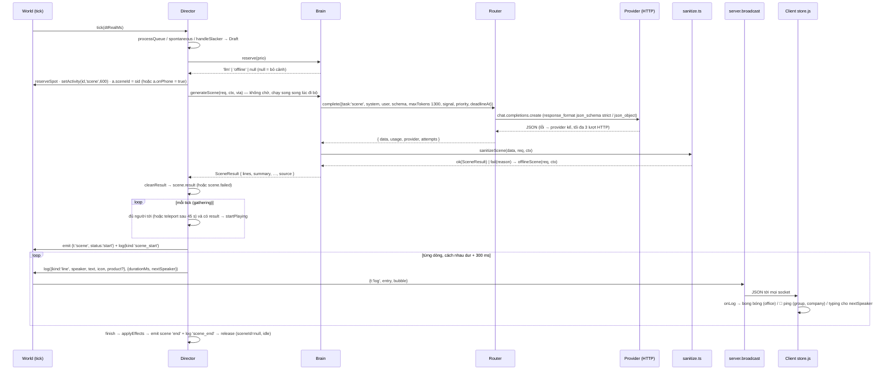

# Kiến trúc & giao thức

> Cập nhật lần cuối: 2026-11-03 · Phạm vi: `src/server.ts`, `src/types.ts`, vòng lặp + xuất dữ liệu của `src/sim/world.ts`, vòng đời cảnh trong `src/sim/director.ts`, điểm nối `src/ai/brain.ts` → `router.ts` → `llm.ts` → `sanitize.ts`, phía trình duyệt `public/js/net.js` + `public/js/store.js` · Đọc khi: cần hiểu các thành phần nối với nhau thế nào, thêm/sửa một thông điệp WebSocket hay route HTTP, thêm trường vào `src/types.ts`, debug nhân vật giật / mất kết nối / không thấy bảng dev / người xem thấy nhầm số liệu hệ thống.

Tài liệu này trả lời câu hỏi: **dữ liệu chạy từ đâu tới đâu, theo nhịp nào, qua hợp đồng kiểu nào, và phần nào chỉ admin mới được thấy**. Nó không mô tả luật mô phỏng (xem [03-mo-phong-the-gioi.md](03-mo-phong-the-gioi.md)), luật chọn cảnh / nhân sự / mạch truyện ([04-dao-dien-cau-chuyen-nhan-su.md](04-dao-dien-cau-chuyen-nhan-su.md)), chính sách từng nhà cung cấp AI ([05-lop-ai.md](05-lop-ai.md)), kho tin RSS ([06-tin-tuc-thoi-su.md](06-tin-tuc-thoi-su.md)), cách vẽ canvas ([07-frontend-ve-canvas.md](07-frontend-ve-canvas.md)) hay vận hành VPS ([10-van-hanh-deploy.md](10-van-hanh-deploy.md)). Hợp đồng kiểu dữ liệu gốc là `src/types.ts`; `SPEC.md` §7 và §10.5 là bản mô tả cũ hơn của cùng giao thức — khi hai bên lệch thì code (và tài liệu này, đã đối chiếu từng dòng ngày 2026-11-02) thắng; các chỗ lệch được liệt kê ở mục cuối. Tổng quan sản phẩm và nguyên tắc của chủ dự án: [01-tong-quan.md](01-tong-quan.md), `README.md`.

---

## 1. Sơ đồ thành phần

```
 .env ──► src/config.ts ──► CONFIG (đọc đúng 1 lần khi tiến trình khởi động)

 ┌─────────────────────────── 1 tiến trình Node (npm start = tsx src/server.ts) ───────────────────────────┐
 │                                                                                                          │
 │  ┌─────────────┐ record()   ┌───────────────────┐  emit(ServerMsg)   ┌────────────────────────────────┐  │
 │  │  Archive    │◄───────────│      World        │───────────────────►│  server.ts                     │  │
 │  │ sim/archive │◄──┐        │   sim/world.ts    │                    │  broadcast() → WebSocket /ws   │  │
 │  │ JSONL/ngày  │   │        │  implements       │◄── handleClient ───│  HTTP: / · /v/<ver>/… · /api/* │  │
 │  └─────────────┘   │        │  WorldApi         │◄── recordClick ────│        /go/:id · dev cookie    │  │
 │                    │        └───┬───────────▲───┘◄── setViewers ─────│                                │  │
 │  ┌─────────────┐   │ getArchive │           │ WorldApi               └───────────────┬────────────────┘  │
 │  │  NewsStore  │   │ DirectorApi│           │ (~40 method)                           │ JSON             │
 │  │ news/store  │◄──┼────────────▼───────────┴──┐  reserve() / generateScene()  ┌─────▼─────────────┐    │
 │  │ RSS→lọc→kho │ pick/markUsed │   Director      │─────────────────────────────►│ Brain ai/brain.ts │    │
 │  └──────▲──────┘   └───────────│ sim/director.ts │◄─────────────────────────────│ nhịp · cầu dao ·  │    │
 │         │ serialize/restore    │ + scenes/hr/    │   SceneResult                │ sanitize · offline│    │
 │         │ (bên trong world     │   story/rumors  │                              └─────────┬─────────┘    │
 │         │  save/load)          └─────────────────┘                                        │ complete()   │
 │  data/state.json ◄── world.save() mỗi 60 s + khi tắt                             ┌────────▼──────────┐   │
 │                                                                                  │ Router ai/router  │   │
 │                                                                                  │ Gemini→Groq→CF…   │   │
 │                                                                                  │ 1 client/provider │   │
 │                                                                                  │ (ai/llm.ts)       │   │
 └──────────────────────────────────────────────────────────────────────────────────┴───────────────────┴───┘
                                     │ WebSocket (JSON) + HTTP
                                     ▼
   Trình duyệt (public/, ES module thuần, không build): net.js ──► store.js (handleMessage) ──► render/office.js (canvas, rAF)
                                                                                           └──► ui/* (DOM: HUD, feed, hồ sơ…)
```

| Thành phần | File | Vai trò trong kiến trúc | Giao tiếp |
|---|---|---|---|
| **Config** | `src/config.ts` | Đọc `.env` một lần thành `CONFIG` (kiểu `Config = typeof CONFIG`). Mọi module đọc `CONFIG`, không đọc `process.env` — **đúng 3 ngoại lệ** (toàn bộ kết quả `grep process.env src/` ngoài `config.ts`): (a) `director.ts:65-69` `showroomMinMs()` đọc thẳng `SHOWROOM_SCENE_MIN_MINUTES`; (b) `director.ts:75-91` `cfgNum`/`cfgBool` thử khoá camelCase trong `CONFIG` trước, **rơi về `process.env[env]`** rồi mới tới mặc định — dùng cho 8 khoá v3 ở `:420-427` (`NEWS_ENABLED`, `NEWS_SCENE_MIN_MINUTES`, `NEWS_ALLOW_SHOWBIZ`, `NEWS_MAX_AGE_DAYS`, `SHOWRUNNER_ENABLED`, `STORY_TRAIT_DRIFT`, `HR_REVIEW_EVERY_DAYS`, `SHOWRUNNER_EVERY_GAME_MINUTES`; `CONFIG` hiện đã có đủ 8 khoá này, `config.ts:297-318`, nên nhánh env chỉ là dự phòng); (c) `llm.ts:279` `debugOn()` đọc `DEBUG_PROMPTS=1` để in prompt/phản hồi ra console (§4.4). Chi tiết: [09-cau-hinh-du-lieu.md](09-cau-hinh-du-lieu.md) §2.3. | Không gọi ai. |
| **World** | `src/sim/world.ts` (3233 dòng) | "Thân xác" 0 token: đồng hồ game, di chuyển, lịch ngày, KPI, công ty; **chủ sở hữu vòng tick và mọi đầu ra** (`emit`, `log`, `toast`, `hello`, `frame`, `agents`, `status`). Lưu/khôi phục toàn bộ trạng thái (gồm cả Director, Brain, NewsStore). | Gọi Director qua `DirectorApi` (bọc try/catch, `world.ts:2903-2924`); gọi Brain chỉ 4 method: `setAudience`, `usage`, `serialize`, `restore`; gọi `getNews().recent/serialize/restore`; gọi `getArchive().record`. |
| **Director** | `src/sim/director.ts` (4401) + `scenes.ts`, `hr.ts`, `story.ts`, `rumors.ts` | "Đạo diễn": chọn cảnh, dựng `SceneRequest`, phát từng dòng thoại, áp hiệu ứng, HR, mạch truyện, tin đồn, bản tin. Giữ đúng 2 slot cảnh: `office` và `online`. | Điều khiển World qua `WorldApi` (`types.ts:531-582`) + API v3 duck-typing (`interface WorldV3`, `director.ts:94-105`); gọi Brain `reserve`, `generateScene`, `generateCandidate`, `generateRecap`, `generateBeats`, `mode`, `usage` (`usage` chỉ trong `llmGated()`, `director.ts:641-650`, để so `costTodayUsd` với `budgetUsd` và hoãn cảnh thường khi hết ngân sách / không ai xem — §4.1); phát `scene`/`recap`/`rumors` qua `world.emit`, dòng thoại qua `world.log`. |
| **Brain** | `src/ai/brain.ts` (402) | Quyết định *khi nào* được gọi AI (`reserve`), hạn chót, cầu dao, làm sạch kết quả, **luôn có đường lui offline** (`src/ai/offline.ts`). Không bao giờ throw. | Gọi Router `complete()`; gọi `prompts.ts` dựng prompt, `sanitize.ts` kiểm kết quả, `schemas.ts` lấy JSON schema. |
| **Router + LLM client** | `src/ai/router.ts` (891), `src/ai/llm.ts` (441) | Chính sách nhiều nhà cung cấp (thứ tự/xen kẽ, RPM/RPD/TPD, cooldown, failover trong cùng request, giữ nhịp quota); mỗi provider 1 client OpenAI-compatible (`openai` SDK, `maxRetries: 0`). | Gọi HTTP ra ngoài (Gemini / Groq / Cloudflare / OpenAI). |
| **NewsStore** | `src/news/store.ts` (+ `feeds.ts`, `filter.ts`) | Kho tin RSS đã lọc an toàn, trong bộ nhớ; singleton `getNews()`. | Server gọi `start()/stop()`; Director `pick/markUsed`; World `recent/serialize/restore`; HTTP `/api/news` đọc `status()/items()/recent()`. |
| **Archive** | `src/sim/archive.ts` (480) | Lưu trữ dài hạn JSONL theo ngày VN (`data/history/YYYY-MM-DD.jsonl[.gz]`); singleton `getArchive()`, **tắt cho tới khi `configure({enabled:true}).start()`**. | World ghi `log`/`kpi`; Director ghi `hr`/`resign`/`news`/`beat`; HTTP `/api/history` đọc `listDays/readDay/hasDay/isFrozenDay`. |
| **Server** | `src/server.ts` (570) | Điểm vào: nối dây mọi thứ, HTTP (`node:http`, không framework) + WebSocket (`ws`), quyền admin theo socket, phiên bản tài nguyên tĩnh, lưu định kỳ, tắt êm. | Nhận `ServerMsg` từ World qua `broadcast`; gọi `world.hello/handleClient/setViewers/recordClick/clickStats/save/load/start/stop`. |
| **Frontend** | `public/` (HTML + CSS + JS thuần) | Vẽ canvas + DOM từ `store`; chỉ nhận dữ liệu qua WS/HTTP. | `net.js` nối `/ws`; `store.js` là điểm vào duy nhất của mọi `ServerMsg`; `ui/history.js` là nơi duy nhất gọi `fetch` ngoài `net.js` (`/api/history`). |

**Ranh giới cố ý:**

- World không biết gì về AI ngoài interface `Brain`; Director không biết provider nào đang chạy — chỉ thấy `'llm' | 'offline'`.
- World phát `StatusInfo` **đầy đủ** (kể cả số lượt click, chi phí AI). Việc che cho người xem thường nằm **hoàn toàn ở `server.ts`** (`publicStatus`, §5.5). Bất kỳ kênh phát mới nào (SSE, API khác) tái dùng `world.hello()` / `statusInfo()` phải tự lọc lại.
- `hello.dev` do World đặt `!!config.devPanel` (`world.ts:918`) nhưng server **ghi đè theo từng socket** (`server.ts:461`). Đừng dùng `hello.dev` phía World cho quyết định bảo mật.

---

## 2. Vòng đời tiến trình: khởi động và tắt

### 2.1 Thứ tự khởi động (đúng như `src/server.ts`, module chạy từ trên xuống)

| # | Dòng | Việc | Vì sao thứ tự này quan trọng |
|---|---|---|---|
| 1 | `server.ts:9` | `import { CONFIG }` → `config.ts` đọc `.env` (`dotenv`) và dựng danh sách provider. | Mọi module sau đó đọc `CONFIG` đã cố định. |
| 2 | `:145-150` | `ASSET_VERSION = computeAssetVersion()` băm toàn bộ `public/` (mức module, trước cả khi dựng World); cùng lúc `OG_VERSION` = SHA-1 (10 ký tự) **nội dung** `public/og-image.jpg` (không có file → `'0'`). | Phiên bản tài nguyên và phiên bản ảnh xem trước chỉ tính **một lần** → sửa `public/` phải khởi động lại (§7, §7.1). |
| 3 | `:245-247` | `getArchive().configure({ enabled: CONFIG.historyEnabled, dir, keepDays, gzipAfterDays }).start()` | Archive bật **trước** World để dòng log đầu tiên của World cũng được lưu. |
| 4 | `:248` | `brain = createBrain(CONFIG)` → bên trong `createRouter(CONFIG)` dựng 1 client/provider, in dòng giới thiệu provider. | Brain phải có trước World (World cần `brain.usage()` cho `status`). |
| 5 | `:249` | `world = new World({ config: CONFIG, brain, emit: broadcast })` — constructor gọi `freshInit()` ngay (`world.ts:473`): dựng đội hình mới, `planDay(1)`, **đã log "🌅 … ngày 1 — văn phòng mở cửa"** (và có thể vài dòng khác) dù sau đó sẽ khôi phục từ file. | `emit` của World chính là `broadcast` của server (lúc này chưa có socket nào nên không gửi đi đâu, nhưng archive **đã** nhận các dòng log "ngày 1" này — xem câu hỏi mở). |
| 6 | `:250-251` | `director = new Director(world, brain)`; `world.attachDirector(director)`. | Director phải được gắn trước `load()` để `director.restore()` được gọi. |
| 7 | `:252` | `if (CONFIG.persist) world.load()` — thứ tự bên trong (`world.ts:1022-1070`): đọc file → kiểm `version === STATE_VERSION (1)` → **`brain.restore` trước** (giữ chi phí đã tiêu kể cả khi world hỏng) → `restoreWorld` (false/throw → cách ly file thành `*.bad-<stamp>` + `freshInit()`) → `director.restore` → `dayStartNotified = true`. | Sau khôi phục thành công **`director.onDayStart` KHÔNG được gọi**; Director tự chạy `ensureDayPlanned()` ở tick đầu (`director.ts:673-676`) chỉ khi `plannedDay` lệch `world.day()`. |
| 8 | `:253` | `world.start()` → `lastTickAt = performance.now()`, `notifyDayStartOnce()` (chỉ gọi `onDayStart` khi là văn phòng mới), `forceFrame = true`, `setInterval(tick, 100)`. | Tick đầu luôn gửi `frame` + `agents` + `status` vì `lastFrameAt/lastAgentsAt = -FAR`. |
| 9 | `:255-256` | `news = getNews(); if (CONFIG.newsEnabled) news.start()` — lần tải RSS đầu sau ~20 s (`firstFetchMs`), rồi mỗi `NEWS_REFRESH_MINUTES`. | Không bao giờ chặn khởi động; `world.load()` đã gọi `getNews().restore()` trước đó nên singleton tồn tại sẵn. |
| 10 | `:401-446` | `server = createServer(router HTTP)`. | |
| 11 | `:449` | `wss = new WebSocketServer({ server, path: '/ws', maxPayload: 16 * 1024 })`. | |
| 12 | `:486-495` | Heartbeat WS mỗi `HEARTBEAT_MS = 30_000` (`.unref()`). | |
| 13 | `:498` | `if (CONFIG.persist) setInterval(() => world.save(), SAVE_EVERY_MS = 60_000).unref()`. | |
| 14 | `:516-521` | `SIGINT`/`SIGTERM` → `shutdown`; `uncaughtException`/`unhandledRejection` → **chỉ log, không thoát** ("livestream không được chết vì một lỗi lẻ"). | |
| 15 | `:533-570` | `server.listen(CONFIG.port)` rồi in log khởi động tiếng Việt: URL, chuỗi provider thật (`label (model) → … → câu mẫu offline`) hoặc OFFLINE, chế độ thời gian, số sản phẩm trên kệ, persist, archive, thời sự, trạng thái bảng dev (**không bao giờ in `DEV_TOKEN`**), ngày/giờ game. `EADDRINUSE` → thông báo đổi `PORT` và `exit(1)`. | |

### 2.2 Tắt êm (`shutdown`, `server.ts:501-515`, chạy đúng 1 lần)

`world.stop()` (clear interval) → `news.stop()` → nếu `persist`: `world.save()` + log đường dẫn `CONFIG.stateFile` → `archive.stop()` (ghi nốt hàng đợi **đồng bộ**, `flushSync`) → đóng mọi socket `close(1001, 'server shutdown')` → `wss.close()` → `server.close(() => process.exit(0))`; dự phòng `exit(0)` sau 1,5 s.

### 2.3 Headless (test / script)

`scripts/smoke.ts:262-264`: `const brain = createBrain(config, { now: realNow }); const world = new World({ config, brain, emit, now: realNow }); const director = new Director(world, brain); world.attachDirector(director)` — `emit` là hàm thu thập `ServerMsg`, `now` là đồng hồ ảo; bước bằng `world.advance(100)` (`world.ts:1111-1116`) thay cho `setInterval`. Archive/NewsStore được cấu hình riêng (`getArchive().configure({ enabled: true, dir: thư mục tạm, … })`, `configureNews({ enabled: false, feeds: [] })` rồi `inject(fixture)`). Không test nào dựng lớp HTTP/WebSocket **của ứng dụng** (`src/server.ts`, `ws`); `scripts/test-router.ts:17,109` và `scripts/test-llm.ts:16,120` chỉ dùng `node:http createServer` để dựng **endpoint provider giả** (đóng vai Gemini/Groq) kiểm Router và LLM client (xem [11-kiem-thu-qa.md](11-kiem-thu-qa.md)).

---

## 3. Các vòng lặp thời gian

### 3.1 Tick 100 ms của World (`world.ts:1080-1105`)

```
setInterval(tick, TICK_MS = 100)
  tick(): now = performance.now(); dtReal = clamp(now − lastTickAt, 0, 1000)
  runTick(dtReal, now):
    1. step(dtReal)          — tiến đồng hồ game, lịch, di chuyển, KPI (try/catch riêng)
    2. director.tick(dtReal) — Director xử lý cảnh/hàng đợi (try/catch riêng)
    3. output(now)           — quyết định gửi frame / agents / status (try/catch riêng)
```

- `dtReal` kẹp ≤ 1000 ms: máy ngủ / event loop nghẽn không làm thời gian game nhảy vọt; `step` còn kẹp `dtGame ≤ 10` phút game/tick (`world.ts:1135`).
- Mỗi bước có `try/catch` riêng và `reportError(where)` (mỗi loại ≤ 1 log/10 s, `world.ts:2937-2945`) → lỗi ở Director không làm World ngừng xuất frame.
- Director còn có **lớp bắt lỗi riêng**, độc lập với `reportError` của World: `tick()` tự bọc try/catch → `err('tick', e)` (`director.ts:432-466`); `err(where, e)` (`:660-670`) in ≤ 1 cảnh báo/10 s (`console.warn('[director] lỗi ở <where>: …')`, kèm số lỗi đã ẩn `errSuppressed`); `guard(where, fn)` (`:652-658`) bọc từng callback `DirectorApi` (`onDayStart`, `onDayEnd`, `onEvent`, `onBossLeft`, `onBossReturned`, `onSlackerSpotted`, `onAgentArrived`); `updateSceneSafe(s)` (`:1379-1392`) bọc từng cảnh — `updateScene` ném → `abort(s, 'lỗi')`, abort cũng ném → giải phóng slot `office`/`online` thẳng tay. Hệ quả: lỗi chỉ lọt tới `callDirector`/`askDirector` của World (`world.ts:2903-2924`) khi chính `guard`/`err` ném — gần như không xảy ra; khi debug Director hãy tìm `[director] lỗi ở` trong console, không phải `[world]`.
- Thứ tự "World trước, Director sau, output cuối" nghĩa là mọi thay đổi Director làm trong tick (đặt `sceneId`, `setActivity`) được phản ánh ngay trong `frame` của cùng tick.

### 3.2 Nhịp nội bộ của Director (`director.ts:432-466`)

Director có đồng hồ riêng `clockMs` (ms **thật**, cộng dồn `dtRealMs` kẹp ≤ 10 s/tick) — khác với `now()` = `world.time()` (phút **game**). Mỗi tick: `ensureDayPlanned()` → `runTimers()` → `updateSceneSafe(office)`, `updateSceneSafe(online)` → rồi theo nhịp:

| Nhịp (ms thật) | Hằng | Việc |
|---|---|---|
| 1 000 | `WATCH_MS` | `watch()` đếm hoạt động (cà phê, toilet…) |
| 1 000 | `QUEUE_MS` | `processQueue()` — mục đến hạn trong hàng đợi |
| 2 000 | `CHECK_MS` | `spontaneous()` — cảnh tự phát |
| 3 000 | `STORY_MS` | `storyTick()` — AI biên kịch |
| 10 000 | `SWEEP_MS` | `sweep()` dọn agent mồ côi, vị trí trống |
| 15 000 | `LEAK_MS` | `leakCheck()` tin đồn lộ |

Chi tiết từng nhịp: [04-dao-dien-cau-chuyen-nhan-su.md](04-dao-dien-cau-chuyen-nhan-su.md).

### 3.3 Nhịp xuất dữ liệu (`World.output`, `world.ts:2763-2777`)

| Thông điệp | Điều kiện gửi | Hằng |
|---|---|---|
| `frame` | `forceFrame` **hoặc** đã ≥ 200 ms từ frame trước | `FRAME_MS = 200` |
| `agents` | `due` (≥ 2000 ms từ lần trước) **hoặc** (`agentsDirty` và ≥ 300 ms) | `AGENTS_MS = 2000` |
| `status` | Gửi **cùng nhịp** với nhánh agents: khi `due` hoặc khi (`agentsDirty \|\| statusDirty`) và ≥ 300 ms — tức `status` luôn đi kèm mỗi lần nhánh này chạy, `agents` chỉ khi `due` hoặc `agentsDirty` | |

`forceFrame = true` được đặt khi: `start()`, `setSpeed`, `endDay`, nhiều chỗ đổi trạng thái đột ngột. `statusDirty` bật khi đổi số người xem (`setViewers`), đổi tốc độ, có click, v.v.; `agentsDirty` khi đội hình đổi (tuyển/đuổi/sang ngày).

### 3.4 Các bộ hẹn giờ khác trong tiến trình

| Ở đâu | Nhịp | Việc |
|---|---|---|
| `server.ts:498` | 60 s | `world.save()` → `data/state.json` (ghi nguyên tử, `src/sim/persist.ts`) |
| `server.ts:486` | 30 s | Heartbeat WS: socket không `pong` từ lần trước → `terminate()`; sau đó `world.setViewers(openCount())` |
| `public/js/net.js:99` | 25 s | Client gửi JSON `{t:'ping'}` (server bỏ qua, `server.ts:471`) — chỉ để giữ kết nối qua proxy, **độc lập** với ping/pong khung WS |
| `archive.ts:113-122` | `max(250, flushMs=2000)` ms; `rotate()` sau 5 s rồi mỗi khi đổi ngày VN | Ghi lô JSONL; gzip/xoá file cũ |
| `news/store.ts` | lần đầu 20 s, rồi `max(60 s, NEWS_REFRESH_MINUTES)` | Tải RSS (`unref`, không giữ tiến trình sống) |
| `router.ts` | theo provider | cooldown / RPM cửa sổ trượt 60 s / giữ nhịp quota ngày (xem [05-lop-ai.md](05-lop-ai.md)) |

---

## 4. Luồng một cảnh: Director → Brain → Router → provider → sanitize → phát từng dòng → client



### 4.1 Bước 1 — Director có một `Draft` và hỏi `brain.reserve(prio)`

Ba nguồn cảnh: hàng đợi `queue` (lịch trong ngày, hậu quả sự kiện, quyết định HR, bước mạch truyện), `spontaneous()` mỗi 2 s, và `handleSlacker()` khi World báo `onSlackerSpotted`.

**Bước lọc trước — `llmGated()`** (`director.ts:641-650`): nếu `brain.mode() === 'llm'` **và** (`LLM_ONLY_WHEN_WATCHED` với `world.viewers() === 0`, **hoặc** `brain.usage().costTodayUsd ≥ budgetUsd`) thì Director coi là "Brain chắc chắn từ chối cảnh thường" và **không gọi `reserve`** nữa: mục hàng đợi không-`high` bị hoãn `nextTry = clockMs + 10 s` (`:865-868`), `spontaneous()` bỏ cả lượt (`:1064`), `planBeats` dùng kế hoạch offline thay cho `generateBeats` (`:3630`, trừ khi `force`). Ở chế độ `offline` hàm luôn trả `false` nên không chặn gì (cảnh offline vẫn chạy khi không ai xem). Mục `high` (HR, phỏng vấn, sa thải, hậu quả sự kiện) **bỏ qua** bước lọc và đi thẳng tới `reserve`. Đây là lý do khi không có người xem, ở chế độ LLM, bảng dev gần như không thấy cảnh mới nhưng `skipped` của Brain **không** tăng (Brain chưa được hỏi).

Qua được bước lọc, Director gọi `brain.reserve(priority)` (`brain.ts:235-261`):

| Tình trạng Brain | `high` | `normal` | `low` |
|---|---|---|---|
| Không provider sẵn sàng (không key / đang nghỉ / cầu dao mở) | `'offline'` | `'offline'` nếu đã ≥ `OFFLINE_MIN_SECONDS` từ lần offline trước, không thì `null` | như normal |
| Hết ngân sách ngày **hoặc** `LLM_ONLY_WHEN_WATCHED` và `viewers === 0` | `'offline'` | `null` (`skipped++`) | `null` |
| Đang có ≥ `MAX_CONCURRENT_LLM` request | `'llm'` (xếp hàng) | `null` | `null` |
| Bình thường | `'llm'` | `'llm'` nếu cách lần gọi trước ≥ `MIN_SECONDS_BETWEEN_LLM / 2` | `'llm'` nếu ≥ `MIN_SECONDS_BETWEEN_LLM` |

`null` → Director bỏ lượt (thử lại sau 4 s với mục hàng đợi). Số người xem tới Brain qua `World.setViewers(n)` → `brain.setAudience(n)` (`world.ts:959-968`), được server gọi lúc nối, lúc đóng và mỗi heartbeat.

### 4.2 Bước 2 — `launch(d, via, prio)` (`director.ts:1136-1323`)

1. Slot phải rảnh (`office` cho kênh `office`; `online` cho `group`/`company`); không ai trong `participants` đang có `sceneId`.
2. Cảnh văn phòng: giữ chỗ chung (`joint`) hoặc chỗ riêng theo `Placement` (`stay | seat | visit | spot`); không đủ chỗ → trả lại tất cả và `null`. Số người tối thiểu: 3 cho `group`, 2 còn lại (`minPeople`).
3. `d.sit(people, label)` viết tình huống tiếng Việt (≤ 690 ký tự, `scenes.ts`). 1/3 số cảnh `pantry_chat`/`lunch` có **tin thật** len vào (`d.news`) nếu còn nhịp (`director.ts:1223-1231`).
4. Dựng `SceneRequest` (`types.ts:227-254`): `sceneId = sc<day>_<seq>`, `type`, `channel`, `locationLabel`, `situation`, `participants` ([0] = người khởi xướng), `minLines/maxLines` từ `SCENE_DEFS`, `allowedEffects`, `priority`, tuỳ chọn `topicHint`, `aboutId`, `extra` (≤ 6 dòng), `rumor`, `news`, `hrDossier`, `product { id, name, pitch, preferSpeaker }`.
5. Giao quyền: `office = scene` / `online = scene`; mọi người `a.sceneId = sid`; văn phòng → `w.setActivity(id, 'scene', 600, { target, label, emote })` (World sẽ dẫn họ đi tới chỗ); online → `a.onPhone = true` (client hiện 📱, không di chuyển). Cập nhật các cap: `productLock`, `lastShowroomAt`, `markNewsUsed`, `lastNewsAt`.
6. `brain.generateScene(req, this.ctx(), via)` được gọi **ngay, không `await`**; khi promise về mà cảnh còn sống (`isLive`) → `cleanResult` (`director.ts:1335-1361`: speaker ∈ participants, ≤ `maxLines + 2` dòng, text ≤ 240 ký tự, emote ≤ 8, verdict ∈ `VERDICT_OK` (Record đầy đủ theo union `Verdict`), hrDecisions ≤ 12) → `scene.result`; không hợp lệ → `scene.failed = true`.

`PromptContext` (`director.ts:3994-4015`, kiểu `types.ts:494-506`): `companyName`, `company`, `day`, `minuteOfDay`, `weekday`, `timeLabel`, `agents` (mọi agent theo id, **kể cả người đã nghỉ trong `departed` để tra tên**), `roster` (active), `recentSummaries` (8 tóm tắt gần nhất, chống lặp), `bossAway`, `bossNote`.

### 4.3 Bước 3 — Brain (`brain.ts:302-312`)

- `via !== 'llm'` hoặc provider không còn sẵn → `offlineSceneSafe(req, ctx)` ngay (không mạng): `offlineScene` (`src/ai/offline.ts`, kịch bản khung + mẫu câu theo giọng từng người) → rỗng/lỗi → `emergencyScene` (2 câu cấp cứu, `sanitize.ts:581-600`).
- `via === 'llm'` → `runLlm('scene', priority, buildSceneUserPrompt, SCENE_SCHEMA_NAME, SCENE_SCHEMA, sanitizeScene)`:
  - `buildSceneUserPrompt(req, ctx)` (`prompts.ts:401`) dựng prompt động theo **bậc** (`prompt-budget.ts`: `SCENE_TIERS` 4 bậc, ngân sách `1200 + 200×(người − 3)` token, tối đa 2000); system prompt **tĩnh** cho cả tiến trình (`buildSystemPrompt`, mục tiêu ≤ ~1300 token) để tận dụng prompt cache.
  - `withDeadline(DEADLINE_MS.scene = 27_000)` bọc `router.complete({ task:'scene', system, user, schemaName, schema, maxTokens: MAX_TOKENS.scene = 1300, signal, priority, deadlineAt })`. 27 s < `RESULT_TIMEOUT_MS = 35_000` của Director nên Brain luôn trả lời trước khi Director huỷ cảnh.
  - Lỗi request (mọi provider đều hỏng) → `noteFailure(apiLevel = true)`: `failures++`, `lastError = "[HH:MM] Cảnh: <mô tả tiếng Việt, đã che key>"`; 3 lỗi liên tiếp → cầu dao mở 60 s, 120 s… tối đa 10 phút (`BREAKER_*`, `brain.ts:42-44`).
  - Kết quả không qua sanitize → `noteFailure(apiLevel = false)` (không tính cầu dao) → offline.

### 4.4 Bước 4 — Router (`router.ts:629-736`) và client HTTP (`llm.ts:368-408`)

- `complete()`: `acquire(signal)` xếp hàng theo `MAX_CONCURRENT_LLM`; sắp provider theo `AI_ROUTING` (`priority` = đúng thứ tự `AI_PROVIDERS`; `balanced` = xen kẽ theo trọng số/quota còn lại); tier `strong` được xếp lên trước khi `priority === 'high'` **hoặc** khi task không phải `scene`/`beats` — tức `candidate`/`recap` luôn ưu tiên `strong` bất kể priority, còn `scene` chỉ khi `high` (`order()`, `router.ts:478-483`); bỏ provider đang nghỉ / chạm RPM-RPD-TPD / request vượt `maxRequestTokens`; tối đa `maxAttempts = 3` lượt HTTP, mỗi lượt ≤ `min(providerTimeoutMs = 20 s, còn lại tới deadline − 300 ms)`; không mở lượt mới khi còn < 2,5 s (6 s với model reasoning).
- Mỗi lượt: `client.attempt(req, format, perCall, limits)` = **đúng 1** `chat.completions.create` với `messages [system, user]`, `response_format` `json_schema` (strict, tên schema `canh_hoi_thoai`) hoặc `json_object` (khi provider đã từng từ chối schema, nhớ 24 h), `max_completion_tokens` (model reasoning ×3, có trần học từ lỗi "Request too large"), `temperature 1` (không gửi cho model reasoning), `reasoning_effort`, `extraBody` từ `AI_<TÊN>_EXTRA_JSON`. Trả `{ data: JSON đã parse (parseJsonLoose), format, usage, finishReason, ms }`; `refusal`/rỗng/JSON hỏng → `LlmError` **kèm `usage`** để vẫn tính token.
- Lỗi được `classifyError` → `penalize` (cooldown riêng từng provider: 429 theo `Retry-After`, hết quota ngày → chờ 0h Pacific với Gemini, 401/403/404 → tắt 1 giờ, 5xx/mạng → 20 s lùi dần). `aborted` (Brain hết hạn) → ném ngay, không phạt. Chi tiết: [05-lop-ai.md](05-lop-ai.md).
- **Debug luồng này**: chạy với `DEBUG_PROMPTS=1` (`llm.ts:279` `debugOn()` — biến duy nhất lớp AI đọc thẳng `process.env`; có dòng mẫu đã comment ở `.env.example:59` và hướng dẫn ở `README.md:250`). Client in ra console: system prompt **một lần cho mỗi băm** `fnv1a(system)` (`printedSystems`, `:371-376`), user prompt kèm `task → label/model (format, max tok)` (`:377`), và phản hồi thô kèm `ms`, `finish`, token prompt/cached/out, chi phí USD (`:392-394`). Chỉ dùng lúc thử nghiệm: prompt chứa tên/tính cách nhân vật, log rất dài; **không bật trên VPS**.

### 4.5 Bước 5 — `sanitizeScene(raw, req, ctx)` (`sanitize.ts:413-578`) — hàm thuần, trả `Outcome<SceneResult>`

| Phần | Luật |
|---|---|
| `lines` | Mỗi dòng: `speaker` phải phân giải được về id trong `participants` (`makeIdResolver` chấp nhận id/tên/biệt danh); text qua `cleanSpokenText` (bỏ tiền tố tên, cắt `LIMITS.lineChars = 220`), `idsToNames`; cần có chữ/số/emoji; bỏ dòng trùng liền kề; bỏ dòng có chữ không Latin (`looksForeign`); cảnh có tin (`news_chat`/`req.news`) bỏ dòng vi phạm `NEWS_BLOCK_RE` hoặc phán xét người có tên trong tin; cắt còn ≤ `max(2, maxLines + 2)`. **Thất bại** nếu < 2 dòng hoặc (≥ 2 người mà chỉ 1 người nói). |
| `product` | Chỉ khi `req.product`: đúng 1 dòng `product: true` (nhiều cờ → chọn câu nhắc tên rõ nhất; không cờ → tự gắn nếu `mentionScore ≥ 3`). |
| hiệu ứng | Chỉ loại trong `allowedEffects`; id phải tồn tại; cộng dồn rồi kẹp: quan hệ ±15 (`to` ∈ participants ∪ `aboutId`), mood ±15, kpi ±25; ký ức ≤ 1/người, ≤ 120 ký tự (cảnh có tin → ký ức theo mẫu cố định "Bàn tin … (nguồn)"). |
| `rumor` | Có `req.rumor` → chủ thể do Director quyết, model quên text thì giữ bản cũ; không có → chủ thể phải ngoài participants và không phải ứng viên. |
| `verdict` | `normalizeVerdict(type, raw)` theo `VERDICT_BY_TYPE` (interview → `hired/rejected`, mặc định `hired`; resign_talk → `stay/leave`, mặc định `stay`; raise_request → `approved/denied`, mặc định `denied`; v5 crisis_meeting → mã phương án **đã đưa ra bàn** (`plan_a..plan_d`, hiểu cả "Phương án C" / số thứ tự), không khớp → `null`; pep_talk → `inspired/unmoved`, phủ định theo từ — "chưa đủ thuyết phục" là `unmoved`); cảnh khác luôn `null`. Chi tiết: [05-lop-ai.md](05-lop-ai.md) §8.2. |
| `hrDecisions` | Chỉ `hr_review`: `sanitizeHrDecisions` lọc theo `hrDossier[].allowed`, mục ngoài hàng rào đổi thành `none` kèm lý do `ngoài hàng rào (<action>)`. |
| `summary` | ≤ 160 ký tự; hỏng → `deriveSummary` tự viết. |

### 4.6 Bước 6 — Diễn (`director.ts:1394-1579`)

- `gathering`: `failed` → `abort('không sinh được thoại')`; không có `result` sau `RESULT_TIMEOUT_MS = 35 s` → abort; cảnh văn phòng chưa đủ người tới sau `GATHER_TELEPORT_MS = 45 s` → `w.teleport(id, target)`; đủ người **và** có result → `startPlaying`.
- `startPlaying`: `emit({t:'scene', scene: pub(s,'start')})` rồi `log({ kind:'scene_start', channel, sceneId, text: "<title> · <tên…> · <nơi>", icon, news? })`, rồi phát dòng đầu ngay.
- `playLine`: người nói/nghe quay mặt (`faceFor`); **`durationMs = round(clamp(1600 + 55 × len, 2200, 7500) / min(speed, 3))`, online ×0.8**; dòng `product: true` đầu tiên → `toPublic(product, 'scene')` gắn `LogEntry.product` (url `/go/<id>?src=scene`); `w.log({ kind:'line', channel, sceneId, speaker, speakerName, text, icon: emote, product }, { durationMs, nextSpeaker })`; `nextAt = clockMs + dur + 300`.
- `playing` quá `MAX_PLAY_MS = 180 s` → `finish` sớm (nhỏ hơn watchdog 5 phút của World, `world.ts:48`).
- `finish`: `clearSlot` (đặt `onlineGapMs` mới 60–120 s, 45–70 s khi boost) → `applyEffects` (chỉ `allowedEffects`, kẹp lần hai) → `pushSummary` → `emit scene 'end'` + `log scene_end` (summary ≤ 200) → `release` (`sceneId = null`, `onPhone = false`, `lastSceneAt = Date.now()`, văn phòng: `releaseSpot` + `setActivity('idle', 0)`) → `onEndHook` (HR, phỏng vấn, tin đồn…).
- `abort(s, why)`: nếu đã `started` → emit/log "bị gián đoạn"; `release`; `onAbortHook` (một số loại cảnh được xếp lại).
- `World.log()` (`world.ts:875-901`): gán `id = ++logSeq`, `day`, `minute`; đẩy `history` (giữ 200); `archiveRecord('log', entry)`; **kẹp `bubble.durationMs` vào 300..30 000** rồi `emit({t:'log', entry, bubble})`.

### 4.7 Bước 7 — Client

`store.onLog` (`store.js:293-325`): `kind === 'line'` kênh `office` → bong bóng `{ key, speaker, name ≤ 40, text ≤ 400, icon ≤ 8, product, t0, dur = clamp(durationMs, 700, 15000) }`, giữ ≤ 5 bong bóng, xoá bong bóng cũ của cùng người; `nextSpeaker` → `typing.set(next, { from: now + max(dur×0.6, dur − 1100), until: now + dur + 2600 })` (3 chấm nhấp); kênh `group`/`company` → `pings.set(speaker, now)` (📱 nhấp, không bong bóng). `scene_end` xoá typing của participants. Thẻ cảnh trong tab Trực tiếp do `ui/feed.js` gom theo `sceneId`. Người xem thấy cùng một thứ dù thoại là AI hay offline — chỉ admin thấy nhãn nguồn (`store.dev`).

---

## 5. Giao thức WebSocket

### 5.1 Kết nối

| Mục | Giá trị / hành vi | Dòng |
|---|---|---|
| Đường dẫn | `/ws` trên cùng HTTP server; client dùng `ws:`/`wss:` theo `location.protocol`, kèm `?dev=<token>` nếu có mã | `server.ts:449`, `net.js:76-80` |
| Khung tối đa client → server | `maxPayload: 16 KiB` (thư viện `ws`) + `parseClientMsg` siết ≤ `MAX_MSG_BYTES = 2048` byte | `server.ts:23, 449, 225-241` |
| Lúc nối | `isDev = devAllowed(req)` quyết định **một lần** (`devSockets` WeakMap); gửi ngay `hello = world.hello()` với `hello.dev = isDev`, socket thường được thay `hello.status = publicStatus(...)`; `world.setViewers(openCount())` | `server.ts:453-467` |
| Heartbeat | Server `ws.ping()` mỗi 30 s; không `pong` kịp lần sau → `terminate()`; cập nhật `viewers` | `server.ts:486-495` |
| Client ping | JSON `{t:'ping'}` mỗi 25 s, server bỏ qua | `net.js:99`, `server.ts:471` |
| Nghẽn | `broadcast` **bỏ qua** socket có `bufferedAmount > MAX_BUFFERED = 1 MB` → client chậm có thể mất `log`/`scene` (không gửi lại) | `server.ts:196-211` |
| Đóng khi tắt | `close(1001, 'server shutdown')` | `server.ts:511` |
| Kết nối lại (client) | `delay = min(15000, 800 × 1.7^attempt) × (0.8 + random × 0.4)`; `visibilitychange` → thấy tab và `online` → nối lại ngay (`attempt = 0`) | `net.js:117-143` |
| Trạng thái client | `store.conn ∈ 'connecting' \| 'open' \| 'closed'`, phát sự kiện `conn`; `#stage.offline` + banner khi mất kết nối sau `hello` | `store.js:410-414`, `main.js:127-133` |

Không có ACK, không có số thứ tự, không gửi lại: client phải coi `hello` là **ảnh chụp đầy đủ** và các tin sau là **gia tăng**; mất tin → tự lành khi `agents`/`status` kế tiếp tới (2 s) hoặc khi kết nối lại (nhận `hello` mới, `store.onHello` reset toàn bộ).

### 5.2 Bảng `ServerMsg` (`types.ts` `ServerMsg`, ≈ dòng 500–527)

| `t` | Ai phát | Khi nào | Trường | Kích thước (ước lượng, chưa đo) | Socket thường vs dev |
|---|---|---|---|---|---|
| `hello` | `server.ts:460-463` (từ `world.hello()`) | Ngay khi nối | `map, companyName, clock, status, agents, log, recaps, rumors, scenes, dev, rules?, products?, news?` | Lớn: `log` ≤ 200 dòng + 10 `PublicAgent` + map → vài chục KB (smoke in ra `hello X B`) | `dev` theo socket; `status` bản công khai cho socket thường |
| `frame` | `World.output` | mỗi 200 ms hoặc `forceFrame` | `clock: ClockInfo`, `a: FrameAgent[]`, `ts: Date.now()` | ~50–60 byte/người + clock ≈ < 1 KB với 10 người; ~5 KB/s/người xem | Giống nhau |
| `agents` | `World.output` | mỗi 2 s, hoặc khi `agentsDirty` (≥ 300 ms) | `agents: PublicAgent[]` (**toàn bộ**, không diff) | Mỗi `PublicAgent` có `relationships` (9 mục), `memories` (≤ 8), `kpiHistory` (≤ 14), `bio`… → vài KB/người, vài chục KB/tin | Giống nhau |
| `status` | `World.output` | cùng nhịp nhánh agents | `status: StatusInfo` | ~1–2 KB (có `ai.providers[]`) | **Khác**: socket thường nhận `publicStatus` (§5.5) |
| `log` | `World.log()` (World tự log sự kiện; Director gọi `world.log` cho thoại/cảnh/HR) | mỗi dòng thoại / sự kiện | `entry: LogEntry`, `bubble?: { durationMs, nextSpeaker? }` | < 1 KB | Giống nhau |
| `scene` | Director `startPlaying`/`finish`/`abort` | bắt đầu / kết thúc cảnh **đã phát** | `scene: PublicScene` (`status: 'start' \| 'end'`, `summary?` chỉ ở end, `news?`) | < 1 KB | Giống nhau |
| `recap` | Director `makeRecap` | sau `onDayEnd` khi Brain trả bản tin (bất đồng bộ, có thể vài giây tới vài chục giây sau) | `recap: DayRecap` | ~1–3 KB | Giống nhau (`source` llm/offline có trong payload; client chỉ hiện nhãn khi `store.dev`) |
| `rumors` | Director `emitRumors` | sau cảnh ghi được tin đồn mới/phiên bản mới (`applyRumor`, `director.ts:1664, 1676`), sau sự kiện drama (`:2619`), khi `sweep` loại tin của người đã nghỉ (`:4087`) | `rumors: Rumor[]` (toàn bộ, ≤ 12) | vài KB | Giống nhau |
| `toast` | `World.toast()` (14 chỗ trong World: tốc độ, nút dev…; 24 chỗ Director gọi `world.toast`) | tức thời | `icon ≤ 16`, `text ≤ 300` | nhỏ | Giống nhau |

`hello.log` = mảng `history` trong bộ nhớ World (≤ `LOG_KEEP = 200` dòng). Khi `PERSIST=true` mảng này được khôi phục từ `state.json` (`raw.log.filter(isLogEntry).slice(-LOG_KEEP)`, `world.ts:3099`; `logSeq` nối tiếp từ `max(saved, max id)`, `:3109`) nên **có thể chứa dòng của các lần chạy trước**; World **không** đọc kho `data/history/` khi dựng `hello`. Lịch sử xa hơn lấy qua `GET /api/history` (§6).

Chuẩn hoá phía client cho các tin nhỏ (`store.handleMessage`, `store.js:394-402`): `recap` → thay bản cùng `day` nếu đã có, giữ ≤ 14 (`filter(r => r.day !== msg.recap.day)` + `slice(-14)`, khớp `director.recaps()` ≤ 14); `rumors` → lọc mục không phải object; `toast` → `icon` cắt ≤ **8** ký tự (server cho phép ≤ 16 — hai con số khác nhau, cố ý hay không chưa rõ), `text` ≤ 300. Loại `t` lạ → `default: break` im lặng.

### 5.3 `hello` chi tiết (`world.ts:906-923`)

| Trường | Nguồn | Ghi chú |
|---|---|---|
| `map` | `MAP_DATA` (`map.ts:203`) = `{ w: 60, h: 34, walls: string[34], rooms, furniture, desks, spots }` | `walls` là lưới ký tự `'#'` tường / `'D'` cửa / `'.'` sàn. Client `render/world.js` kiểm `4 < w,h ≤ 200`, bỏ qua `spots`. |
| `companyName` | `CONFIG.companyName` | Client cắt ≤ 80, rút gọn bằng `shortCompanyName`. |
| `clock` | `world.clock()` | `ClockInfo { time, day, minute, weekday, speed, isNight, timeMode }`. |
| `status` | `statusInfo()` → server thay `publicStatus` cho socket thường | |
| `agents` | `publicAgents()` — **mọi** agent trong `map` kể cả `candidate`/`fired` đang đi ra | `PublicAgent` (`types.ts:419-436`). |
| `log` | `history.slice()` ≤ 200 | |
| `recaps` / `rumors` / `scenes` | `director.recaps()` (≤ 14) / `director.rumors()` (≤ 12) / `director.publicScenes()` (cảnh `started && !ended`) — mặc định `[]` nếu Director lỗi | `askDirector` bọc try/catch. |
| `dev` | `!!config.devPanel` rồi **server ghi đè** `= isDev` | |
| `rules` | `{ kpiLowRatio, kpiWarnDays, kpiFireDays }` từ CONFIG | Client kẹp `kpiLowRatio` 0.05..2, 2 trường kia ≥ 1. |
| `products` | `showroomProducts()` cache 1 lần/tiến trình (`buildShowroomProducts`, ≤ 40) | `url` luôn `/go/<id>?src=showroom`; client cắt ≤ 60 (`store.js:363`). |
| `news` | `getNews().recent(5)` (`NewsRef[]`, **mới nhất cuối**) | Client hợp nhất với `scene_start.news` trong `log` và `scenes[].news`, giữ ≤ 30. |

Client `onHello` (`store.js:341-381`) đặt `ready = true`, thay toàn bộ `agents`, học tên/ngoại hình (`nameCache`, `lookCache` giữ cả người đã nghỉ), reset `actors/bubbles/typing/pings`, rồi phát **theo thứ tự**: `hello`, `agents`, `status`, `recaps`, `rumors`, `products`, `news`. Mọi `init*` của UI phải đăng ký `store.on(...)` **trước** `connect()` (`main.js:236` là lệnh cuối).

### 5.4 `frame` và `FrameAgent` (`world.ts:2779-2787`, `types.ts:438-439`)

`FrameAgent = [id, x, y, dir, activity, emote, flags]` — **mảng**, không phải object, để tiết kiệm byte (5 lần/giây).

| Chỉ số | Kiểu | Ý nghĩa |
|---|---|---|
| 0 | `string` | agent id |
| 1, 2 | `number` | toạ độ ô (float, `round2` = 2 chữ số) |
| 3 | `Dir` | `'up' \| 'down' \| 'left' \| 'right'` (client coi giá trị lạ là `'down'`) |
| 4 | `Activity` | hoạt động hiện tại (client dùng cho tư thế, đồ cầm, màn hình bàn) |
| 5 | `string` | emoji trên đầu (có thể rỗng) |
| 6 | `number` | **cờ bit**: `1` đang đi (`path.length > 0`) · `2` `onPhone` · `4` trong cảnh (`sceneId !== null`) · `8` ẩn (trong WC, `hidden`) |

Chỉ agent `present === true` được đưa vào (kể cả người ẩn — để client biết WC "Có người"). Agent **không có trong frame** = đã rời văn phòng → client đánh dấu `goneAt` và mờ dần rồi xoá sau 520 ms (`office.js:443-445`). `ts` là `Date.now()` của server lúc gửi, dùng cho bộ đệm chống giật (§10). Client **chỉ xử lý `frame` sau khi có `hello`** (`store.js:389`). Phía client, hằng cờ ở `office.js:26`: `FLAG_WALK=1, FLAG_PHONE=2, FLAG_SCENE=4, FLAG_HIDDEN=8`; `scripts/smoke.ts:207-218` kiểm `flags & 8` khớp `a.hidden` và chỉ đi với `activity 'toilet'`.

### 5.5 `status` và che thông tin hệ thống (`publicStatus`, `server.ts:184-193`)

`StatusInfo` (`types.ts:409-417`) = `{ bossAway, bossNote, viewers, ai: UsageStats, company, clicks, speed }`. World luôn phát bản đầy đủ; `broadcast` serialize **hai** bản khi `msg.t === 'status'` và chọn theo `devSockets.get(ws)`:

| Trường | Socket dev | Socket thường |
|---|---|---|
| `bossAway`, `bossNote`, `viewers`, `company`, `speed` | giữ | giữ |
| `clicks` | số thật | `0` |
| `ai.mode` | giữ | giữ (`'llm' \| 'offline'` — chỉ để vẽ chấm xanh/xám cạnh "TRỰC TIẾP", `hud.js renderAiDot`) |
| `ai.model` | giữ | `''` |
| `ai.calls, failures, inputTokens, cachedTokens, outputTokens, costTodayUsd, costTotalUsd, budgetUsd, skipped` | giữ | `0` |
| `ai.lastError`, `ai.activeProvider`, `ai.providers` | giữ | **không có** (object mới không chép) |

Đây là nơi thực thi nguyên tắc "người xem thường không thấy gì về hệ thống". Chip 🤖 AI, popover chi tiết, nhãn "AI chấp bút" chỉ hiện khi `store.dev` (`hud.js:183-207`, `recaps.js`). Số `viewers` **được công khai** (chip 👀). `GET /api/health` cũng công khai `mode` (nhất quán với `ai.mode`).

### 5.6 `log` — `LogEntry` và `bubble`

`LogEntry` (`types.ts:342-355`): `id` (tăng dần toàn tiến trình), `day`, `minute`, `kind: LogKind`, `channel?`, `sceneId?`, `speaker?`, `speakerName?`, `text` (≤ 1000, **chữ thuần**; emoji nằm ở `icon` — `World.log` tự cắt icon lặp ở đầu text cho `kind ≠ 'line'`), `icon?`, `product?: ProductPublic`, `news?: NewsRef`.

| `kind` | Ai tạo | Có `bubble`? | Client |
|---|---|---|---|
| `line` | Director `playLine` | có (`durationMs`, `nextSpeaker?`) | bong bóng (office) / 📱 (group, company); dòng trong thẻ cảnh |
| `scene_start` | Director `startPlaying` (có `news` nếu cảnh có tin) | không | mở thẻ cảnh, cập nhật dải "Tin đang bàn" |
| `scene_end` | Director `finish`/`abort` (`text` = tóm tắt / "bị gián đoạn") | không | đóng thẻ, xoá typing |
| `event` | World (🔑 mở cửa `world.ts:1953`, 👔 sếp đến `:1960`, 💰 chốt deal `:1790`, 🚀/📁 release + dự án mới `:1779-1780`, 🔒 tắt đèn, 🍜 ăn trưa, ⏰ hạn chót, sự kiện cá nhân 🤒/💔/📱… ≈ 20 chỗ `kind: 'event'`) và Director `logEvent` (🏌️/🚪 sếp đi–về, ⚖️/⏸️ huỷ–hoãn quyết định HR, 🧑‍💼 ứng viên tới…) | không | pill 1 dòng |
| `hr` | Director (cảnh cáo, quyết định họp, ghi sổ) | không | pill, nhãn theo `HR_ACTION_LABELS` |
| `system` | World — **đúng 4 chỗ**, đều là mốc mở/đóng ngày: 🌅 "ngày N — văn phòng mở cửa" `world.ts:2537`, 🏖️ cuối tuần đóng cửa `:2534`, 🌙 "Hết ngày N" (có/không KPI) `:2477, 2484`; Director: 🎬 mạch truyện intensity ≥ 3 `director.ts:3668`, 🧑‍💼 vị trí để trống chờ doanh thu `:2733, 2772`, ⚖️ đề xuất HR bị gác / hết bàn `:3291, 3403`, hành động mạch truyện có `kind: 'system'` `:3725` | không | pill |

`bubble.durationMs` do Director tính (§4.6), World kẹp 300..30 000; client kẹp lại 700..15 000 và chỉ dùng `bubbleDuration(text)` của mình (`clamp(1600 + 55×len, 2200, 7500)`) làm **dự phòng** khi server không gửi.

### 5.7 `ClientMsg` (`types.ts` `ClientMsg`, ≈ dòng 529–532) và kiểm tra phía server (`parseClientMsg`)

| Thông điệp | Ai gửi | Server xử lý |
|---|---|---|
| `{ t: 'ping' }` | `net.js` mỗi 25 s | Bỏ qua |
| `{ t: 'dev', action: 'speed', value }` | `ui/devbar.js` (nút x1/x2/x5/x10) | `value ∈ SPEEDS [1,2,5,10]`; → `world.handleClient` → `setSpeed` (realtime: chỉ toast từ chối) |
| `{ t: 'dev', action: 'event', name }` | `ui/devbar.js` (13 nút) | `name ∈ DEV_EVENTS` (13 tên `DevEventName`); → `world.devEvent` (`world.ts:2688-2699`): **3 tên World tự xử lý hoàn toàn** (`boss_leave`, `boss_return`, `end_day` — Director không nhận gì); **2 tên World làm phần mô phỏng rồi vẫn báo Director kèm dữ liệu**: `deal` → `devDeal` chọn một sales (ưu tiên người đang có mặt) → `closeDeal` (doanh thu tháng, `kpiToday += 40`, log 💰) → `director.onEvent('deal', { agentId, note })` (`:1795`; không có sales → `onEvent('deal')` không data, `:2759`); `release` → `release()` (dự án mới, log 🚀/📁) → `onEvent('release', { note: tên dự án cũ })` (`:1782`); **8 tên còn lại** rơi vào `default` → `director.onEvent(name)` nguyên văn (`:2695-2697`, toast ⚠️ nếu chưa gắn Director). Phía Director: `onEvent` (`director.ts:497-499`) → `handleEvent(name, data, auto=false)` (`:503-521`) có `case` cho 10 tên (gồm `deal` → `evDeal(agentId)` và `release` → `evRelease(note)`), `default: break` im lặng cho 3 tên World lo. Luật từng sự kiện: [04-dao-dien-cau-chuyen-nhan-su.md](04-dao-dien-cau-chuyen-nhan-su.md) §5.7 |

Luật chung: binary → bỏ; rỗng hoặc > 2048 byte → bỏ; JSON hỏng / không phải object → bỏ; socket **không có quyền dev** gửi lệnh dev → bỏ và `noteIgnoredDev()` (đếm, cảnh báo ≤ 1 lần/phút); socket dev: rate limit `DEV_RATE = 10 lệnh / 5 s` cửa sổ trượt, vượt → bỏ im lặng. `world.handleClient` (`world.ts:949-957`) kiểm lại `t === 'dev'` và tên sự kiện trong `DEV_EVENTS` của World (`world.ts:105-108`).

Thêm một `DevEventName` mới phải sửa **5 chỗ**: `types.ts` `DevEventName` (≈ dòng 495), `server.ts` `DEV_EVENTS`, `world.ts:105-108`, `director.ts handleEvent` (`:503-521`), `public/js/labels.js DEV_EVENTS` (`:36`). **Bẫy**: vì `World.devEvent` chuyển tiếp mặc định mọi tên lạ cho Director và `handleEvent` có `default: break`, quên thêm `case` ở Director thì nút vẫn bấm được, qua hết mọi whitelist nhưng **không làm gì và không báo lỗi**. Cùng hàm `handleEvent` còn được gọi với `auto = true` từ sự kiện tự lên lịch trong ngày (`:828`) và hành động `kind 'event'` của mạch truyện (`:3720`) — `case` mới phải xử lý cả hai đường (`auto` quyết định có toast phản hồi hay im lặng).

---

## 6. HTTP API

Router nằm trong `createServer` (`server.ts:401-446`), thứ tự xét **đúng như dưới** (dòng đầu khớp thắng):

| # | Route | Method | Quyền | Tham số | Trả về | Cache-Control | Dòng |
|---|---|---|---|---|---|---|---|
| 1 | `/api/dev/login` | POST | công khai (nhưng cần mã đúng) | body JSON ≤ 2048 byte `{ token }` | `204` + `Set-Cookie: vpa_dev=<token>; Path=/; HttpOnly; SameSite=Lax[; Secure]; Max-Age=31536000` · `403 "Sai mã"` · `400` body hỏng · `204` **không cookie** nếu `DEV_TOKEN` rỗng · `404` nếu `DEV_PANEL=false` · `405 Allow: POST` nếu không POST | `no-store` | `:100-121` |
| 1 | `/api/dev/logout` | POST | công khai | — | `204` + cookie `Max-Age=0` (các mã lỗi như login) | `no-store` | `:105-108` |
| 2 | *(mọi route còn lại)* | ≠ GET/HEAD | — | — | `405` + `Allow: GET, HEAD` | `no-cache` | `:407-410` |
| 3 | `/api/health` | GET/HEAD | công khai | — | `{ ok: true, mode: 'llm'\|'offline', viewers, day, minute }` | `no-store` | `:411-416` |
| 4 | `/api/stats` | GET/HEAD | **chỉ dev** (`devAllowed(req)`: `?dev=<token>` hoặc cookie); thiếu quyền → `404 "Not found"` (ẩn như không tồn tại) | — | `{ clicks, clicksBy, clicksBySource, clicksByProductSource, ai: { mode, model, activeProvider\|null, calls, failures, costTodayUsd, costTotalUsd, budgetUsd, skipped, lastError\|null, providers: ProviderStats[] }, day }` | `no-store` | `:417-433` |
| 5 | `/api/news` | GET/HEAD | công khai | `limit` (mặc định 120, 1..240) | `{ enabled, feeds, refreshMinutes, lastRefreshAt, lastOkAt, lastError, refreshes, counts, total, used, recent: NewsRef[≤20], items: (NewsRef & { publishedAt })[≤limit] }` | `no-store` | `:282-286` |
| 6 | `/api/history` | GET/HEAD | công khai | không `date` → danh sách; `date=YYYY-MM-DD`, `offset` (0..1e9), `limit` (1..5000, mặc định 5000) | không date: `{ enabled, days: [{ date, count, bytes, gz }], stats: { queued, written, dropped, errors, lastFlushAt, lastRotateAt } }` · có date: `{ date, offset, limit, count, entries: [{ ts, kind, data }] }` · `400` date sai · `404` không có ngày · `429 Retry-After: 3` khi > `HISTORY_MAX_INFLIGHT = 3` lần đọc song song · `500` | ngày đã nén (`isFrozenDay`): `public, max-age=86400`; còn lại `no-store` | `:292-327` |
| 7 | `/go/:productId` | GET/HEAD | công khai | `src` khớp `/^[A-Za-z0-9_-]{1,32}$/`, lạ → `'khac'` | `302 Location: <product.url>` + `X-Robots-Tag: noindex, nofollow`; id không khớp `/^[A-Za-z0-9_-]{1,80}$/`, không có trong danh mục, hoặc url không http(s) → `404`. **Chỉ GET đếm click** (`world.recordClick`), HEAD không. Không open redirect. | `no-store` | `:330-349` |
| 8 | `/v/<ver>/<path>` | GET/HEAD | công khai | `ver` khớp `[A-Za-z0-9]{4,40}` | file tĩnh; `immutable` **chỉ khi** `ver === ASSET_VERSION` | `public, max-age=31536000, immutable` hoặc `no-cache` | `:438-439` |
| 9 | `/`, `/index.html` | GET/HEAD | công khai | — | `index.html` đã viết lại `href/src` → `/v/<ver>/…` (§7) và điền `%OG_VERSION%`, `%SITE_URL%` (§7.1) | `no-cache` | `sendIndexHtml`, `handleStatic` |
| 9 | `/<file>` | GET/HEAD | công khai | — | file tĩnh trong `public/`; `If-Modified-Since` → `304`; `400` đường dẫn hỏng/`\0`; `404` dotfile hoặc `..`; `403` ra ngoài `PUBLIC_ROOT`; symlink ra ngoài → `404`; thư mục → `index.html`. Từ 2026-11-03 gồm cả file phục vụ chia sẻ / máy tìm kiếm: `/og-image.jpg` (1200×630), `/icon-192.png`, `/icon-512.png`, `/apple-touch-icon.png`, `/site.webmanifest` (`application/manifest+json`), `/robots.txt` (cho mọi bot đọc trang, **chặn `/go/` và `/api/`** để bot không làm phồng số bấm link) | `no-cache` + `Last-Modified` | `handleStatic` |

Ghi chú chung:

- `send()` luôn thêm `X-Content-Type-Options: nosniff`; `Content-Type` theo `CONTENT_TYPES` (`.html .js .mjs .css .json .svg .png .ico .jpg .jpeg .webp .gif .txt .map .woff2 .webmanifest`), đuôi lạ → `application/octet-stream`.
- `send()` (`server.ts:259-264`) mặc định `Cache-Control: no-cache`; `sendJson()` (`:266-268`) mặc định `no-store`. Hai hàm này **không xét `req.method`** — chỉ `sendIndexHtml` (`:160`) và `handleStatic` (`:386`) chủ động `res.end()` không body cho HEAD; với `/api/*` việc HEAD không trả body dựa vào lớp `node:http` (`ServerResponse` tự bỏ body khi method là HEAD — cần kiểm tra bằng `curl -I`). Hệ quả thứ hai: các mã lỗi của `/api/dev/login|logout` (`404` `:101`, `405` `:102`, `403` `:116`, `400` `:120`) đi qua `send()` nên mang `no-cache`; chỉ các `204` (`:106, 115, 118`) mới `no-store` — cột Cache-Control trong bảng là của đường thành công.
- Hợp đồng `entries[].data` của `GET /api/history` do `Archive.record(kind, data)` (`src/sim/archive.ts:138-147`) quyết định: `kind` được `trim()` và cắt ≤ 32 ký tự, rỗng → `'misc'`; dòng JSON vượt `maxLineBytes` bị **thay** bằng `{ truncated: true, text: <2000 ký tự đầu của dòng gốc> }` — client đọc lịch sử phải chịu được `data` không đúng shape. World ghi `kind 'log'` (`data` = `LogEntry`); Director ghi qua `this.archive(kind, text, data)` (`director.ts:2964-2976`, no-op khi archive tắt) nên `data` luôn có `{ day, minute, text ≤ 300, …extra }` (các kind `hr`, `resign`, `news`, `beat`).
- Lỗi bất kỳ trong handler → `500 "Lỗi máy chủ"` hoặc `res.destroy()` nếu đã gửi header.
- Trên production nginx đặt `limit_req zone=vpa_api burst=5` (2 r/s mỗi IP, `deploy/nginx.limit.conf`) cho **toàn bộ** `/api/` — kể cả `/api/dev/login`, `/api/health` và phân trang `/api/history` của tab Lịch sử (429 từ nginx, không phải từ `HISTORY_MAX_INFLIGHT`). `location = /ws` và request có `$arg_dev` **không ghi access log** để không lộ mã dev.
- Client chỉ gọi HTTP ở 3 chỗ: `net.js` (`POST /api/dev/login|logout`), `ui/history.js` (`GET /api/history`, timeout 15 s, phân trang DOM 300 dòng), và `window.open(url, '_blank', 'noopener')` — **duy nhất một chỗ** trong `public/js`: `ui/products.js:29-32` `openProduct()` cho kệ trên canvas (`src=showroom`). Mọi link `/go/` khác là thẻ `<a href target="_blank" rel="noopener sponsored">` do trình duyệt điều hướng: tab 🛍️ dùng `productUrl(p.url, 'sidebar')` (`products.js:19-26` — **thay** tham số `src` có sẵn, không nối thêm; gọi ở `:73`); chip thoại (`ui/feed.js:464-477`) và "Món đồ trên bàn" trong hồ sơ (`ui/profile.js:138, 206`) dùng **nguyên** url server đã gắn: `toPublic(s.product, 'scene')` (`director.ts:1460`) → `src=scene`, `toPublic(p, 'desk')` (`world.ts:2799`) → `src=desk`. Client chỉ kiểm bằng `safeProductUrl` (phải bắt đầu `/go/`), không tự dựng url.

---

## 7. Phiên bản tài nguyên tĩnh `/v/<ver>/…`

**Vấn đề** (comment `server.ts:123-128`, bối cảnh 2026-11-02): Cloudflare ép `max-age` 4 giờ cho `.js/.css` → sau deploy người xem chạy code cũ hàng giờ, trong khi `index.html` mới đã trỏ tới hợp đồng dữ liệu mới.

**Cách làm:**

1. `computeAssetVersion()` (`:129-145`) duyệt đệ quy `PUBLIC_ROOT` (bỏ dotfile), băm SHA-1 chuỗi `"<đường dẫn tương đối>|<size>|<floor(mtimeMs)>\n"` của mọi file → lấy 12 hex đầu. Không có `public/` → `'dev'` (3 ký tự nên không bao giờ khớp `ASSET_PREFIX_RE`, vô hại).
2. `sendIndexHtml()` đọc `index.html` (cache **bản mẫu** theo mtime), thay mọi `href="…"`/`src="…"` **tương đối** có đuôi `.css|.js` (không bắt đầu `http:`/`https:`/`data:`/`/`/`%`) thành `/v/<ASSET_VERSION>/<path>`, thay `%OG_VERSION%`; mỗi request thay tiếp `%SITE_URL%` (§7.1) rồi trả `Cache-Control: no-cache`, `Content-Length` tính theo từng bản. Trong `public/index.html` chỉ có hai tham chiếu `.css/.js` như vậy: `href="style.css"` và `src="js/main.js"`; các `<link>` icon / manifest dùng đường dẫn tuyệt đối (`/icon-192.png`…) — đúng ý, chúng không cần phiên bản.
3. Vì `main.js` là ES module được nạp từ `/v/<ver>/js/main.js`, mọi `import './store.js'`, `import('./render/office.js')`… tự phân giải trong **cùng tiền tố phiên bản** → toàn bộ `public/js/**` được cache mãi mà không phải sửa import.
4. Router: `/v/<ver>/<path>` → `handleStatic(path, { immutable: ver === ASSET_VERSION })`. Phiên bản cũ (tab mở từ trước deploy) **vẫn được phục vụ** nhưng `no-cache`.

**Bẫy:**

- `ASSET_VERSION` tính **một lần lúc khởi động**. Sửa file trong `public/` mà không khởi động lại → nội dung đổi nhưng URL không đổi → trình duyệt/Cloudflare giữ bản cũ "immutable". `npm run dev` (`tsx watch`) chỉ theo dõi file được import từ `src/`, không theo dõi `public/` (cần kiểm tra). Quy tắc: **đổi `public/` → khởi động lại server**.
- `deploy/deploy.sh` dùng `rsync -az` (giữ mtime) nên file không đổi không làm đổi phiên bản — đúng ý.
- Nếu thêm `<link>`/`<script>` mới vào `index.html` với đường dẫn tuyệt đối (`/js/x.js`) thì regex **không** viết lại → file đó bị Cloudflare cache 4 giờ. Luôn dùng đường dẫn tương đối.
- Font "Be Vietnam Pro" tải từ Google Fonts nằm ngoài cơ chế này.

### 7.1 Thẻ chia sẻ: `%SITE_URL%`, `%OG_VERSION%` (2026-11-03)

`index.html` có đủ thẻ Open Graph / Twitter / canonical / JSON-LD ([08-frontend-giao-dien.md](08-frontend-giao-dien.md) §2) — các URL tuyệt đối viết bằng chỗ giữ chỗ để một file chạy đúng ở mọi tên miền:

- `%OG_VERSION%` → `OG_VERSION` (băm nội dung `og-image.jpg` lúc khởi động) — `og:image` có `?v=<băm>` nên Facebook / Zalo chỉ tải lại ảnh khi ảnh thật sự đổi.
- `%SITE_URL%` → `siteOrigin(req)`: `CONFIG.siteUrl` (biến `SITE_URL`, chuẩn hoá bởi `siteUrlOf` trong `config.ts`: chỉ `http:`/`https:`, bỏ `/` cuối, sai định dạng → rỗng) nếu có; không thì `<scheme>://<host>` với `host` = header `Host` đã `toLowerCase` và **phải khớp `HOST_RE`** (`[a-z0-9.-]{1,253}` + cổng tuỳ chọn; lạ → `localhost:<PORT>`, nên không ai chèn được HTML qua header `Host`), `scheme` = https khi `requestIsHttps(req)`: `X-Forwarded-Proto` (giá trị đầu) là `https`, **hoặc** `CF-Visitor` chứa `"https"` (Cloudflare — đúng cả khi Cloudflare nối origin bằng HTTP), hoặc socket TLS. Giá trị điền vào được thoát HTML (`escAttr`).
- `requestIsHttps` cũng quyết cờ `Secure` của cookie admin trong `handleDevCookie` (§8) — trước đây chỉ xét `X-Forwarded-Proto`/TLS, nay thêm `CF-Visitor`.
- Kiểm nhanh: `curl -s -H 'Host: example.com' -H 'CF-Visitor: {"scheme":"https"}' http://localhost:<PORT>/ | grep og:url` → `https://example.com/`; Host chứa ký tự lạ → `http://localhost:<PORT>/`. Quy trình tạo ảnh và kiểm sau deploy: [10-van-hanh-deploy.md](10-van-hanh-deploy.md) §7.6.

---

## 8. Quyền admin (DEV_TOKEN) trên giao thức

| Bước | Server | Client |
|---|---|---|
| Cấu hình | `CONFIG.devPanel` (`DEV_PANEL`), `CONFIG.devToken` (`DEV_TOKEN`). `devAllowed(req)` (`server.ts:68-75`): `devPanel=false` → không ai; `devToken` rỗng → **mọi người** là dev (hành vi v1/v2); có token → lấy `?dev=` từ URL, **chỉ khi query rỗng** mới đọc cookie `vpa_dev`; so bằng `safeEqual` (SHA-256 cả hai rồi `timingSafeEqual`); token ≤ 200 ký tự. | `net.js devToken()` (`:51-74`): lần đầu đọc `?dev=` (ưu tiên) rồi `#dev=`; cất `localStorage['vpa.dev']` (di trú từ `sessionStorage` cũ); gỡ `dev` khỏi URL bằng `history.replaceState` giữ `#tab/#profile`; `#dev=` rỗng → xoá localStorage. |
| Cookie | `POST /api/dev/login { token }` → `Set-Cookie: vpa_dev=…; HttpOnly; SameSite=Lax; Secure (khi `requestIsHttps`: `X-Forwarded-Proto: https`, `CF-Visitor` https, hoặc TLS); Max-Age 1 năm`. | `syncCookie(token)` gọi **một lần mỗi lần tải trang** (`credentials: 'same-origin'`). |
| WebSocket | `isDev = devAllowed(req)` lúc nối → `hello.dev`, `status` đầy đủ, nhận lệnh dev. | `wsUrl()` gắn `?dev=<token>` nếu có. `store.dev = !!hello.dev` → bảng dev (`ui/devbar.js`), chip AI (`ui/hud.js`), nhãn nguồn bản tin (`ui/recaps.js`). |
| HTTP | `/api/stats` cần `devAllowed` (404 nếu không). | — |
| Thoát | `POST /api/dev/logout` xoá cookie. | Nút 🚪 trong bảng dev → `forgetDevToken()`: xoá storage + logout + `location.reload()`. |
| Không lộ | Server không bao giờ in token (log khởi động, cảnh báo đều không); nginx tắt access log cho `/ws` và `$arg_dev`. | Không hiển thị / không log. README khuyến nghị mở trang bằng `#dev=` (fragment không gửi lên máy chủ). |

Bẫy đã biết: mở trang với `#dev=` **rỗng** chỉ xoá localStorage, không gọi `/api/dev/logout` → cookie còn → server vẫn coi socket là dev (comment `net.js:2-3` nói "quên mã" là chưa đủ). Chỉ nút 🚪 mới thoát hẳn. Ngược lại, mở link có `?dev=<sai>` sẽ ghi đè token đúng trong localStorage và `devAllowed` không xét cookie khi query có giá trị → mất quyền tới khi mở lại link đúng.

---

## 9. Hợp đồng kiểu dữ liệu — `src/types.ts` là nguồn sự thật

`src/types.ts` (645 dòng, dòng 3: "Không đổi shape nếu không cập nhật SPEC.md"; số dòng dưới đây đúng ngày 2026-11-03 — tìm theo tên kiểu) là hợp đồng duy nhất cả 4 vùng (sim, drama, ai, server) import. Frontend là JavaScript thuần nên **không được TypeScript kiểm**; `store.js` tự chuẩn hoá phòng thủ từng thông điệp.

| Nhóm | Kiểu (dòng) | Ai tạo → ai dùng |
|---|---|---|
| Nhân vật | `Look 20-27`, `Traits 30-37`, `Persona 39-57`, `Activity 60-80`, `AgentStatus 89`, `AgentState 91-125` | `content/roster.ts` + AI sinh ứng viên → World giữ; `AgentState` **không** gửi client (có `path`, `spotKey`, `relationships` chi tiết…) |
| Công ty | `ProjectState 128-135`, `CompanyState 137-144` | World → `StatusInfo.company` |
| Sản phẩm | `Product 147-166` (có `url` Shopee thật, **chỉ server**; v4 thêm `short?`, `facts?`, `avoid?`, `hooks?` — chất liệu cho AI, không gửi client), `PriceFeel 169` (v4: `'re' \| 'vua' \| 'cao'` — cảm nhận giá thay cho con số), `ProductCategory 171`, `ProductShelf 172`, `ProductPublic 174-177` (`url` luôn `/go/<id>?src=…`), `ShowroomProduct 180-187` | `content/products.ts` → `toPublic()` → client |
| Cảnh | `SceneType 190-205` (**26 loại**: 18 v1/v2 + 6 v3 `news_chat, hr_review, resign_talk, raise_request, promotion, layoff` + 2 v5 `crisis_meeting, pep_talk` — danh sách và luật từng loại ở [04-dao-dien-cau-chuyen-nhan-su.md](04-dao-dien-cau-chuyen-nhan-su.md) §3, không lặp ở đây), `SceneEffectKind 206`, `SceneRequest 240-295` (v4: `product` thêm `short?`, `facts?`, `avoid?`, `angle?`, `hook?`, `mode?: 'mention' \| 'showroom' \| 'unboxing' \| 'gift' \| 'owner'`, `priceFeel?` — xem [04](04-dao-dien-cau-chuyen-nhan-su.md) §11; **v5 `crisis?: { kind, title, note, options?: {code, label}[], pick?, variant?: 'all' \| 'one' \| 'mediate', topic?, centerId? }`** — tình huống công ty đang xử lý, phương án đưa ra bàn và lựa chọn dự phòng, xem [04](04-dao-dien-cau-chuyen-nhan-su.md) §16 và [05](05-lop-ai.md) §6.3), `SceneLine 297`, `SceneResult 304` (`verdict` ghi chú thêm crisis_meeting / pep_talk), `Verdict 235-237` (v5 thêm `plan_a, plan_b, plan_c, plan_d, inspired, unmoved`), `HrAction 225`/`HrDecision 229` | Director → Brain → Director; client chỉ thấy `PublicScene`/`LogEntry` |
| Thời sự | `NewsCategory 209`, `NewsItem 211` (nội bộ, có `summary`), `NewsRef 222` (gửi client) | `news/*` → Director → `LogEntry.news`, `PublicScene.news`, `hello.news` |
| AI biên kịch / ứng viên / bản tin | `BeatRequest 318`, `Beat 326`, `BeatPlan 334`, `CandidateRequest 337`, `RecapRequest 348`, `DayRecap 357` | Director ↔ Brain; `DayRecap` tới client qua `recap`/`hello.recaps` |
| Tin đồn | `RumorVersion 368`, `Rumor 370` | `sim/rumors.ts` → client nguyên khối |
| Log | `LogKind 381`, `LogEntry 383` | World/Director → client, archive |
| Thống kê AI | `ProviderStats 400`, `UsageStats 420` | Router → Brain `usage()` → `StatusInfo.ai` (bị `publicStatus` che) |
| Giao thức | `ClockInfo 440`, `StatusInfo 450`, `PublicAgent 460`, `FrameAgent 480`, `PublicScene 482`, `DevEventName 495`, `ServerMsg 500-527`, `ClientMsg 529-532` | World/Director/server ↔ client |
| Bối cảnh prompt | `PromptContext 535`, `KpiResult 346` | Director → Brain |
| Interface module | `Brain 552`, `WorldApi 572` (v4 thêm `setDeskItem(id, productId)`: đổi "món đồ trên bàn" khi hàng về / được tặng quà, chỉ nhận id có trong danh mục), `DirectorApi 628` | Hợp đồng hai chiều World ↔ Director, Director ↔ Brain |

### 9.1 Cách thêm trường an toàn (quy trình đã dùng cho v2/v3)

1. **Chỉ thêm, không đổi tên / không đổi kiểu** trường cũ. Trường mới trên kiểu đi qua mạng hoặc file lưu phải là **tuỳ chọn** (`?`) — ví dụ `AgentState.hidden?`, `PublicAgent.traitBase?`, `hello.rules?`, `hello.products?`, `hello.news?`, `frame.ts` (client cũ bỏ qua, server cũ không có thì client dùng `now`, `store.js:161`).
2. **Server (producer)**: điền trường ở đúng một chỗ — `world.toPublicAgent` cho `PublicAgent`, `world.frameAgents` cho `FrameAgent`, `world.hello` cho `hello`, `world.statusInfo` cho `StatusInfo`, `director.pub` cho `PublicScene`. Nếu trường là thông tin hệ thống (AI, chi phí, click, lỗi) → **thêm vào `publicStatus()` để xoá** cho socket thường.
3. **Client (consumer)**: `store.js` phải có mặc định khi thiếu (`num(v, d)`, `str`, `arr`); không bao giờ `innerHTML` (`util.el` dùng `textContent`); màu qua `safeColor`, link qua `safeProductUrl`/`safeImageUrl`.
4. **Thông điệp mới** (`ServerMsg` mới): thêm vào union `types.ts`, phát từ World/Director qua `world.emit`, xử lý trong `store.handleMessage` (loại lạ hiện bị bỏ qua im lặng nên client cũ không hỏng), cân nhắc redaction trong `broadcast`.
5. **Lệnh client mới**: thêm vào `ClientMsg`, **validate trong `parseClientMsg`** (whitelist, không `JSON.parse` rồi tin), phân quyền dev, rate limit.
6. **Lưu trữ**: trường mới trong `AgentState`/`CompanyState`/Director/NewsStore phải có validator khi khôi phục (`reviveAgent`, `restoreLedger`, `parseQ`…) và mặc định hợp lý — **không** tăng `STATE_VERSION` (file cũ sẽ bị cách ly và văn phòng làm lại từ đầu, `world.ts:1036-1039`). Chỉ tăng khi cố ý bỏ tương thích.
7. Cập nhật `SPEC.md` (§7 hoặc §10.5), tài liệu này (§5/§6/§9), và chạy `npm run typecheck` + `npm run smoke` (smoke kiểm `world.hello()` serialize được, `FrameAgent` hợp lệ, url sản phẩm `/go/…`).

### 9.2 Những ràng buộc ngầm không có trong kiểu

- `LogEntry.id` tăng dần toàn tiến trình, được khôi phục (`logSeq = max(saved, max id)`); client dùng làm `key` bong bóng.
- `PublicAgent.sceneId` và `FrameAgent flags & 4` phải nhất quán (cùng nguồn `a.sceneId`); `flags & 8` chỉ đi với `activity 'toilet'` (World `sanitize`, `world.ts:2873`). **Lưới an toàn thứ hai** cho `sceneId`: `World.watchScene` (`world.ts:2876-2900`) theo dõi `rt.sceneSeen/sceneSince` từng agent; `sceneId` giữ nguyên quá `SCENE_WATCHDOG_MS = 5 phút` (`:48`) thì hỏi `director.publicScenes()` — cảnh còn (`status !== 'end'`) → lùi mốc, kiểm lại sau 2,5 phút; cảnh không còn → `console.warn('[world] … kẹt trong cảnh … — tự gỡ')`, đặt `sceneId = null`, `onPhone = false`, kết thúc activity `scene`/`meeting` (`activityUntil = t`). Vì vậy Director quên `release` chỉ làm nhân vật đứng tối đa ~5 phút, không kẹt vĩnh viễn; bình thường `MAX_PLAY_MS = 180 s` của Director (§4.6) kết cảnh trước nên watchdog không bao giờ kích — thấy dòng warn này là dấu hiệu lỗi ở Director.
- `ProductPublic.url` **luôn** bắt đầu `/go/` — client từ chối mọi url khác (`safeProductUrl`).
- `NewsRef.url` là link báo gốc http(s) — client chỉ gắn link khi là http/https (`normNewsRef`).
- `WorldApi` trong `types.ts` **thiếu** các method v3 World có và Director đang dùng qua duck-typing (`driftTrait, setRole, setProbation, grantBonus, headcount, removeAgent, getArchive`; Director còn kiểm `getNews` mà World không có) — xem câu hỏi mở.
- `StateFile` (`src/sim/persist.ts:7-13`; `STATE_VERSION = 1` ở `:5`) = `{ version: 1, savedAt, world, director, brain }`; `brain`/`director` đi qua `jsonSafe` (lỗi → `null`, không làm hỏng cả file).

---

## 10. Client xử lý `frame`: khung hình + bộ đệm thích ứng (`store.js:140-202`)

**Vì sao** (comment `store.js:141-145`, sự cố 2026-11-02): server phát đều 200 ms nhưng qua Cloudflare các gói tới so le 100/300 ms; vẽ theo lúc gói *tới* làm nhân vật đi–khựng–đi dù server CPU ~0% và trình duyệt 60 fps.

**Cách làm:** mỗi `frame` được gán mốc `ft` trên trục `performance.now()` suy từ `ts` của server (neo ở frame đầu nên không phụ thuộc lệch đồng hồ hai máy); mỗi actor giữ tối đa 10 khung hình `{ t, x, y, jump }`; vẽ **trễ** `store.net.buffer` ms rồi nội suy tuyến tính giữa 2 khung kẹp mốc đó.

| Hằng (`store.js:146-149`) | Giá trị | Ý nghĩa |
|---|---|---|
| `NET_BUFFER_MIN` | 260 ms | sàn độ trễ vẽ (≥ 1 frame + jitter thường gặp) |
| `NET_BUFFER_MAX` | 700 ms | trần |
| `NET_BUFFER_START` | 340 ms | giá trị khởi điểm |
| `NET_SLACK_MIN` | 60 ms | frame phải tới sớm hơn lúc cần vẽ ít nhất chừng này |
| `KF_MAX` | 10 | số khung hình giữ mỗi actor |
| `TELEPORT_TILES` | 3.2 ô | nhảy xa hơn giữa 2 khung = dịch chuyển tức thời (vào/ra WC, `walkTo` không có đường, teleport của Director) |

Thuật toán:

1. `frameTime(ts, now)` (`:159-175`): `ts` không hợp lệ → dùng `now` (tương thích server cũ). Neo lại khi chưa có neo hoặc lệch > 60 s. `ft = localBase + (ts − tsBase)`. `slack = ft − (now − buffer)`; `slack < 60` → **nới ngay** `buffer += 60 − slack` (≤ 700), `lateFrames++`. Mỗi cửa sổ 40 frame: nếu `minSlack > 140` → **siết dần** `buffer = max(260, buffer − (minSlack − 100)/2)`.
2. `pushKeyframe(a, ft, x, y)` (`:178-185`): mốc ≤ khung cuối → ghi đè; đánh `jump` nếu `hypot > 3.2`; cắt còn 10.
3. `actorPos(a, now)` (`:188-202`): `rt = now − buffer`; `rt ≥ khung cuối` → đứng ở khung cuối; `rt ≤ khung đầu` → khung đầu; ngược lại tìm cặp `p, q` kẹp `rt`; `q.jump` → đứng ở `p` tới đúng mốc rồi nhảy; không thì nội suy `k = (rt − p.t)/(q.t − p.t)`.
4. `onFrame` (`:254-291`): trước hết **lọc phòng thủ** từng `FrameAgent` (`:265-267`): bỏ mục không phải mảng hoặc `length < 7`, `id` không phải string, `x`/`y` không hữu hạn; `dir` lạ → `'down'`, `activity` lạ → `'idle'`, `flags` → `num(flags) | 0`. Actor mới → `newActor(id, x, y, ft)` (`:244-252`, gọi ở `:271`): khung đầu **và** `bornAt` đều = `ft` (mốc server đã quy đổi, không phải `now`) → hiện dần 420 ms tính từ mốc đó; actor từng `goneAt` → hồi sinh (`:274`): `goneAt = 0`, `bornAt = now − 400`, `kf = []` (xoá khung cũ để không nội suy từ vị trí lúc rời đi); đổi emote → `emoteAt`; lưu `deskAct` khi `working/slacking/napping` (màn hình bàn giữ nội dung khi người đó sang cảnh); actor không có trong frame → `goneAt = now`. Cuối cùng `emit('frame', clock)` cho HUD đồng hồ.
5. `render/office.js prepareActors` (`:437-483`) gọi `actorPos` mỗi khung vẽ (`requestAnimationFrame`, dùng **`performance.now()`** chứ không dùng timestamp của rAF — comment `:305-307`); mờ dần 480 ms rồi xoá actor khỏi `store.actors` sau 520 ms; `FLAG_HIDDEN` → không vẽ, bật biển WC "Có người"; chưa biết `look` (agent mới, `agents` chưa tới) → tạm ẩn (`a.unknown`) rồi hiện dần khi có.

Hệ quả thiết kế: độ trễ hiển thị ≈ 260–700 ms so với server (chấp nhận cho khán giả); `frame` chỉ mang **vị trí/hướng/hoạt động/emote/cờ**, còn hồ sơ (tên, màu áo, KPI) tới chậm hơn qua `agents` 2 s. `store.net` **không reset** khi nhận `hello` mới (chỉ `lastFrameAt = 0`); khi server khởi động lại `ts` vẫn tăng đơn điệu nên neo cũ vẫn dùng được, lệch lớn thì tự neo lại nhờ ngưỡng 60 s. Đổi `FRAME_MS` phía server phải cân lại các hằng `NET_*`.

---

## 11. Lưu trạng thái & khôi phục — phần chạm tới giao thức

- `world.save()` (`world.ts:1006-1020`): `StateFile { version: 1, savedAt, world: serializeWorld(), director, brain }` → `writeJsonAtomic(CONFIG.stateFile)` (`src/sim/persist.ts`: ghi `.tmp-<pid>`, fsync, rename). `serializeWorld()` (`:3013-3038`) gồm `log` (≤ 200), `clicks*`, `agents` (toàn bộ `AgentState`), `rt`, `boss`, `news: getNews().serialize()`.
- Sau khôi phục, những gì **không sống sót** và người xem sẽ thấy: cảnh đang diễn (Director `restore` đặt `office = online = null`, `director.ts:4175-4178`; World `normalizeRestored` đặt `sceneId = null`, `onPhone = false`, `hidden = false`, `spotKey = null`, `:3195-3206`) → feed client sau reconnect chỉ còn `scene_start` trong `log` mà không có `scene_end`; sự cố `incident` về `null`; mọi người đang đi → về `idle`/tiếp tục ra cửa/về bàn.
- `hello` sau khởi động lại vẫn có đủ `log` 200 dòng, `recaps`, `rumors` (khôi phục từ file) nên khán giả gần như không nhận ra gián đoạn ngoài banner mất kết nối vài giây.
- Chi tiết validator/kịch bản hỏng file: [03-mo-phong-the-gioi.md](03-mo-phong-the-gioi.md) và [09-cau-hinh-du-lieu.md](09-cau-hinh-du-lieu.md).

---

## Khi sửa code vùng này

| Nếu bạn thay đổi … | → cập nhật … |
|---|---|
| Thêm/bớt một `ServerMsg` | `types.ts` `ServerMsg`; nơi phát (World `emit`/Director `world.emit`); `server.ts broadcast` nếu cần bản công khai riêng; `public/js/store.js handleMessage`; `SPEC.md` §7; mục §5.2 tài liệu này; chạy `npm run typecheck && npm run smoke` |
| Thêm trường vào `hello` | `world.ts hello()`; `store.js onHello` (mặc định khi thiếu); §5.3; nếu là thông tin hệ thống → `publicStatus` hoặc gỡ cho socket thường ở `server.ts:460-463` |
| Đổi `FrameAgent` / cờ bit | `world.ts frameAgents()`; `store.js onFrame`; `office.js FLAG_*`; `scripts/smoke.ts` (kiểm frame); `SPEC.md` §7; §5.4 |
| Đổi `FRAME_MS` / `AGENTS_MS` | `store.js NET_BUFFER_*`/`NET_SLACK_MIN` cân lại; §3.3, §10; đo lại độ mượt trên site thật qua Cloudflare |
| Đổi `StatusInfo`/`UsageStats` | `server.ts publicStatus` (quyết định che hay không); `public/js/ui/hud.js`; §5.5; [05-lop-ai.md](05-lop-ai.md) |
| Thêm `DevEventName` | 5 chỗ ở §5.7 (`types.ts`, `server.ts`, `world.ts`, `director.ts handleEvent`, `labels.js DEV_EVENTS`); **bắt buộc có `case` ở `handleEvent`** — không thì rơi `default: break` im lặng (§5.7 bẫy); §5.7; `scripts/smoke.ts` phần nút dev; [04-dao-dien-cau-chuyen-nhan-su.md](04-dao-dien-cau-chuyen-nhan-su.md) §5.7 |
| Thêm/đổi route HTTP | Thứ tự trong `createServer` (`server.ts:401-446`); quyền (`devAllowed`) nếu lộ hệ thống; bảng §6; nhớ nginx giới hạn `/api/` (`deploy/nginx.site.conf`); [10-van-hanh-deploy.md](10-van-hanh-deploy.md) |
| Đổi tên cookie `vpa_dev` / key `vpa.dev` / tham số `dev` | `server.ts:72-78`, `public/js/net.js:13, 51-80`, `deploy/nginx.site.conf` (`$arg_dev`), §8, `README.md` §8 |
| Sửa bất kỳ file trong `public/` | **Khởi động lại server** (ASSET_VERSION, OG_VERSION); nếu thêm `<script>/<link>` `.css/.js` vào `index.html` dùng đường dẫn tương đối; §7 |
| Thẻ chia sẻ (`%SITE_URL%`, `%OG_VERSION%`), `siteOrigin` / `requestIsHttps` / `HOST_RE`, `SITE_URL` | §7.1; [08-frontend-giao-dien.md](08-frontend-giao-dien.md) §2; [09-cau-hinh-du-lieu.md](09-cau-hinh-du-lieu.md) (biến `SITE_URL`); [10-van-hanh-deploy.md](10-van-hanh-deploy.md) §7.6; kiểm bằng `curl` như §7.1 (Host lạ phải về localhost) |
| Đổi thứ tự khởi động / thêm module cần `configure().start()` | `server.ts:243-256` và bảng §2.1; nhớ bật trước World nếu cần nhận log đầu |
| Đổi `SceneRequest`/`SceneResult`/`LIMITS` sanitize | `types.ts`, `ai/schemas.ts` (JSON schema phải khớp), `ai/sanitize.ts`, `director.ts cleanResult`, `scripts/test-llm.ts`; §4.5; [05-lop-ai.md](05-lop-ai.md) |
| Đổi `playLine` (thời lượng bong bóng) | `store.js onLog` (clamp 700..15000) và `bubbleDuration` dự phòng; `World.log` clamp 300..30000; §4.6, §5.6 |
| Đổi shape `StateFile` / `serializeWorld` | `src/sim/persist.ts STATE_VERSION` (chỉ tăng khi cố ý bỏ tương thích), validator `revive*`; §9.1 bước 6; [03-mo-phong-the-gioi.md](03-mo-phong-the-gioi.md) |
| Thêm method vào `WorldApi`/`DirectorApi`/`Brain` | `types.ts` (`Brain`, `WorldApi`, `DirectorApi` ≈ dòng 552–645); World/Director/Brain implement; `scripts/smoke.ts` spy `DirectorApi` (`:286-305`) phải thêm method tương ứng |
| Thêm khoá cấu hình mà Director đọc | `src/config.ts` (khoá camelCase trong `CONFIG`) + `.env.example`; nếu dùng `cfgNum`/`cfgBool` thì tên env trong tham số thứ 3 phải khớp; §1 hàng Config (danh sách 3 ngoại lệ `process.env`); [09-cau-hinh-du-lieu.md](09-cau-hinh-du-lieu.md) §2.3 |
| Thêm chỗ đọc `process.env` ngoài `config.ts` | Tránh — đưa vào `CONFIG`. Nếu buộc phải: cập nhật danh sách "đúng 3 ngoại lệ" ở §1 và 09 §2.3, 14 §1.1 |
| Đổi `llmGated()` / điều kiện Brain từ chối (`reserve`) | §4.1 (bước lọc trước + bảng `reserve`); [05-lop-ai.md](05-lop-ai.md); [04-dao-dien-cau-chuyen-nhan-su.md](04-dao-dien-cau-chuyen-nhan-su.md) phần hàng đợi |
| Thêm `LogKind` mới / đổi ai log `event`–`system` | `types.ts` `LogKind` (≈ dòng 381); `store.js onLog`; `ui/feed.js` (pill/thẻ); bảng §5.6 (cột "Ai tạo" ghi rõ World hay Director) |
| Đổi `Archive.record` / shape dòng JSONL / `maxLineBytes` | `src/sim/archive.ts`; `ui/history.js` (phải chịu `data` lạ, `truncated`); §6 ghi chú; [09-cau-hinh-du-lieu.md](09-cau-hinh-du-lieu.md) |
| Đổi `SCENE_WATCHDOG_MS` / `MAX_PLAY_MS` | Giữ `MAX_PLAY_MS` (Director) **<** `SCENE_WATCHDOG_MS` (World) để watchdog chỉ là lưới an toàn; §4.6, §9.2 |
| Đổi `err()`/`guard()` của Director hoặc `reportError` của World | §3.1 (hai lớp bắt lỗi); chuỗi `[director] lỗi ở` / `[world]` dùng để grep log pm2 ([10-van-hanh-deploy.md](10-van-hanh-deploy.md)) |

## Câu hỏi còn mở / cần kiểm tra

1. **Kích thước thật của `hello` và `agents`** chưa đo; `agents` gửi **toàn bộ** `PublicAgent` (relationships, memories, kpiHistory, bio) mỗi 2 s cho mọi người xem — ước tính vài chục KB/tin, ~10–15 KB/s/người xem. Nên đo (`scripts/smoke.ts` in `hello X B`; thêm đếm byte `agents`) và cân nhắc gửi diff hoặc tách phần tĩnh (bio, quirks) ra khỏi nhịp 2 s.
2. `GET /api/news` công khai nhưng trả `lastError`, `refreshes`, `lastRefreshAt`, số feed — là "thông tin hệ thống" theo nguyên tắc (4) của chủ dự án. Cân nhắc `devAllowed()` như `/api/stats` hoặc bỏ các trường trạng thái cho người thường.
3. Không có test tự động cho lớp HTTP/WebSocket (router, `/go/`, cookie dev, `/v/`, `publicStatus`, rate limit dev). Đề xuất một script khởi động server trên cổng ngẫu nhiên với 1 socket thường + 1 socket dev.
4. Constructor World gọi `freshInit()` → `planDay(1)` → log "🌅 … ngày 1" **trước** `load()`, mà archive đã bật từ bước 3 → mỗi lần khởi động lại có `state.json`, `data/history/<hôm nay>.jsonl` có thể nhận vài dòng "ngày 1" giả (cần kiểm tra bằng cách xem file sau một lần restart).
5. Sau khôi phục `director.onDayStart` không được gọi → `applyDayStartStory` (tăng ca, lateTomorrow, driftPlans, expire mạch, resolveProbations) không chạy cho ngày đang dở — có thể là chủ ý, chưa ghi ở SPEC.
6. `#dev=` rỗng không xoá cookie (§8); `devAllowed` không xét cookie khi `?dev=` có giá trị sai. Nên sửa code hoặc ghi vào README.
7. `frame` phát cho mọi socket kể cả tab ẩn; chưa có cơ chế hạ nhịp khi không ai nhìn (client có `visibilitychange` chỉ để nối lại).
8. `store.net` không reset khi nhận `hello` (dựa vào ngưỡng lệch 60 s). Hoạt động đúng nhưng cân nhắc reset `tsBase` khi hello để khung đầu sau reconnect không dùng neo cũ.
9. `WorldApi` (`types.ts:531-582`) thiếu các method v3 (`driftTrait, setRole, setProbation, grantBonus, headcount, removeAgent, getArchive`) mà Director dùng qua `interface WorldV3`; Director còn kiểm `w.getNews` nhưng World không có method này (luôn rơi về singleton). Nên đưa vào `WorldApi` hoặc ghi rõ là mở rộng tuỳ chọn.
10. `/go/:id` đếm mọi GET (kể cả bot xem trước link); chỉ HEAD bị loại. Thống kê click có thể lẫn bot.
11. `SPEC.md` §7 chưa mô tả `/v/<ver>/` immutable, cookie `vpa_dev`, `POST /api/dev/login|logout`; §10.5 chỉ nói `?dev=`; `SPEC.md:828` nói mã dev ở `sessionStorage` (thực tế `localStorage` + cookie). Cần đánh dấu lỗi thời và trỏ sang tài liệu này.
12. `ws` `maxPayload` 16 KiB lớn hơn `MAX_MSG_BYTES` 2 KB — thừa nhưng vô hại; có thể hạ xuống 4 KiB để chặn sớm hơn.
13. `tsx watch` có theo dõi `public/` không (ảnh hưởng bẫy §7 khi dev) — cần kiểm tra thực tế.
14. **`cfgNum`/`cfgBool` (`director.ts:75-91`) rơi về `process.env[env]`** là mã dự phòng từ lúc tích hợp v3; hiện `CONFIG` đã có đủ 8 khoá (`config.ts:297-318`) nên nhánh env không bao giờ chạy. Cân nhắc bỏ nhánh đó (và `showroomMinMs()` đọc thẳng `SHOWROOM_SCENE_MIN_MINUTES`) để nguyên tắc "chỉ đọc `CONFIG`" tuyệt đối; nếu giữ thì đồng bộ cách đếm "ngoại lệ" giữa tài liệu này (3), 09 §2.3 (3) và 14 §1.1 (2 biến đọc thẳng + nhánh dự phòng).
15. `DEBUG_PROMPTS` đã có trong `.env.example:59` (dạng comment) và `README.md:250` nhưng **không** có trong `src/config.ts` — phản biện ngày 2026-11-02 nói "chưa có trong `.env.example`" là sai, đã kiểm `grep`. Câu hỏi còn lại: có nên đưa vào `CONFIG.debugPrompts` để `llm.ts` không đọc `process.env`.
16. HEAD tới `/api/*`: `send()`/`sendJson()` không xét method; tài liệu ghi "node:http tự bỏ body cho HEAD" theo hiểu biết về `ServerResponse`, **chưa kiểm bằng `curl -I`**. Nếu body thật sự đi ra, nên thêm `if (req.method === 'HEAD') { res.end(); return; }` vào `send()` (một chỗ sửa cho mọi route).
17. `toast.icon`: server cho ≤ 16 ký tự (`World.toast`), client cắt ≤ 8 (`store.js:402`) — emoji ghép (ZWJ, cờ) dài hơn 8 code unit có thể bị cắt hỏng. Cần thống nhất một con số hoặc cắt theo grapheme.
18. Khi `llmGated()` chặn (§4.1), `UsageStats.skipped` không tăng vì Brain không được hỏi — bảng dev không có chỉ số nào cho thấy "đang chờ người xem / hết ngân sách"; nên cân nhắc đếm riêng ở Director hoặc hiện trạng thái này trong popover AI (chỉ cho `store.dev`).
